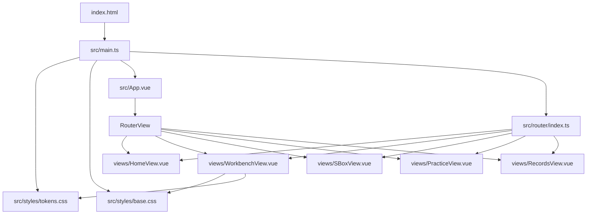

# CipherLens F0 · 脚手架与设计令牌落地 —— 实现方案

| 项 | 内容 |
|---|---|
| 功能点 | F0 · 脚手架与设计令牌落地 |
| 文档类型 | 技术实现方案（只回答“怎么建”，不含实现代码） |
| 输入 | 用户提供的上一阶段需求结论 + `docs/` 下 8 份权威文档 + `README.md` |
| 输出路径 | `.arts/design/F0-design.md`（不修改 `docs/` 下任何文件） |
| 本轮边界 | 只产出本文档；不初始化工程、不写业务代码、不提交、不推送 |
| 关联功能点 | 后续 F4（真实五区结构）、F5（矩阵）、F7（七态） |

> **流程说明（必须记录）**：按 spec-design 规范，开工前应先读取 `.codeartsdoer/specs/<feature>/spec.md`。实际检查结果：仓库中不存在 `.codeartsdoer/specs/`，上一阶段需求结论也尚未落盘为独立文件。本方案以用户在本轮消息中给出的需求结论为输入，并逐条回到 `docs/` 权威文档核对。该偏离不改变设计结论，但建议在 F0 实施前决定是否补落 `spec.md`。

---

## 结论先行

F0 技术上可执行，但**有 3 个 P0 口径必须先裁决**；另有 1 个 P1 令牌冲突建议同批裁决。裁决前不应开始写代码。

1. **B/E 区宽度（P0）**：手册 F0 与本轮验收写 **B 280 / E 380**；视觉规范 §4.1、§6.8、§10 令牌写 **B 268 / E 360**。§4.1 另规定 ≥1440 时 E=400、1280–1439 时 E=344，但 §10 没有对应媒体查询。三者不能同时满足“令牌名与值照抄 §10”和“五区实测 280/380”。
2. **前端工程位置（P0）**：`README.md` 的目录规划是 `frontend/`；手册 F0 的 `npm create vite@latest .` 暗示仓库根。两者影响全部文件路径与提交范围。
3. **脚手架生成方式（P0）**：`npm create vite@latest` 在 2026 年会生成 Vite 7+ 模板，与技术栈锁定的 Vite 5 冲突。推荐手写最小工程并锁定主版本。
4. **令牌值照抄与五条硬约束的 2 处冲突（P1）**：§10 的 `--st-idle-border`、`--st-done-border` 仍指向 `--line-default`，而 r5 冻结口径与硬约束②要求字节格边框取 `--rule-region-ink`。常规态两者同值，演示态会分叉。

本方案的推荐口径（待用户确认后生效）：

| 事项 | 推荐口径 | 依据 |
|---|---|---|
| 前端位置 | `frontend/` | README §目录规划 |
| 脚手架 | 手写最小工程，依赖锁 Vite 5 | 技术栈锁定 + 禁止模板 logo/HelloWorld |
| B/E 宽度 | `--input-col: 268px` / `--ai-col: 360px` | 视觉规范 §4.1、§6.8、§10；§8.4 约定视觉参数以视觉规范为准 |
| 五区占位 | 只在 `WorkbenchView.vue` 内写 5 个占位块 | 手册 F0 第 6 条；F4 才替换为真实分区 |
| 令牌落地 | 完整照抄 §10 的 7 个作用域块 | 手册“全部令牌” + 验收“缺一不可” |
| 空目录 | 不创建 | 禁止预建空 store / 空 composable / 空组件 |
| 路由空视图 | 算 F0 范围，但只放标题 | 手册 F0 第 2 条明确要求 |
| 字体 | F0 不引入 webfont，先用系统回退 | F0 不验收字体；避免新增依赖 |
| 验收视口 | 1440×900（复核 1920×1080） | 避开 `max-height:780px` 压缩档 |

---

# 一、需求与存量功能关系分析

## 1.1 需求功能与存量功能对比

### 1.1.1 已实现功能（以设计资产计，不以代码计）

仓库当前是**空代码仓库**：只有 `README.md`、`docs/`、`LICENSE`、`evidence/.gitkeep`、`.gitignore` 与 CodeArts 元数据，没有任何 `package.json`、`src/`、Vue 文件或后端代码。因此 F0 的每一项都**没有可复用的源码**；所谓“已实现”只存在于设计文档中。

| 需求功能 | 存量形态 | 权威位置 | 代码匹配度 |
|---|---|---|---|
| 五区职责与顺序（A/B/C/D/E） | 已完成设计定义，无代码 | 信息架构 §2.1–2.2（135–181 行）；视觉规范 §4.1（341–370 行） | 0%（设计 100%） |
| A 56 / D 104 高度 | 已落成令牌 | 视觉规范 §10 `--topbar-h` / `--transport-h`（1786–1787 行） | 0%（令牌已定义） |
| B/E 宽度 | 设计定义存在但数值漂移 | 视觉规范 §4.1（349 行）、§6.8（947 行）、§10（1789–1790 行）；手册 F0（148 行） | 0%（需先收敛口径） |
| 五条路由（Home/Workbench/SBox/Practice/Records） | 已完成设计定义 | 信息架构 §1.1–1.2（44–77 行）；前端规格 §1.2（108–141 行）；手册 F0 第 2 条 | 0%（设计 100%） |
| 工程目录结构 | 已完成设计定义 | 前端规格 §1.1（33–102 行） | 0%（设计 100%） |
| 设计令牌全集 | 已封版，可直接粘贴 | 视觉规范 §10（1694–1985 行）；证据页切片 §10（同源） | 0%（令牌已定义） |
| 基础 reset / 字体栈 / `.sr-only` | 已在文档中规定 | 手册 F0 第 5 条；视觉规范 §3.1（296–300 行） | 0%（设计 100%） |
| 五区静态占位块 | 已规定做法 | 手册 F0 第 6 条（148 行） | 0%（设计 100%） |
| 技术栈与禁止依赖 | 已锁定 | 手册 §1 上下文卡（38–47 行）；README §五条硬约束（42–50 行） | 不适用（约束） |
| `.gitignore` 对依赖/产物的覆盖 | 已存在 | 根 `.gitignore` 1–33 行 | 100%（可直接复用） |

### 1.1.2 需要扩展的功能

F0 没有“需要扩展的存量代码”。但存在 **3 项需要先收敛的文档内漂移**，否则实现时必然二选一踩空：

| 需求功能 | 存量表述 | 差异说明 | 收敛方向 |
|---|---|---|---|
| B 区宽度 | 268px（视觉 §4.1/§6.8/§10） vs 280px（手册 F0/F4、本轮验收） | 输入值差 12px；前者是令牌，后者是提示词转述 | 以视觉规范令牌为准，或经裁决新增派生布局令牌 |
| E 区宽度 | 360px（视觉 §4.1/§10、F4） vs 380px（手册 F0、本轮验收）；≥1440 又有 400px（§4.1），1280–1439 有 344px | 三个值并存，且 §10 未把 400/344 落成媒体查询 | 先定 F0 单值，再定 F4 响应式档位 |
| 字节格 idle/done 边框 | §10 写 `var(--line-default)`；r5 冻结口径写 `var(--rule-region-ink)` | 常规态同值（0.845），演示态分叉（0.760 vs 0.545） | F0 是否提前修正 2 处令牌，需裁决 |

### 1.1.3 需要新增的功能或接口

F0 全部为新增，按模块分组如下。每项只列**输入、输出、核心逻辑**，不列实现代码。

**A. 工程与工具链（新增）**

| 功能点 | 输入 | 输出 | 核心逻辑 |
|---|---|---|---|
| 最小 Vite 5 工程 | 技术栈约束、Node 24.15.0 | 可 `npm run dev` / `npm run build` 的前端工程 | 手写 `package.json`、`index.html`、`vite.config.ts`、`tsconfig.json`；锁定 Vue 3.5 / Vite 5 / Pinia 2 / Router 4 / TS 5 |
| 路由壳 | 五条路由清单 | `router/index.ts` + 5 个视图文件 | `createWebHistory`；`/` 静态导入 Home，其余动态导入；无守卫、无 meta 业务逻辑 |
| 应用入口 | 路由、Pinia、全局样式 | `main.ts` / `App.vue` | 先引入 tokens.css 与 base.css，再挂 `createPinia()` 与 router；`App.vue` 只放 `RouterView` |

**B. 样式与令牌（新增）**

| 功能点 | 输入 | 输出 | 核心逻辑 |
|---|---|---|---|
| `tokens.css` | 视觉规范 §10 全量代码块 | 7 个作用域的 CSS 变量 | 变量名与值照抄；仅 2 处待裁决偏离；不新增令牌（除非裁决派生令牌） |
| `base.css` | 手册 F0 第 5 条、视觉 §3.1 | reset、字体栈、`tabular-nums`、`.sr-only`、焦点环基础、`[data-motion="reduced"]` 占位 | 只写基础排版与可访问性工具，不写任何组件视觉 |
| 五区占位布局 | 五区尺寸、`data-region` 契约 | `WorkbenchView.vue` 的 CSS Grid | 3 列 × 3 行；A 跨 3 列、D 跨 3 列；C `minmax(0,1fr)`；B/E 固定令牌宽；无 JS resize |

**C. 视图与留痕（新增）**

| 功能点 | 输入 | 输出 | 核心逻辑 |
|---|---|---|---|
| Home 最小入口 | 路由 `/` | `HomeView.vue` | 标题 + 一个到 `/workbench` 的 `RouterLink`；不做首页视觉 |
| Workbench 五区空壳 | A/B/C/D/E 尺寸与区名 | `WorkbenchView.vue` | 根节点 `data-density="compact"`；5 个 `<section data-region>`；每区一个带区名的占位块 |
| 三条旁路空视图 | 路由 `/sbox` `/practice` `/records` | 3 个只含 `<h1>` 的视图 | 不建 store、不建 composable、不写业务 |
| 验收证据 | 验证结果 | `evidence/acceptance/F0.md` + 截图 | 逐条对应 F0 验收 1–4，证据可核 |

## 1.2 存量功能详细分析（存量约束）

F0 的“存量”不是代码，而是**已经封版的文档契约与仓库约束**。这些约束直接决定实现方式。

### 1.2.1 文档只读与交叉引用

- `docs/` 下 8 份 md + 1 份 docx 是开发期唯一权威版本，**F0 不得修改任何文件**。
- 文件名不可改：文档之间以文件名交叉引用，改名会断链（README 13 行）。
- 冲突时的权威顺序：视觉色值与视觉参数以《视觉设计规范》为准；行为与阈值以《信息架构与交互规格》为准（信息架构 §8.4 第 1294 行）。因此 B/E 宽度应优先取视觉规范 §10 令牌，而不是手册提示词中的转述值。
- 本文档写在 `.arts/design/`，不进入 `docs/`，不触碰权威文档。

### 1.2.2 目录与提交约束

- README 目录规划：`frontend/`（Vue3 + Vite + Pinia，待建）、`backend/`（FastAPI + SQLite，待建）、`output/`（构建产物、截图、验收证据，不进 git）。
- 根 `.gitignore` 已覆盖 `node_modules/`、`dist/`、`dist-ssr/`、`*.local`、Python 缓存、数据库、`.env`、`output/`、编辑器目录。F0 可直接复用，不需要新增忽略规则（`.arts/` 的例外见 §2.10）。
- `evidence/` 不在 `.gitignore`，是大赛留痕目录；`evidence/.gitkeep` 已存在。
- 提交信息按手册 §11：`<type>(<scope>): <做了什么> —— 通过 F<N> 验收 <编号>`。

### 1.2.3 技术栈与禁止项

- 锁定：Vue 3.5 + Vite 5 + TypeScript + Pinia 2 + Vue Router 4；后端 FastAPI + SQLite（F0 不涉及）。
- 禁止：React / Next / Nuxt / Element Plus / Ant Design / Naive UI / Tailwind / GSAP / axios / 任何 UI 组件库或动画库；CSS 手写；HTTP 用原生 fetch（F0 无 HTTP）。
- 禁止：`!important`、未删除的 `console.log`、为“以后可能用到”预建空 store / 空 composable / 空组件、复制模板 logo 与样式。
- 五条硬约束（README 42–50 行）：F0 虽不碰字节格，但令牌层必须为后续实现留下正确基线，尤其是第 2 条 `--rule-region-ink` 与第 3 条 `--cell-gap`。

### 1.2.4 视觉约束对 F0 的直接约束

- 分区只用 1px 发丝线，不用背景色差、不用阴影、不用卡片（视觉 §4.3，408–419 行）。
- 圆角 ≤ 3px、零渐变、零毛玻璃（手册 F0 硬约束，152–153 行）。
- 阴影只允许浮层用 2 个（视觉 §10 `--shadow-*`，1816–1818 行）；F0 不使用阴影。
- 字体栈必须显式写全 fallback，避免首帧 FOUT 导致网格位移（视觉 §3.1，294 行）。
- `@media (max-height: 780px)` 会把 A 压到 52px、D 压到 92px（视觉 §10，1885–1897 行）。**F0 的五区尺寸验收必须避开 780px 及以下高度**，否则测到的不是 56/104。

### 1.2.5 关键约束：F0 与 F4 的职责切分

手册 F0 第 6 条已经要求“搭五区静态布局，每区只放一个带区名的占位块，纯 CSS Grid”；手册 F4 又要求“把 F0 的占位块换成真实分区结构（先不填内容）”。因此：

- **F0 负责**：Grid 骨架、固定尺寸、五区可见、1px 分区线、C 区可收缩。
- **F4 负责**：真实区域组件（ContextBar / InputPanel / StageArea / TransportBar / TutorPanel 等）、A/B/C/D/E 的职责结构、多宽度截图（1920/1440/1120/1024）、E 区 48px 折叠、B 区折叠、C 区正方形比例、`App.vue` 挂 `data-density` / `data-mode`。
- F0 **不**创建 `components/region-a..e/`、不创建 `AppBar`、不创建 `WorkbenchLayout`、不实现任何交互。

---

# 二、增量设计方案

## 2.1 目标与非目标

### 2.1.1 目标

1. 交付一个能 `npm run dev`、`npm run build` 的最小前端工程，**零 TS error**。
2. 五条路由可访问，其中 `/workbench` 可见五区空壳。
3. 五区尺寸正确：A 56px、B 固定令牌宽、C `flex`、D 104px、E 固定令牌宽（具体值待 §2.9 裁决）。
4. `tokens.css` 完整落地视觉规范 §10 的令牌，变量名不改、值照抄（2 处待裁决例外）。
5. `base.css` 提供 reset、字体栈、`tabular-nums`、`.sr-only`、焦点环基础、`[data-motion="reduced"]` 占位。
6. 初始路由 JS gzip < 150KB。
7. 形成可复核的验收证据：build 输出、五区实测、令牌对账、`--paper-0` 取值、gzip 数字、截图。

### 2.1.2 非目标（F0 明确不碰）

- AES 引擎、S 盒、密钥扩展、trace、diff（F1–F3）。
- 字节格、矩阵、轮密钥轨、Canvas、SVG 装饰（F5–F11）。
- 时间轴四轨、播放控制、动效、演示模式切换（F12–F15）。
- AI 辅导、SSE、诊断、练习判分、记录页（F16–F20）。
- 抽屉、焦点陷阱、键盘漫游、URL 状态、错误边界（F6、F22、F23）。
- 后端 FastAPI、SQLite、Docker（B1–B3、F24）。
- 响应式折叠、多宽度适配、C 区正方形（F4）。
- 真实 webfont 加载、首页视觉、AppBar（后续首页/布局阶段）。
- 任何 Pinia store 文件、任何 composable 文件、任何业务组件文件。

### 2.1.3 验收口径

| # | 验收项 | 通过标准 |
|---|---|---|
| 1 | build | `npm run build` 零 TS error；初始路由 JS gzip < 150KB |
| 2 | 五区 | `/workbench` 五区可见；A=56、D=104、B/E=裁决值、C=剩余宽；`scrollWidth === clientWidth` |
| 3 | 令牌 | §10 变量名无缺失、无多余；值逐块一致（2 处白名单例外） |
| 4 | 纸底 | `--paper-0` 计算值为 `oklch(0.981 0.0025 250)` |

---

## 2.2 实现模型

### 2.2.1 上下文视图

F0 是**纯前端静态空壳**，不连接后端、不发起任何 HTTP 请求、不读写数据库。

```
┌────────────────────┐        npm run dev / vite preview        ┌─────────────────────┐
│  桌面浏览器         │ ───────────────────────────────────────> │ Vite 5 Dev Server   │
│  Chrome / Edge      │ <─────────────────────────────────────── │ 或 dist 静态产物     │
└────────────────────┘              HTML / CSS / JS              └─────────────────────┘
          │
          │ 只加载本地资源
          ▼
┌────────────────────┐
│ 前端静态模块        │
│ Vue 3.5 + Router 4 │
│ Pinia 2（仅挂载）   │
│ CSS 令牌 + 基础样式 │
└────────────────────┘
```

| 上游 | 调用方式 | 频率 | F0 是否涉及 |
|---|---|---|---|
| 用户浏览器 | 打开 `/`、`/workbench`、`/sbox`、`/practice`、`/records` | 手动 | 是 |
| Vite Dev Server | HTTP 静态资源 | 开发期 | 是 |
| 后端 FastAPI | `/api/*` | — | **否** |
| SSE / SQLite | — | — | **否** |

**关键决策**：F0 不创建 `.env.example`、不定义 `VITE_API_BASE`。接口地址属于 B1/F16，提前创建会形成“空配置”债务。

### 2.2.2 服务 / 组件总体架构

F0 的模块关系极简，**没有 store、没有 composable、没有业务组件**：

```
main.ts
├─ styles/tokens.css        （先加载，保证变量可用）
├─ styles/base.css          （reset / 字体 / a11y 工具）
├─ createPinia()            （挂载但不建 store）
├─ router/index.ts
│   ├─ HomeView.vue         （静态导入，/）
│   ├─ WorkbenchView.vue    （动态导入，/workbench）
│   ├─ SBoxView.vue         （动态导入，/sbox）
│   ├─ PracticeView.vue     （动态导入，/practice）
│   └─ RecordsView.vue      （动态导入，/records）
└─ App.vue
    └─ <RouterView />
```

| 模块 | 职责 | 依赖 | 不负责 |
|---|---|---|---|
| `main.ts` | 创建应用、注册 Pinia 与 Router、引入全局样式 | Vue、Pinia、Router、styles | 业务初始化、API 请求 |
| `App.vue` | 唯一根组件，渲染 `RouterView` | vue-router | 布局、导航、主题挂载 |
| `router/index.ts` | 五条路由表 | 5 个视图 | 守卫、权限、URL 状态 |
| `WorkbenchView.vue` | 五区占位 Grid | tokens/base | 真实区域组件、交互 |
| 三个旁路视图 | 标题占位 | 无 | 任何业务 |
| `tokens.css` | §10 令牌全集 | 无 | 组件样式 |
| `base.css` | reset / 字体 / a11y | tokens | 布局、组件视觉 |

**配置项与取值策略**：

| 配置 | F0 取值 | 理由 |
|---|---|---|
| `vite.config.ts` | 仅 `@vitejs/plugin-vue` | engine 尚不存在，不提前配手动 chunk |
| `tsconfig` | `strict: true`，`noUncheckedIndexedAccess: true` | 与后续 engine 的类型安全要求一致 |
| `build.target` | 默认（Vite 5 默认 `modules`） | 不提前优化 |
| 路径别名 | 不配置 | F0 文件层级浅；别名属于“以后可能用到” |
| 端口 | Vite 默认 5173 | 不写死；验收时以终端输出为准 |

### 2.2.3 五区静态布局实现设计

**结构示意（不是实现代码）**：

```
.workbench（display: grid; height: 100dvh）
├─ grid-template-columns:
│    var(--input-col)  minmax(0, 1fr)  var(--ai-col)
├─ grid-template-rows:
│    var(--topbar-h)   minmax(0, 1fr)  var(--transport-h)
├─ grid-template-areas:
│    "a a a"
│    "b c e"
│    "d d d"
│
├─ <section data-region="a">  A · 上下文条
├─ <section data-region="b">  B · 输入区
├─ <section data-region="c">  C · 舞台区
├─ <section data-region="d">  D · 步进与时间轴
└─ <section data-region="e">  E · AI 辅导栏
```

**尺寸来源与约束**：

| 区 | 尺寸来源 | F0 约束 | F4 扩展 |
|---|---|---|---|
| A | `var(--topbar-h)` = 56px | 跨 3 列；`min-height: 0` | 挂 ContextBar、演示态 72px |
| B | `var(--input-col)` = 268px（待裁决） | 固定列；`min-width: 0; overflow: hidden` | 折叠为 44px、真实输入面板 |
| C | `minmax(0, 1fr)` | **必须 `min-width: 0; min-height: 0`**，否则内容会撑破网格 | 矩阵正方形、三层坐标系 |
| D | `var(--transport-h)` = 104px | 跨 3 列；`min-height: 0` | 控制行 40 + 时间轴 64、四轨 |
| E | `var(--ai-col)` = 360px（待裁决） | 固定列；`min-width: 0; overflow: hidden` | 48px 折叠、TutorPanel |

**分区线实现（避免双线）**：

| 区 | 只画哪条边 | 结果 |
|---|---|---|
| A | `border-bottom` | A 与 B/C/E 之间 1px |
| B | `border-right` | B 与 C 之间 1px |
| C | 不画 | C 不产生额外边 |
| D | `border-top` | C/B/E 与 D 之间 1px |
| E | `border-left` | C 与 E 之间 1px |

- 线宽取 `var(--rule-region-w)`，颜色取 `var(--line-hairline)`。
- **禁止**用容器背景色 + `gap: 1px` 画分区线（这是矩阵格线的错误方案，虽然 F0 还没到矩阵，但分区线也应保持“单线”语义）。
- `box-sizing: border-box` 由 `base.css` 全局设置，固定尺寸含边框，实测高度仍为 56/104。

**占位块内容规范**：

- 每个区只放一个 `<p>`，文字为“A · 上下文条”“B · 输入区”“C · 舞台区”“D · 步进与时间轴”“E · AI 辅导栏”。
- 字体 `var(--font-mono)`、字号 `var(--fs-label)`、颜色 `var(--ink-3)`、字距 `var(--ls-label)`。
- 内边距 `var(--sp-3)`；不使用背景色差、不使用阴影、不使用卡片。
- 占位块**不写尺寸数字**，避免 UI 文案与令牌值再次漂移；尺寸用 DevTools 实测。

**响应式与最小宽度策略（F0 边界）**：

- F0 **不做**任何断点、折叠、`@media` 布局调整、`ResizeObserver`、`window.resize` 监听。
- F0 的验收视口为 **1440×900**（复核 1920×1080）。在 1440 下：C = 1440 − 268 − 360 = 812px（若 A 方案）；若 B 方案则为 1440 − 280 − 380 = 780px。
- 视口 < 1280 时可能出现横向溢出，这是 **F4 的范围**（F4 才做 E 区 48px 折叠与 1024 适配）。F0 不自作主张加 `min-width` 或 `overflow: hidden` 掩盖问题。
- **B 区折叠不属于 F0**。手册 F4 只明确 E 区 48px 折叠，没有把 B 区折叠写进 F4；信息架构 §2.3 第 4 条只规定“trace 生成后可折叠为一行”。F0 不做 B 折叠；B 折叠归 F4 还是更后面的 B 区交互，需在 F4 开工前裁决。
- `height: 100dvh` 为主，`100vh` 作为回退；不写 `position: fixed`（F4 硬约束，F0 提前遵守）。

**扩展点**：

| 扩展点 | F0 默认 | 后续替换方式 |
|---|---|---|
| 五区占位块 | 5 个 `<section data-region>` | F4 替换为 `ContextBar` / `InputPanel` / `StageArea` / `TransportBar` / `TutorPanel` |
| C 区内容 | 空占位 | F5 挂 `MatrixStage`；F0 保证 `min-width: 0`，不阻碍填充 |
| 主题 | 只有令牌作用域，无切换 | F4 在 `App.vue` 挂 `data-density` / `data-mode`；F0 只在 Workbench 根挂 `data-density="compact"` |
| 字体 | 系统回退 | 首页/视觉阶段再引入 `@fontsource` 或本地字体 |

---

## 2.3 目录与文件清单

**前置假设**：前端工程放在 `frontend/`（待裁决）。若裁决为仓库根，以下路径全部去掉 `frontend/` 前缀。

### 2.3.1 F0 真正会创建的文件

```
CipherLens/
├─ frontend/
│  ├─ package.json                 # 依赖、scripts、engines
│  ├─ package-lock.json            # npm install 生成，随提交锁定
│  ├─ index.html                   # lang=zh-CN、#app、入口 script
│  ├─ vite.config.ts               # 仅 vue 插件
│  ├─ tsconfig.json                # strict、Bundler、include src + vite.config.ts
│  └─ src/
│     ├─ main.ts                   # 引入 tokens/base，挂 Pinia 与 Router
│     ├─ App.vue                   # 只放 RouterView
│     ├─ env.d.ts                  # vite/client 类型引用
│     ├─ router/
│     │  └─ index.ts               # 五条路由
│     ├─ styles/
│     │  ├─ tokens.css             # 视觉规范 §10 全量令牌
│     │  └─ base.css               # reset / 字体 / a11y / 焦点环
│     └─ views/
│        ├─ HomeView.vue           # 最小入口：标题 + 到 /workbench 的链接
│        ├─ WorkbenchView.vue      # 五区占位 Grid
│        ├─ SBoxView.vue           # 仅标题
│        ├─ PracticeView.vue       # 仅标题
│        └─ RecordsView.vue        # 仅标题
└─ evidence/
   └─ acceptance/
      ├─ F0.md                     # 验收证据（实施阶段生成）
      └─ F0-*.png                  # 1440×900 / 1920×1080 截图（实施阶段生成）
```

### 2.3.2 明确不创建的东西

| 不创建 | 理由 |
|---|---|
| `src/stores/*.ts` | F0 没有任何状态；`createPinia()` 挂载即可，不需要空 store |
| `src/composables/*.ts` | 没有交互逻辑 |
| `src/components/**` | F0 的占位块写在 `WorkbenchView.vue` 内；F4 才拆组件 |
| `src/engine/**` | F1 才开始 |
| `src/types/**` | 没有跨模块 DTO；`RouteRecordRaw` 由 vue-router 提供 |
| `src/canvas/**`、`src/svg/**`、`src/data/**` | F0 无 Canvas / SVG / 内置向量 |
| `src/styles/motion.css`、`reduced-motion.css` | F0 无动效；reduced-motion 令牌覆盖已在 tokens.css 内 |
| `src/assets/**`、`public/**` | 不使用模板 logo / 图片 |
| `.env.example` | F0 不调 API |
| `docker/**` | F24 才做 |
| `frontend/.gitignore` | 根 `.gitignore` 已覆盖 |
| `scripts/check-tokens.mjs` | 对账用一次性命令，不落盘；避免新增“工具债”（如用户希望固化，再作为独立功能点） |

### 2.3.3 目录创建策略

手册 F0 第 3 条要求“按 §1.1 建目录（components/region-a..e、composables、stores、engine、types、canvas、svg、views、styles、data）”。本方案**只创建包含 F0 文件的目录**：

- 创建：`frontend/src/router/`、`frontend/src/styles/`、`frontend/src/views/`。
- 不创建：`components/`、`composables/`、`stores/`、`engine/`、`types/`、`canvas/`、`svg/`、`data/`。
- 理由：空目录不进 git，且会让后续 Agent 误以为已有结构；用户明确“禁止预建空 store / 空 composable / 空组件”。此点与手册字面有偏差，列入 §2.9 裁决。

---

## 2.4 脚手架与工具链方案

### 2.4.1 方案选择：手写最小工程（推荐）

| 方案 | 做法 | 优点 | 缺点 |
|---|---|---|---|
| **A（推荐）** | 手写 `package.json` + `index.html` + `vite.config.ts` + `tsconfig.json`，再 `npm install` | 版本完全可控；无模板 logo / HelloWorld / 多余样式；文件清单与 F0 一一对应 | 需要手写少量配置 |
| B | `npm create vite@latest . -- --template vue-ts` | 一步生成 | 2026 年 latest 生成 Vite 7+，与技术栈锁定的 Vite 5 冲突；会带入模板资产，需要删除 |
| C | `npm create vite@5 . -- --template vue-ts` | 可能生成 Vite 5 模板 | `create-vite` 版本与 Vite 版本不是一一对应，生成结果不确定；仍需删模板 |

**推荐 A 的核心理由**：技术栈锁定 Vite 5 是硬约束，而 `latest` 是时间相关变量；F0 的验收又要“零 TS error + 文件清单可控”。手写工程是最小、最可复现的做法。手册 F0 第 1 条的命令视为“意图”（初始化 Vue3+TS 工程），不是必须逐字执行。

### 2.4.2 依赖清单与版本策略

| 包 | 类型 | 版本策略 | 理由 |
|---|---|---|---|
| `vue` | dependency | `^3.5.0` | 技术栈锁定 Vue 3.5；caret 允许 3.x 安全升级 |
| `vue-router` | dependency | `^4.4.0` | 锁定主版本 4 |
| `pinia` | dependency | `^2.2.0` | 锁定主版本 2；F0 只 `createPinia()`，不建 store |
| `vite` | devDependency | `^5.4.0` | **主版本硬锁 5**；不允许 npm 解到 6/7 |
| `@vitejs/plugin-vue` | devDependency | `^5.1.0` | 与 Vite 5 配套的 5.x |
| `typescript` | devDependency | `~5.6.0` | 锁 minor，避免 TS 新版本与 vue-tsc 的兼容波动 |
| `vue-tsc` | devDependency | `^2.1.0` | 与 Vue 3.5 / TS 5.6 配套的 2.x |

**版本策略**：

1. **主版本锁定**：Vite 5、Vue 3、Pinia 2、Router 4、TS 5。任何跨主版本升级都必须单独裁决，不在 F0 顺手做。
2. **次版本用 caret / tilde**：允许补丁与安全升级；实际版本由 `package-lock.json` 固定。
3. **提交 lockfile**：`package-lock.json` 必须随 F0 提交，保证评审与复现。
4. **不使用 `latest`**：`npm install <pkg>@latest` 一律禁止；新增依赖先问。
5. **可选字体包不在 F0**：`@fontsource/archivo`、`@fontsource/ibm-plex-mono` 是否引入待裁决；F0 先用系统回退，保证构建体积与依赖面最小。

**不安装**：`@types/node`（`vite.config.ts` 不用 Node API）、ESLint / Prettier / Vitest / Playwright / `rollup-plugin-visualizer` / 任何 CSS 预处理器。理由：F0 不需要；测试与 lint 在对应功能点再引入。

### 2.4.3 scripts 与工具链

| script | 命令 | 用途 |
|---|---|---|
| `dev` | `vite` | 本地开发 |
| `build` | `vue-tsc --noEmit && vite build` | **零 TS error + 生产构建**，一条命令完成验收 1 |
| `preview` | `vite preview` | 预览 `dist`，用于 gzip/首屏复核 |
| `typecheck` | `vue-tsc --noEmit` | 单独类型检查，便于排错 |

- `package.json`：`"private": true`、`"type": "module"`、`"engines": { "node": ">=20.0.0" }`。
- Windows / cmd 下 `&&` 可用；不使用 bash-only 语法。
- 不添加 `lint` / `test` 脚本，避免出现“脚本存在但工具未装”的空壳。

### 2.4.4 TypeScript 配置要点

`tsconfig.json` 关键项：

| 项 | 值 | 理由 |
|---|---|---|
| `target` | `ES2022` | 现代浏览器；与 Vite 5 默认目标兼容 |
| `module` | `ESNext` | Vite 原生 ESM |
| `moduleResolution` | `Bundler` | Vue 3.5 + Vite 5 推荐 |
| `lib` | `["ES2022", "DOM", "DOM.Iterable"]` | 浏览器环境 |
| `strict` | `true` | 类型安全基线 |
| `noUncheckedIndexedAccess` | `true` | 后续 engine 的 `Uint8Array` 下标访问需要显式判空；F0 提前统一 |
| `noUnusedLocals` / `noUnusedParameters` | `true` | 防止模板残留 |
| `noFallthroughCasesInSwitch` | `true` | 后续状态机基础 |
| `isolatedModules` | `true` | 与 Vite 单文件转译一致 |
| `verbatimModuleSyntax` | `true` | 强制 `import type`，避免运行时副作用 |
| `jsx` | `preserve` | Vue SFC 不需要，但保留模板默认 |
| `skipLibCheck` | `true` | 减少第三方类型噪声 |
| `noEmit` | `true` | `vue-tsc` 只检查不产出 |
| `include` | `src/**/*.ts`、`src/**/*.d.ts`、`src/**/*.tsx`、`src/**/*.vue`、`vite.config.ts` | 覆盖全部 F0 TS 源 |

- 不创建 `tsconfig.node.json`：`vite.config.ts` 只用 `defineConfig` 与插件，不需要 Node 类型；单 tsconfig 更符合“最小工程”。
- `src/env.d.ts` 只写 `/// <reference types="vite/client" />`，不重复声明 `*.vue`（`vue-tsc` 负责）。

### 2.4.5 构建与 chunk 策略

- F0 **不配置** `build.rollupOptions.output.manualChunks`。`engine/` 尚不存在，提前配 chunk 规则会形成“空规则”。
- 路由用动态 `import()` 让 Workbench 与三个旁路视图各自成 chunk；Home 静态导入，减少首屏一次请求。
- 初始路由 JS 的口径：`dist/assets/index-*.js` 的 gzip 大小（entry chunk）。F0 预算 < 150KB；预计 Vue + Router + Pinia + Home 约 50–70KB gzip，余量充足。
- 不引入 `vite-bundle-visualizer`；需要时用 `npx` 临时执行，不写入依赖。

### 2.4.6 入口文件与全局样式顺序

- `main.ts` 的引入顺序固定为：`tokens.css` → `base.css` → Vue / Pinia / Router → `App.vue`。
- 理由：令牌必须先于任何组件样式解析；`base.css` 的 `body` 背景与字体依赖令牌。
- `App.vue` 不引入任何样式；`WorkbenchView.vue` 的布局样式写在 `<style scoped>`，不新建 `layout.css`。
- `index.html` 设置 `lang="zh-CN"`、`<meta name="color-scheme" content="light">`、`<title>CipherLens · 密码透镜</title>`。

## 2.5 设计令牌落地方案

### 2.5.1 文件结构：完整照抄 §10 的 7 个作用域

视觉规范 §10（1694–1985 行）不是“三块”，而是 **7 个作用域块**。手册 F0 说的“分三块”是重点，不是排他；F0 验收又要求“全部令牌、缺一不可”。因此 `tokens.css` 采用以下顺序：

| # | 作用域 | 选择器 / 条件 | 内容 | F0 是否使用 |
|---|---|---|---|---|
| 1 | 常规 | `:root` | 字体、字号、行高、字距、中性/表面、强调、七态、间距、尺寸、时间轴、结构线、角标、阴影、动效、焦点、层级 | 是（全部变量的唯一来源） |
| 2 | 工作台密度 | `[data-density="compact"]` | 8 个 `--sp-*`、`--fs-body`、`--lh-body`、`--measure`、`--r-control` | 是（Workbench 根节点挂载） |
| 3 | 宽松密度 | `[data-density="roomy"]` | 同 2 的变量名，换值 | 否（F0 不建首页视觉；保留以便令牌完整） |
| 4 | 压缩高度 | `@media (max-height: 780px)` | `--topbar-h`、`--transport-h`、时间轴四带、`--sp-6/8` | 否（验收视口避开） |
| 5 | 演示态 | `[data-mode="present"]` | 字号、尺寸、结构线、文字对比、状态色、时间轴标记、焦点环、`--d-3` | 否（F0 不挂 present） |
| 6 | 系统减动效 | `@media (prefers-reduced-motion: reduce)` | `--d-*` 归零 | 否（F0 无动效） |
| 7 | 页内减动效 | `[data-motion="reduced"]` | 同 6 | 否（F0 只保留占位） |

**为什么 3/4/6/7 也要照抄**：令牌文件是“唯一落地处”，不是“本轮用到的子集”。如果只写三块，后续 F4/F15 会重新打开 §10 补值，补的过程就是第二次漂移。F0 一次抄全，成本最低。

**块顺序不可调换**：`[data-mode="present"]` 必须在 `[data-density]` 之后，才能在同时挂 `compact + present` 时让演示态覆盖 `--sp-4` / `--sp-6`；`[data-motion="reduced"]` 必须在最后，确保页内开关覆盖系统媒体查询。

### 2.5.2 照抄原则与 2 处待裁决例外

**照抄原则**：

1. **变量名一个字都不改**。不得把 `--st-key-fill` 写成 `--st-keyed-fill`，不得把 `--tl-mark-diag` 写成 `--timeline-diag`。
2. **值字符串照抄**，包括 `oklch(...)`、`clamp(...)`、`calc(...)`、`repeating-linear-gradient(...)`、`var(--...)`。
3. **注释可保留**（分组注释、`/* r3：... */`），但不得用注释“解释”成新规则。
4. **不新增令牌**。若 §2.9 裁决采用 280/380，需另行批准 2 个派生令牌，不能私自加。
5. **不在 tokens.css 里写组件选择器**。该文件只放变量；`body`、`.workbench` 等选择器属于 `base.css` / 组件 scoped 样式。

**必须记录的 2 处冲突**（`--st-idle-border`、`--st-done-border`）：

| 令牌 | §10 字面值 | r5 冻结口径 / 硬约束② | 常规态解析值 | 演示态解析值 | 推荐处理 |
|---|---|---|---|---|---|
| `--st-idle-border` | `var(--line-default)` | 字节格边框取 `var(--rule-region-ink)` | 两者都是 0.845，等价 | §10 为 0.760；r5 为 0.545 | 改为 `var(--rule-region-ink)`，对账表标“有意偏离 1” |
| `--st-done-border` | `var(--line-default)` | 七态一律含 `done`，取 `var(--rule-region-ink)` | 等价 | 同上 | 改为 `var(--rule-region-ink)`，对账表标“有意偏离 2” |

- 依据：README 五条硬约束第 2 条（45 行）、前端规格 §10.6 第 1 条与 §10.12 第 1 条（1362–1364、1455 行）、视觉规范 §7.1（982 行）。
- 风险：如果 F0 严格“值照抄”，这 2 处会保留 `--line-default`；F7 实现 `idle`/`done` 时在演示态必然踩到 0.760 边界。**建议在 F0 修正，但需用户批准“对账白名单 2 处”。**
- 若用户拒绝偏离：tokens.css 照抄 §10，在文件注释中标记“F7 开工前必须复查这 2 个令牌”，并把该复查写进 F7 的验收。

### 2.5.3 令牌分组清单（对账用索引）

下表是 §10 的**变量名全集**，按语义分组。实施时逐组对照，不能只看总数。

| 组 | 令牌名 |
|---|---|
| 字体 | `--font-display` `--font-ui` `--font-mono` |
| 字号 | `--fs-display` `--fs-h1` `--fs-h2` `--fs-h3` `--fs-body` `--fs-ui` `--fs-label` `--fs-micro` `--fs-byte` `--fs-byte-lg` `--fs-sbox` |
| 行高 | `--lh-tight` `--lh-snug` `--lh-body` `--lh-mono` |
| 字距 | `--ls-label` `--ls-hex-cell` `--ls-hex-long` |
| 中性 / 表面 | `--paper-0` `--paper-1` `--surface-inset` `--surface-raised` `--line-hairline` `--line-default` `--line-strong` `--ink-1` `--ink-2` `--ink-3` `--ink-4` |
| 强调 | `--accent` `--accent-strong` `--accent-soft` `--accent-ring` |
| 七态 | `--st-idle-fill` `--st-idle-border` `--st-idle-ink` `--st-changed` `--st-changed-bar` `--st-selected` `--st-selected-ring` `--st-error` `--st-error-fill` `--st-key-ink` `--st-key-fill` `--st-key-hatch` `--st-done-ink` `--st-done-border` `--st-done-dots` `--st-downstream-fill` `--st-downstream-ink` `--st-downstream-border` `--warn` |
| 间距 | `--sp-1` `--sp-2` `--sp-3` `--sp-4` `--sp-6` `--sp-8` `--sp-12` `--sp-16` |
| 尺寸 | `--cell-size` `--cell-gap` `--r-cell` `--r-control` `--r-float` `--topbar-h` `--transport-h` `--diag-row-h` `--ai-col` `--input-col` |
| 时间轴 | `--tl-round-band` `--tl-tick-band` `--tl-mark-band` `--tl-cursor-band` `--tl-cursor-h` `--tl-round-alt` `--tl-mark-diag` `--tl-mark-ask` `--tl-mark-z` `--tl-hint-slot` |
| 结构线 | `--rule-region-w` `--rule-region-ink` `--rule-scope-w` `--rule-scope-ink` `--rule-scope-arm` `--rule-scope-inset` |
| 角标 | `--flag-size` |
| 阴影 | `--shadow-1` `--shadow-float` |
| 动效 | `--e-out-quart` `--e-out-quint` `--e-in-out-cubic` `--e-step-4` `--e-linear` `--d-1` `--d-2` `--d-3` `--d-4` `--d-linger` `--d-fade-linger` `--d-stagger-cell` `--d-stagger-row` `--d-stagger-col` `--step-interval` |
| 焦点 | `--focus-ring-w` `--focus-ring-color` `--focus-ring-offset` `--focus-halo` |
| 层级 | `--z-canvas` `--z-cells` `--z-svg-overlay` `--z-corner` `--z-transport` `--z-inspector` `--z-annotation` |
| compact 覆盖 | `--sp-1`…`--sp-16`（8 个）、`--fs-body` `--lh-body` `--measure` `--r-control` |
| roomy 覆盖 | 同 compact 的变量名，值不同 |
| max-height 覆盖 | `--topbar-h` `--transport-h` `--tl-round-band` `--tl-tick-band` `--tl-mark-band` `--tl-cursor-band` `--tl-cursor-h` `--sp-6` `--sp-8` |
| present 覆盖 | `--fs-body` `--fs-ui` `--fs-label` `--fs-micro` `--fs-byte` `--fs-sbox` `--lh-body` `--cell-size` `--cell-gap` `--r-cell` `--topbar-h` `--transport-h` `--diag-row-h` `--ai-col` `--tl-round-band` `--tl-tick-band` `--tl-mark-band` `--tl-cursor-band` `--tl-cursor-h` `--tl-round-alt` `--sp-4` `--sp-6` `--rule-region-w` `--rule-region-ink` `--rule-scope-w` `--rule-scope-ink` `--line-hairline` `--line-default` `--ink-1` `--ink-2` `--ink-3` `--ink-4` `--st-changed` `--st-changed-bar` `--st-error` `--st-error-fill` `--st-key-fill` `--st-key-hatch` `--st-done-dots` `--st-downstream-fill` `--st-downstream-ink` `--st-downstream-border` `--accent-ring` `--tl-mark-diag` `--tl-mark-ask` `--focus-ring-w` `--focus-ring-color` `--focus-ring-offset` `--focus-halo` `--d-3` |
| reduced 覆盖（两处） | `--d-1` `--d-2` `--d-3` `--d-4` `--d-linger` `--d-fade-linger` |

**注意**：`--measure` 只在 compact / roomy 块出现，`:root` 没有；对账时不能把它当成 `:root` 缺失。

### 2.5.4 对账方法（可执行）

**第 1 步：提取 §10 的权威集合**

- 源：`docs/CipherLens-视觉设计规范-v1.2.md` 第 1696–1985 行的代码块。
- 按选择器块切分：`:root`、`[data-density="compact"]`、`[data-density="roomy"]`、`@media (max-height: 780px)`、`[data-mode="present"]`、`@media (prefers-reduced-motion: reduce)`、`[data-motion="reduced"]`。
- 每个块提取 `--token-name:` 与值字符串。

**第 2 步：提取 tokens.css**

- 同一套切分规则。
- 变量名集合按块比较：`§10 - tokens.css` = 缺失；`tokens.css - §10` = 多余。
- 值比较前做规范化：去首尾空白、折叠连续空白、统一换行；不改变 `oklch` / `calc` 内部空格。

**第 3 步：输出对账表**

| 令牌 | §10 值 | tokens.css 值 | 块 | 状态 |
|---|---|---|---|---|
| `--paper-0` | `oklch(0.981 0.0025 250)` | 同左 | `:root` | 一致 |
| `--st-idle-border` | `var(--line-default)` | `var(--rule-region-ink)` | `:root` | 有意偏离 1 |
| … | … | … | … | … |

状态只允许四种：一致 / 有意偏离（必须写明依据） / 缺失 / 多余。**缺失和多余必须为 0**；有意偏离必须逐条获批。

**第 4 步：人工复核 7 个块**

- 重点核对容易漏的“块内覆盖”：`--ai-col` 在 present 块是 48px；`--rule-region-ink` 在 present 块是 0.545；`--st-downstream-border` 在 present 块是 `var(--rule-region-ink)`；`--line-default` 在 present 块是 0.760。
- 重点核对 `--measure`、`--tl-mark-z`、`--tl-hint-slot`、`--flag-size`、`--shadow-float` 这类“非高频”令牌，避免只对颜色。

**第 5 步：把对账表存进 `evidence/acceptance/F0.md`**

- 表格至少包含上表列头；缺失/多余/偏离三类的计数写在表头下方。
- 不接受“已全部落地”这种无表结论。

### 2.5.5 禁止硬编码的校验方法

**允许出现字面量的位置（白名单）**：

1. `src/styles/tokens.css`：全量令牌值，必须字面量。
2. `src/styles/base.css` 的 `.sr-only`：`width: 1px; height: 1px; margin: -1px; clip-path: inset(50%)` 是无障碍技术常量，不是视觉值；在文件中用注释标明。
3. `100dvh` / `100vh` / `100%` / `0`：不是 px 视觉值。
4. `src/env.d.ts`、`router/index.ts` 的字符串路径：不是视觉值。

**组件 / 视图 / base.css 其余部分的校验命令（在 `frontend/` 下执行）**：

> 若环境没有 `rg`，用 `grep -rnE` 等价替代；`--glob` 的排除逻辑改写成 `--exclude=tokens.css --exclude=env.d.ts`，或先 `find` 再 `grep`。判定标准不变。

```bash
# 1) 颜色字面量：tokens.css 之外应为 0
rg -n --glob '!src/styles/tokens.css' --glob '!src/env.d.ts' \
  '#[0-9a-fA-F]{3,8}\b|oklch\(|rgba?\(|hsla?\(' src

# 2) px 字面量：tokens.css 之外应为 0（.sr-only 白名单单独看）
rg -n --glob '!src/styles/tokens.css' --glob '!src/env.d.ts' \
  '\b[0-9]+(\.[0-9]+)?px\b' src

# 3) 禁止项
rg -n '!important|style="|console\.log' src
rg -n 'border-width' src

# 4) 禁止依赖
rg -n 'axios|tailwind|gsap|element-plus|ant-design|naive-ui|react|next|nuxt' package.json
npm ls --depth=0
```

**判定**：

- 命令 1、2 的命中数应为 0；若命令 2 命中 `.sr-only`，必须在证据中标注白名单行号。
- 命令 3 的命中数应为 0。`console.error` 也不允许在 F0 出现（F0 没有 DEV 断言）。
- 命令 4 的依赖清单只允许 §2.4.2 表中的 7 个包（加传递依赖）。
- `WorkbenchView.vue` 的布局必须全部使用 `var(--sp-*)`、`var(--topbar-h)`、`var(--transport-h)`、`var(--input-col)`、`var(--ai-col)`、`var(--rule-region-w)`、`var(--line-hairline)`，不得出现 `56px`、`104px`、`268px`、`360px`、`1px`。
- 如果某个视觉值没有令牌，**停下来问**，不要自造（手册 C3，816–822 行）。

---

## 2.6 接口与内部契约

### 2.6.1 总体设计

F0 **不新增任何 HTTP 接口**，不定义 DTO，不连后端。F0 的“接口”是四类内部契约：

| 契约 | 消费者 | 稳定性 | 变更策略 |
|---|---|---|---|
| 路由表 | 浏览器、后续页面 | 实验 | F4 可调整 path / 组件，但 path 名尽量保持 |
| 五区 DOM 契约 | F4、验收脚本 | 实验 | F4 会用真实组件替换，`data-region` 值保持 a–e |
| CSS 令牌契约 | 所有后续组件 | **稳定** | §10 封版；只允许按裁决修 2 处 |
| 文件导出契约 | Vite / Router | 稳定 | 每个视图默认导出；router 命名导出 `router` |

### 2.6.2 路由表契约

| path | name | 组件 | 加载方式 | F0 内容 |
|---|---|---|---|---|
| `/` | `home` | `HomeView.vue` | 静态 import | 标题 + 到 `/workbench` 的链接 |
| `/workbench` | `workbench` | `WorkbenchView.vue` | 动态 import | 五区占位 |
| `/sbox` | `sbox` | `SBoxView.vue` | 动态 import | `<h1>S 盒浏览器</h1>` |
| `/practice` | `practice` | `PracticeView.vue` | 动态 import | `<h1>练习模式</h1>` |
| `/records` | `records` | `RecordsView.vue` | 动态 import | `<h1>学习记录</h1>` |

- 使用 `createWebHistory(import.meta.env.BASE_URL)`；不使用 hash 模式。
- `RouteRecordRaw[]` 显式类型；不使用 `any`。
- **不建 404 路由**：F0 不预建错误页；未知路径的行为记录为已知缺口，F23 处理。
- **不加导航守卫**：F0 无登录、无权限、无 URL 状态。
- **不加 `meta.title`**：文档标题属于页面级语义，F4 再定；F0 的 `index.html` 标题固定。

**前置 / 后置条件**：

- 前置：Vite 能解析 `.vue`，`vue-router` 已注册。
- 后置：访问任一 path 渲染对应视图；`/workbench` 渲染五区 Grid；无控制台错误。

### 2.6.3 五区 DOM 契约

```text
<main class="workbench" data-density="compact">
  <section data-region="a" class="workbench__region">…</section>
  <section data-region="b" class="workbench__region">…</section>
  <section data-region="c" class="workbench__region">…</section>
  <section data-region="d" class="workbench__region">…</section>
  <section data-region="e" class="workbench__region">…</section>
</main>
```

- `data-region` 只允许 `a`、`b`、`c`、`d`、`e` 五个值；F0 的验收脚本依赖它。
- DOM 顺序固定为 a → b → c → d → e；Grid 的视觉位置由 `grid-area` 决定，不依赖 DOM 顺序。
- 每个区内部只允许一个占位 `<p>`；F0 不添加按钮、输入框、链接、图标。
- 根节点 `data-density="compact"` 是 F0 唯一挂载的密度作用域；`data-mode`、`data-motion` F0 不挂。
- 不添加 `id`、`role`、`tabindex`、`aria-*`；五区无障碍语义属于 F4/F22。唯一例外：`<main>` 是语义标签，不是 ARIA 属性。

### 2.6.4 CSS 令牌契约

| 契约 | 规则 |
|---|---|
| 作用域 | `:root` 是默认；`[data-density="compact"]` 由 Workbench 根节点挂载；`[data-mode="present"]` 与密度正交，F0 不挂 |
| 消费方式 | 组件只写 `var(--token)`，不写令牌值 |
| 令牌名 | 不改名、不新增（除裁决） |
| 令牌值 | 照抄 §10；2 处待裁决偏离 |
| 优先级 | `present` 在 `compact` 之后；`reduced` 在最后 |
| 禁止 | 组件内 `if (mode === 'present')` 分支；F0 不写任何模式分支 |

### 2.6.5 文件导出契约

- 每个 `.vue` 视图使用 `<script setup lang="ts">`，默认导出由 SFC 编译器生成；不写 `export default defineComponent(...)`。
- `router/index.ts` 命名导出 `router`（`export const router = createRouter(...)`），`main.ts` 导入后 `app.use(router)`。
- `main.ts` 不使用默认导出。
- 不使用桶文件（`index.ts` 再导出），避免循环依赖与“预建结构”。

### 2.6.6 异常映射

F0 无业务异常。已知的运行时边界：

| 场景 | F0 行为 | 后续归属 |
|---|---|---|
| 访问未知路径 | Vue Router 警告，`RouterView` 为空 | F23（404 / 错误边界） |
| `dist` 资源 404 | 浏览器报错；F0 不处理 | F24（部署） |
| 无后端 | 不发起请求，因此无网络异常 | B1/F16 |
| 令牌名写错 | CSS 静默回落到 `currentColor` 或初始值 | F0 用对账表 + `--paper-0` 实测兜住 |

---

## 2.7 数据模型

### 2.7.1 设计目标

F0 **没有领域数据模型**：没有 AES 状态、没有 trace、没有字节、没有 store、没有持久化。F0 只需要表达三类静态结构：

1. 路由记录（`RouteRecordRaw[]`）。
2. 五区标识（`'a' | 'b' | 'c' | 'd' | 'e'`）。
3. CSS 令牌作用域（不是数据对象，是样式契约）。

**明确不做**：不建 `src/types/`；不定义 `TraceStep`、`ByteState`、`OpKind`、`KeyWord`；不建 Pinia store。若 `WorkbenchView` 需要区列表，用组件内 `as const` 局部常量，不提升为全局类型。

### 2.7.2 模型实现

**文件/模块依赖图**：



**对象关系**：

| 对象 | 关系 | 多重性 | 生命周期 |
|---|---|---|---|
| `router` | 包含 5 条 `RouteRecordRaw` | 1 : 5 | 应用启动创建，卸载销毁 |
| `WorkbenchView` | 包含 5 个 `section[data-region]` | 1 : 5 | 路由进入挂载，离开卸载 |
| `tokens.css` | 被所有视图消费 | 1 : N | 全局，不随路由变化 |

**创建与销毁策略**：

- 无对象池、无缓存、无持久化。
- 视图随路由切换由 Vue Router 自动挂载/卸载；F0 不使用 `keep-alive`。
- `createPinia()` 在 `main.ts` 创建，F0 不注册任何 store；不持久化。

**持久化策略**：无。F0 不写 `localStorage`、不写 URL query、不写 cookie。

**为什么不用类图**：F0 没有领域实体，也没有方法签名；强行画类图会虚构 `Region`、`Layout` 等不存在的对象，违反“数据模型与领域概念对齐”。此处用依赖图 + 关系表替代。

---

## 2.8 验证方案

### 2.8.1 环境前置

| 项 | 要求 | 检查命令 |
|---|---|---|
| Node | 24.15.0（当前环境） | `node -v` |
| npm | ≥ 10（随 Node 24 提供） | `npm -v` |
| 浏览器 | Chrome / Edge 最新两个大版本（支持 oklch、dvh、container queries） | 手动 |
| 视口 | 1440×900（主）；1920×1080（复核） | DevTools 设备模式 |
| 工作目录 | `D:\project\CipherLens\frontend`（若裁决为根目录则相应调整） | `pwd` |

### 2.8.2 验证步骤与证据

| # | 验证项 | 操作 | 通过标准 | 证据 |
|---|---|---|---|---|
| 1 | 依赖安装 | `npm install` | 无 error；`package-lock.json` 生成 | 终端输出 |
| 2 | 类型与构建 | `npm run build` | 零 TS error；`dist/` 生成 | 终端输出 |
| 3 | 初始 JS gzip | 查看 `dist/assets/index-*.js` 的 gzip | **< 150KB** | 文件名 + gzip 字节数 |
| 4 | 开发启动 | `npm run dev` | 3 秒内启动；无编译错误 | 终端输出 + URL |
| 5 | 路由 | 依次访问 `/`、`/workbench`、`/sbox`、`/practice`、`/records` | 五个页面均渲染；无 404；无控制台 error | 五个 URL + 截图或文字 |
| 6 | 五区可见 | 打开 `/workbench` | A/B/C/D/E 五个区均可见，区名可读 | 1440×900 截图 |
| 7 | 五区尺寸 | 控制台执行 §2.8.3 脚本 | A=56；D=104；B/E=裁决值；C=剩余宽；无横向滚动 | 脚本输出 |
| 8 | 令牌对账 | 执行 §2.5.4 流程 | 缺失 0、多余 0；有意偏离 2 处且有依据 | 对账表 |
| 9 | `--paper-0` | 控制台打印 | `oklch(0.981 0.0025 250)` | 控制台输出 |
| 10 | 禁止硬编码 | 执行 §2.5.5 命令 | 颜色/px 命中 0（除白名单）；无 `!important` / 内联样式 / `console.log` | 命令输出 |
| 11 | 依赖合规 | `npm ls --depth=0` | 只有 §2.4.2 的 7 个直接依赖 | 依赖树 |
| 12 | 分区线 | DevTools 查 A 的 `border-bottom-color` | 等于 `--line-hairline` 计算值；宽度 1px | computed value |
| 13 | 无模板残留 | `git status` / 文件清单 | 无 `HelloWorld.vue`、无 `vue.svg`、无 `vite.svg`、无模板 `style.css` | 文件清单 |

### 2.8.3 五区实测脚本（验收用，不是产品代码）

在 `/workbench` 的 DevTools Console 执行：

```js
const pick = (r) => {
  const el = document.querySelector(`[data-region="${r}"]`)
  if (!el) return null
  const b = el.getBoundingClientRect()
  return { w: +b.width.toFixed(2), h: +b.height.toFixed(2), x: +b.x.toFixed(2), y: +b.y.toFixed(2) }
}
const result = Object.fromEntries(['a','b','c','d','e'].map(r => [r, pick(r)]))
console.log(result)
console.log({
  innerWidth: window.innerWidth,
  innerHeight: window.innerHeight,
  htmlScroll: document.documentElement.scrollWidth - document.documentElement.clientWidth,
  bodyScroll: document.body.scrollWidth - document.body.clientWidth
})
```

**断言**：

- `Math.abs(result.a.h - 56) <= 0.5`（1440×900 或 1920×1080；**不要用 1366×768**，会触发 `max-height:780px` 压缩档）。
- `Math.abs(result.d.h - 104) <= 0.5`。
- `Math.abs(result.b.w - 268) <= 0.5`（A 方案）或 `Math.abs(result.b.w - 280) <= 0.5`（B 方案）。
- `Math.abs(result.e.w - 360) <= 0.5`（A 方案）或 `Math.abs(result.e.w - 380) <= 0.5`（B 方案）。
- `Math.abs(result.c.w - (innerWidth - result.b.w - result.e.w)) <= 0.5`。
- `Math.abs(result.c.h - (innerHeight - result.a.h - result.d.h)) <= 0.5`。
- `htmlScroll === 0`、`bodyScroll === 0`。

### 2.8.4 令牌对账与 `--paper-0`

**对账**：按 §2.5.4 生成表，粘贴到 `evidence/acceptance/F0.md`。表中必须有“§10 有 / tokens.css 有”的逐项状态，不接受只给总数。

**`--paper-0`**：

```js
getComputedStyle(document.documentElement).getPropertyValue('--paper-0').trim()
// 期望：oklch(0.981 0.0025 250)
CSS.supports('color', 'oklch(0.981 0.0025 250)') // 期望：true
getComputedStyle(document.body).backgroundColor        // 期望：非 rgb(255, 255, 255)
```

- 三个结果都要贴进证据。
- 如果浏览器把 `oklch` 序列化成别的形式，以 `getPropertyValue('--paper-0')` 的原始字符串为准；`body` 背景只作为“实际生效”的旁证。

### 2.8.5 gzip 预算

- 口径：**初始路由 JS** = `dist/assets/index-*.js` 的 gzip 大小；不含动态路由 chunk、不含 CSS、不含字体。
- `npm run build` 的 Vite 输出会给出 gzip 数字；同时用 Node 复核：

```bash
node --input-type=commonjs -e "const fs=require('fs'),z=require('zlib');const f=fs.readdirSync('dist/assets').find(x=>/^index-.*\.js$/.test(x));const b=fs.readFileSync('dist/assets/'+f);console.log(f, (z.gzipSync(b).length/1024).toFixed(1)+'KB')"
```

> 若 `package.json` 是 `"type": "module"`，必须加 `--input-type=commonjs`；否则 `require` 会报“not defined in ES module scope”。

- 预算 < 150KB；若超，先检查是否误把 Workbench 静态导入、是否引入了未使用依赖，不要先加 chunk 配置掩盖。
- 记录：文件名、gzip KB、`dist/assets` 总文件数。

### 2.8.6 截图与证据文件

- 截图：`evidence/acceptance/F0-workbench-1440x900.png`、`evidence/acceptance/F0-workbench-1920x1080.png`。
- 单张 ≤ 500KB（手册 §11 留痕要求，880 行）。
- `evidence/acceptance/F0.md` 结构：

```markdown
# F0 验收证据
| 验收项 | 结果 | 证据 |
|---|---|---|
| build | 通过 | 终端输出 / 时间 |
| 五区尺寸 | 通过 | 脚本输出 / 截图路径 |
| 令牌对账 | 通过（缺失 0 / 多余 0 / 偏离 2） | 对账表 |
| --paper-0 | oklch(...) | 控制台输出 |
| gzip | xx.xKB | 文件名 / 数字 |
```

- 不接受“已实现”“正常”作为证据。

### 2.8.7 本阶段不做的验证

- Lighthouse / FCP / LCP / TBT：F21 才做；F0 只看 gzip。
- 灰度验收、七态、`border-width` 恒定性：F7/F14 才做。
- 键盘全链路、读屏：F6/F22 才做。
- 1024 / 1120 宽度：F4 才做。
- 演示态：F15 才做。

---

## 2.9 风险与待裁决项

### 2.9.1 风险登记

| # | 风险 | 等级 | 影响 | 缓解 |
|---|---|---|---|---|
| R1 | B/E 宽度三套数值（268/360、280/380、400/344） | **P0** | 五区验收与令牌对账互相矛盾 | 先裁决；F0 只认一个口径 |
| R2 | 前端工程位置（`frontend/` vs 仓库根） | **P0** | 全部路径、提交范围、`npm run build` 工作目录 | 先裁决；本文默认 `frontend/` |
| R3 | `npm create vite@latest` 生成 Vite 7+ | **P0** | 违反技术栈锁定 | 手写最小工程；不执行 latest |
| R4 | Node 24.15.0 与 Vite 5.4 的兼容性 | P1 | 安装/构建失败 | F0 第一步验证；失败时优先换 Vite 5 最新补丁，仍失败再议 Node 20 LTS |
| R5 | §10 的 idle/done 边框与硬约束②冲突 | **P1** | 演示态字节格边框发灰（0.760 vs 0.545） | 2 处有意偏离，需批准；否则 F7 复查 |
| R6 | “三块作用域”与 §10 七块的表述差 | P1 | 令牌缺项或多余 | 完整照抄 7 块；对账按块 |
| R7 | 空目录 / 空视图是否算预建 | P1 | 违反“不预建”或漏交付 | 不建空目录；三个旁路视图算 F0（手册明确） |
| R8 | §4.1 的 E 区 400/344 未落成 token | P1 | 1440 下 E=360，与 §4.1 文字不一致 | F0 只落 §10；F4 再补媒体查询，需视觉确认 |
| R9 | 1024 视口横向溢出 | P2 | F0 截图不合格 | F0 验收只用 1440/1920；1024 留给 F4 |
| R10 | 字体未加载导致视觉与设计稿不同 | P2 | 评审误判“字体不对” | F0 证据注明“系统回退”；字体引入单独裁决 |
| R11 | `.arts/design/F0-design.md` 被 `git add -A` 带入提交 | P2 | 设计稿进入仓库 | F0 提交用精确 `git add`；或批准 `.arts/.gitignore` |
| R12 | `100dvh` 在旧浏览器不支持 | P3 | 高度塌陷 | `100vh` 先写、`100dvh` 后写作为增强；目标浏览器支持 |
| R13 | npm 网络 / 镜像不可用 | P3 | 安装失败 | 先问环境；不擅自换包管理器 |
| R14 | 流程偏离：`spec.md` 不存在、文档不在 `.codeartsdoer/specs` | P3 | 评审追问流程完整性 | 本文记录；建议补落 spec.md |

### 2.9.2 待裁决问题清单（按优先级）

**P0-1：B/E 区宽度取哪一套？**

| 选项 | B | E | 依据 | 后果 |
|---|---|---|---|---|
| **A（推荐）** | `var(--input-col)` = 268px | `var(--ai-col)` = 360px | 视觉规范 §4.1/§6.8/§10；§8.4 视觉参数以视觉规范为准 | 令牌 100% 照抄；本轮验收数字需从 280/380 改为 268/360 |
| B | 新增 `--wb-input-col: 280px`、`--wb-ai-col: 380px` | 同左 | 手册 F0 + 本轮验收 | 需批准新增 2 个派生令牌；`--input-col`/`--ai-col` 仍在但不用，评审会问“为何两套” |
| C | 改 §10 令牌为 280/380 | 同左 | 无 | **不可行**：docs 只读，且与视觉规范封版冲突 |

补充：E 区在 `≥1440px` 还有 400px、`1280–1439px` 有 344px（视觉 §4.1，365 行），但 §10 没有对应媒体查询。**F0 建议只落 §10 的 360px，不补 400/344；F4 再处理响应式档位。**

**P0-2：前端工程放 `frontend/` 还是仓库根？**

| 选项 | 路径 | 依据 | 后果 |
|---|---|---|---|
| **A（推荐）** | `frontend/` | README 目录规划；未来 `backend/` 并存 | 命令需在 `frontend/` 下执行；提交路径带前缀 |
| B | 仓库根 | 手册 F0 的 `npm create vite@latest .` | `package.json`、`src/` 与 `docs/`、`backend/` 平级；README 目录规划需改（docs 只读，不可） |

**P0-3：脚手架用哪种方式？**

- **推荐 A：手写最小工程 + 锁定版本**（理由见 §2.4.1）。
- 备选 B：`npm create vite@5`，但必须先验证生成结果的 `vite` 版本；若生成 7.x 立即停止。

**P1-1：是否允许 2 处令牌有意偏离？**

- 推荐：允许 `--st-idle-border`、`--st-done-border` 改为 `var(--rule-region-ink)`，对账表标“有意偏离 1/2”。
- 备选：严格照抄 §10，F7 开工前复查。

**P1-2：tokens.css 是否完整落地 §10 的 7 块？**

- 推荐：是（含 roomy、max-height、reduced-motion）。手册“三块”视为重点，不是排他。
- 备选：只写 `:root` / compact / present；roomy 与 reduced 留给对应功能点。缺点是“全部令牌”验收不成立。

**P1-3：空目录是否创建？**

- 推荐：不创建（`components/`、`composables/`、`stores/`、`engine/`、`types/`、`canvas/`、`svg/`、`data/`）。
- 备选：按手册 F0 第 3 条建空目录。缺点是空目录不进 git、会误导后续 Agent。

**P1-4：三个旁路空视图是否算预建？**

- 推荐：算 F0 范围。手册 F0 第 2 条明确要求五条路由，“后三条先给只有标题的空视图”。
- 边界：只放 `<h1>`，不建 store、不建组件、不写业务；HomeView 只放标题 + 一个 `RouterLink`。

**P1-5：F0/F4 边界是否按本文切分？**

- 推荐：F0 只做 Grid 占位 + 尺寸 + 1px 分区线；F4 做真实区域组件、多宽度、折叠、C 区正方形、`data-mode` 挂载。
- 依据：手册 F0 第 6 条 + F4 提示词（253–279 行）。

**P2-1：F0 是否引入 webfont？**

- 推荐：不引入。F0 验收不含字体；先系统回退，避免新增依赖与字体子集问题。
- 备选：引入 `@fontsource/archivo` 与 `@fontsource/ibm-plex-mono`（400/500/600/700），中文仍走系统回退。注意这会把字体文件打进 `dist`，但不影响 JS gzip。

**P2-2：验收视口用哪个？**

- 推荐：1440×900 主，1920×1080 复核；**不用 1366×768**（`max-height:780px` 会把 A 压到 52、D 压到 92）。
- 备选：1280×800（高度 800 > 780，不会触发压缩档）。

**P2-3：设计文档是否纳入 git？**

- 推荐：本轮不提交；F0 实施提交时用 `git add frontend evidence` 精确添加，避免 `git add -A` 把 `.arts/design/F0-design.md` 带入。
- 备选：批准 `.arts/.gitignore` 或把 `.arts/` 加入根 `.gitignore`（需改仓库根文件）。

**P2-4：是否补落 `spec.md`？**

- 推荐：补落，便于评审与后续任务拆分；但不在本轮做（本轮只产出设计文档）。
- 备选：以用户消息摘要为准，后续在 tasks 阶段补。

**P2-5：Node/npm 版本假设是否接受？**

- 当前环境：Node 24.15.0；npm 版本需在 F0 第一步用 `npm -v` 确认（预计 ≥10，lockfileVersion 3）。
- 推荐：以 Node 24.15.0 + npm ≥10 为基线。Vite 5 官方要求 Node 18+，Node 24 属于“高于最低要求”，但必须在 F0 第一次 `npm install` / `npm run build` 时实测，不能只凭版本号假设。
- 若 Node 24 与 Vite 5 的 esbuild/rollup 出现兼容问题：优先换 Vite 5 最新补丁；仍失败再裁决是否临时使用 Node 20 LTS（这会改变环境假设，不能由 Agent 自行决定）。
- 不假设全局安装 `vite` / `pnpm` / `yarn`；统一用 `npm run`。

---

## 2.10 提交与留痕方案

### 2.10.1 一次提交的范围

**提交（F0 实施时）**：

- `frontend/package.json`
- `frontend/package-lock.json`
- `frontend/index.html`
- `frontend/vite.config.ts`
- `frontend/tsconfig.json`
- `frontend/src/**`（仅 §2.3.1 列出的 10 个源文件）
- `evidence/acceptance/F0.md`
- `evidence/acceptance/F0-*.png`（2 张截图）

**不提交**：

- `.arts/design/F0-design.md`（本轮设计稿；除非用户另行要求）
- `frontend/node_modules/`、`frontend/dist/`、`output/`
- `docs/` 下任何文件
- 任何 `backend/` 文件（F0 不涉及）
- 任何未在 §2.3.1 出现的“以后可能用到”文件

### 2.10.2 提交信息

```
chore(layout): 搭建 Vite5+Vue3.5+TS 脚手架并落地设计令牌与五区空壳 —— 通过 F0 验收 1/2/3/4
```

- `type`：`chore`（手册 F0 的 scope 列为 chore）。
- `scope`：`layout`（手册 §11 的 scope 列表包含 layout；不用未定义的 `scaffold`）。
- 正文可加 3 行：`frontend/` 路径、B/E 取值口径、令牌对账结果（缺失 0 / 多余 0 / 偏离 2）。
- 不写“改了哪些文件”的流水账；写“通过了哪几条验收”。

### 2.10.3 提交前检查清单

| # | 检查 | 命令 / 动作 | 不通过时 |
|---|---|---|---|
| 1 | 工作区干净、无 docs 改动 | `git status --short` | 撤回 docs 改动 |
| 2 | 构建通过 | `npm run build` | 修到零 error；修不动停下 |
| 3 | 五区尺寸 | §2.8.3 脚本 | 修布局，不改验收数字 |
| 4 | 令牌对账 | §2.5.4 | 补缺失；多余项删除或说明 |
| 5 | `--paper-0` | §2.8.4 | 检查 tokens.css 是否被覆盖 |
| 6 | gzip | §2.8.5 | 检查静态导入 / 依赖 |
| 7 | 禁止硬编码 | §2.5.5 | 改成 var()；无令牌则停下问 |
| 8 | 依赖清单 | `npm ls --depth=0` | 卸载多余依赖 |
| 9 | 证据文件 | 打开 `evidence/acceptance/F0.md` | 补数字 / 路径 |
| 10 | 提交范围 | `git diff --cached --stat` | 移除 `.arts/`、`node_modules`、`dist` |

### 2.10.4 提交与推送步骤

```bash
# 在 D:\project\CipherLens 下
git status --short
git add frontend evidence/acceptance
git diff --cached --stat
git commit -m "chore(layout): 搭建 Vite5+Vue3.5+TS 脚手架并落地设计令牌与五区空壳 —— 通过 F0 验收 1/2/3/4"
unset http_proxy https_proxy HTTP_PROXY HTTPS_PROXY
git push origin main
```

- 用精确 `git add frontend evidence/acceptance`，不用 `git add -A`，避免设计稿与无关文件进入提交。
- 若 `.arts/` 已被 git 跟踪或用户要求提交设计稿，再改为 `git add -A`。
- 以上为 Git Bash 写法。若在 cmd 下，`unset` 不可用；PowerShell 用 `Remove-Item Env:http_proxy,Env:https_proxy,Env:HTTP_PROXY,Env:HTTPS_PROXY -ErrorAction SilentlyContinue`，cmd 用 `set http_proxy=` 等逐条清除。
- 推送失败不重试超过一次；贴完整报错。
- 提交后回报四行：commit hash 前 7 位、改动文件数与新增行数、TODO/已知缺陷、下一个功能点建议。

### 2.10.5 留痕清单

| # | 留痕物 | 位置 | F0 是否产出 |
|---|---|---|---|
| 1 | CodeArts 对话记录（关键决策截图） | `evidence/dialogue/F0-*.png` | 可选；建议至少截“尺寸口径裁决”一页 |
| 2 | 代码仓库与提交历史 | GitHub + CodeArts | 是（F0 提交） |
| 3 | 验收证据 | `evidence/acceptance/F0.md` | 是 |
| 4 | 设计文档 | `docs/`（已有）+ 本文 | 本文不进 docs；是否提交待裁决 |
| 5 | 演示视频 / 答辩材料 | `evidence/demo/` | 否（F24 后） |

- 截图单张 ≤ 500KB。
- `evidence/` 不进 `.gitignore`，它就是要被看到的。

### 2.10.6 本轮的“不提交”声明

本轮（设计阶段）**不执行** `git add`、`git commit`、`git push`；只写 `.arts/design/F0-design.md`。上述步骤属于 F0 实施阶段，待用户逐条裁决并说“开始 F0”后再执行。

---

# 附录 A · 权威文档引用索引

| 主题 | 文件 | 章节 / 行号 |
|---|---|---|
| 项目定位、五条硬约束、目录规划 | `README.md` | 1–86 行（硬约束 42–50；目录 54–65） |
| 五条冻结口径、7 条可自动化验收 | `docs/CipherLens-视觉设计流程与Coding-Agent提示词-v1.0.md` | §4.6（256–282 行）、§7.1（379–390 行） |
| 五区布局与宽度 | `docs/CipherLens-视觉设计规范-v1.2.md` | §4.1（341–370 行）、§6.8（945–957 行） |
| 设计令牌全集 | 同上 | §10（1694–1985 行） |
| 字体系统与加载策略 | 同上 | §3.1（282–300 行） |
| 演示态 token 变化 | 同上 | §7.1（967–1002 行） |
| 五区职责与密度纪律 | `docs/CipherLens-信息架构与交互规格-v1.3.md` | §2.1–2.3（135–200 行） |
| 跨文档一致性口径 | 同上 | §8.4（1287–1317 行） |
| 目录结构、组件树 | `docs/CipherLens-前端实现规格与Coding-Agent提示词-v1.9.md` | §1.1（33–102 行）、§1.2（106–143 行） |
| 性能预算 | 同上 | §5.1（843–863 行） |
| W1 提示词（含宽度 280/flex/380） | 同上 | §7.1（980–1021 行） |
| 格线 owner 与令牌主从 | 同上 | §10.6（1354–1369 行）、§10.12（1449–1471 行） |
| F0 提示词 | `docs/CipherLens-华为CodeArts-分功能开发提示词手册-v1.0.md` | §4 F0（135–162 行） |
| F4 提示词 | 同上 | §5 F4（253–279 行） |
| 提交信息规范、留痕清单 | 同上 | §11（850–880 行） |
| 纠偏提示词 C3/C6 | 同上 | §10（816–846 行） |

---

# 附录 B · F0 验收证据表模板

````markdown
# F0 验收证据

- 提交：<commit hash 前 7 位>
- 视口：1440×900 / 1920×1080
- 前端路径：frontend/

## 1. 构建

| 项 | 结果 | 证据 |
|---|---|---|
| `npm run build` | 通过 / 失败 | 终端输出（含时间） |
| TS error | 0 | 输出末行 |
| 初始 JS gzip | xx.x KB（< 150KB） | `dist/assets/index-xxxx.js` |

## 2. 五区实测

| 区 | 期望 | 实测（1440×900） | 实测（1920×1080） |
|---|---|---|---|
| A 高 | 56 | | |
| B 宽 | 268 / 280 | | |
| C 宽 | 剩余 | | |
| D 高 | 104 | | |
| E 宽 | 360 / 380 | | |
| 横向滚动 | 0 | | |

## 3. 令牌对账

| 项 | 结果 |
|---|---|
| §10 变量缺失 | 0 |
| tokens.css 多余变量 | 0 |
| 有意偏离 | 2（`--st-idle-border` / `--st-done-border`，依据 ……） |

## 4. 纸底

```js
getComputedStyle(document.documentElement).getPropertyValue('--paper-0').trim()
// oklch(0.981 0.0025 250)
```

## 5. 禁止项扫描

| 命令 | 命中数 | 说明 |
|---|---|---|
| 颜色字面量 | 0 | tokens.css 除外 |
| px 字面量 | 0 | tokens.css / `.sr-only` 除外 |
| `!important` / 内联样式 / `console.log` | 0 | |
| 禁止依赖 | 0 | |

## 6. 截图

- `evidence/acceptance/F0-workbench-1440x900.png`
- `evidence/acceptance/F0-workbench-1920x1080.png`
````

---

# 附录 C · 实施顺序建议（F0 内部，不是新功能点）

1. 裁决 §2.9.2 的 P0 项（宽度、目录、脚手架）。
2. 建 `frontend/` 最小工程文件（不含 `src` 业务）。
3. `npm install`，确认 Vite 5 与 Node 24 可用。
4. 写 `tokens.css`（先 `:root`，再 6 个覆盖块）。
5. 写 `base.css`。
6. 写 `router/index.ts` + 5 个视图。
7. 写 `WorkbenchView.vue` 五区 Grid。
8. `npm run build`，修到零 TS error。
9. 跑 §2.8 验证，生成 `evidence/acceptance/F0.md`。
10. 自检通过后提交、推送、停下等下一句。

**F0 完成后立即停止**：不进入 F1、不拆 tasks、不写 tasks.md。任务拆分由 spec-task-agent 负责。

---

**文档结束。**