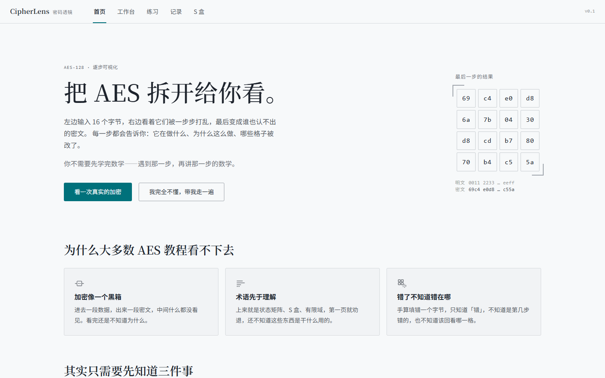
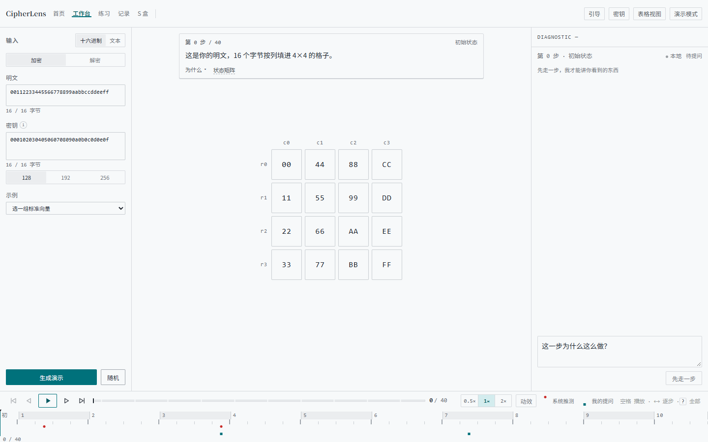
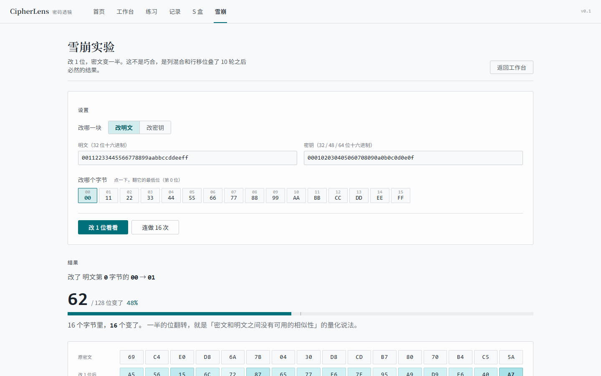
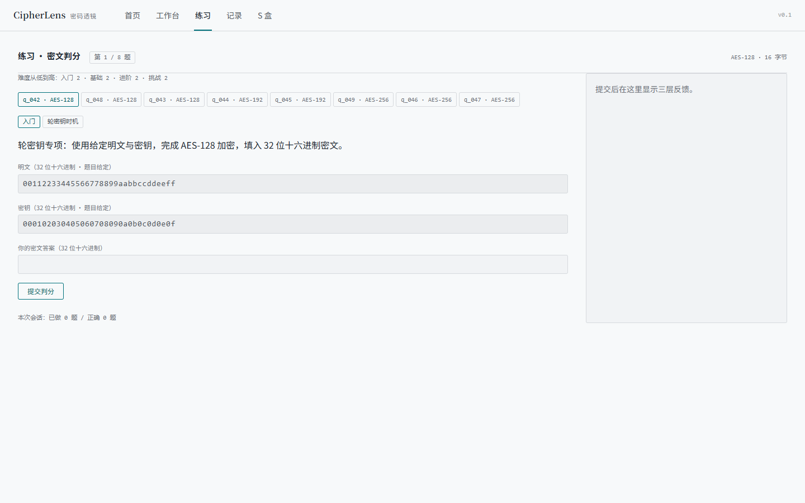
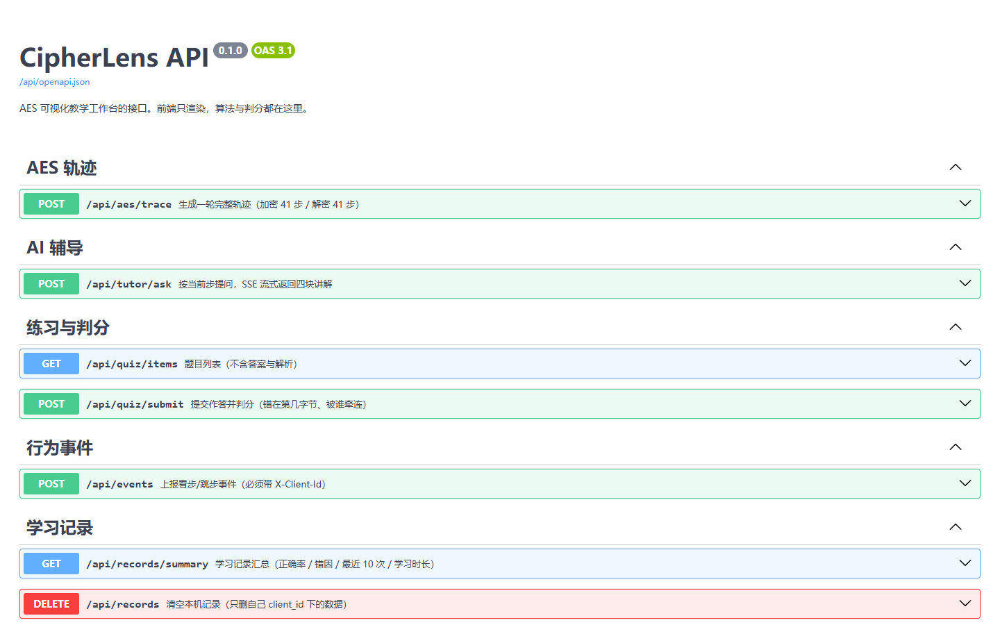
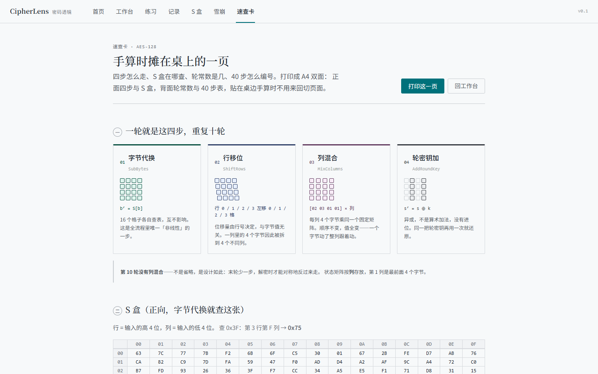

# CipherLens · 密码透镜

**把 AES 的一轮加密拆开给学生看，并在卡住的那一刻开口。**

面向高校《信息安全》课程的密码学算法可视化教学与 AI 辅导平台。核心不是"把 AES 画出来"（这件事有大量现成动画），而是**三层反馈**：算法层永远对（对照 FIPS-197）、认知层指出你错在哪一步、区域层分清"错了"和"被这个错牵连"。

> 答辩用一句话：**别人的可视化让你看对的过程，CipherLens 让你看错的那一步。**

---

## 快速开始

需要 Docker 24+（推荐），或者 Node 20+ 与 Python 3.12+。

### A. Docker（三条命令）

```bash
cp .env.example .env          # 可选：填 LLM_* 才会接模型，留空自动降级本地讲解
docker compose up -d --build
open http://localhost:8080
```

| 入口 | 地址 |
|---|---|
| 前端 | `http://localhost:8080` |
| 接口文档（Swagger） | `http://localhost:8080/api/docs` |
| OpenAPI schema | `http://localhost:8080/api/openapi.json` |
| 健康检查 | `http://localhost:8080/api/health` |

停止：`docker compose down`。**数据在命名卷 `cipherlens-data` 里，`down` 不会删**；要连数据一起清掉用 `docker compose down -v`。

### B. 本机裸跑（改代码时用这个）

```bash
# 终端 1：后端
pip install -r backend/requirements.txt
python -m uvicorn --app-dir backend main:app --port 8000

# 终端 2：前端
cd frontend && npm ci && npm run dev     # http://localhost:5173
```

开发态前端把 `/api` 代理到 `127.0.0.1:8000`（见 `frontend/vite.config.ts`），不需要额外配 CORS。

### 长什么样

| 首页 | 工作台 | 雪崩实验 |
|---|---|---|
|  |  |  |

| 练习（四级难度） | 接口文档 | 速查卡（可打印） |
|---|---|---|
|  |  |  |

> 截图取自 `docker compose` 起来的 1440×900 生产形态，不是设计稿。

---

## 接口一览

十一个端点，都在 `/api` 下。完整字段与示例见 `/api/docs`。

| 方法 | 路径 | 作用 |
|---|---|---|
| `POST` | `/api/aes/trace` | 生成加密或解密的一轮完整轨迹（各 41 步），`direction` 切换 |
| `POST` | `/api/aes/avalanche` | 改 1 位，返回两块密文与 128 个位级差异 |
| `POST` | `/api/aes/avalanche/sweep` | 逐字节各改 1 位，返回 16/24/32 次的变化位数分布与均值 |
| `POST` | `/api/tutor/ask` | 按当前步提问，SSE 流式返回 `conclusion / why / next / cite` 四块 |
| `GET` | `/api/quiz/items` | 题目列表，**不含答案与解析** |
| `POST` | `/api/quiz/submit` | 判分：对不对、首错在第几字节、哪些格是被牵连的 |
| `POST` | `/api/events` | 上报看步/跳步事件（需 `X-Client-Id`），返回 204 |
| `GET` | `/api/records/summary` | 记录汇总：正确率、错因分布、最近 10 次、学习时长 |
| `DELETE` | `/api/records` | 清空本机记录（只删自己 `client_id` 下的） |
| `GET` | `/api/glossary` | 术语表，与前端 `data/glossary.ts` 同源 |
| `GET` | `/api/health` | 健康检查，只报「有没有配模型」，不报 base_url 与 key |

错误统一是 `{"error": {"code", "message", "field"}}`：`field` 直接给出 `plaintext` 或 `key`，前端不用猜是哪个输入框错了。

文档页的 css/js/favicon **打包在镜像里**（`backend/static/swagger/`），不连 CDN——
评审机不能联外网时，`/api/docs` 照样是完整样式，不是一页裸 HTML。

---

## 接模型（可选，不做也能跑）

AI 辅导区有两条路：**配了模型走模型，没配走本地模板**。两条路的四块结构完全一致，
本地模板不是"降级凑数"，它引用的就是当前这一步的真实数值。

```bash
cp .env.example backend/.env     # 然后填 LLM_BASE_URL / LLM_API_KEY / LLM_MODEL
```

| 变量 | 作用 | 不填时 |
|---|---|---|
| `LLM_BASE_URL` | OpenAI 兼容根路径（例 `https://api.deepseek.com/v1`） | 走本地模板 |
| `LLM_API_KEY` | 模型 key，只从环境变量读，不进代码/日志/库 | 走本地模板 |
| `LLM_MODEL` | 模型名（例 `deepseek-chat`） | 走本地模板 |
| `LLM_TIMEOUT_S` | 单次超时，失败重试一次（×1.5） | 20 |
| `LLM_MAX_TOKENS` | 单次回答上限 | 400 |

- 状态点：`GET /api/health` 的 `llm.enabled` 决定 E 区显示 `AI` 还是 `本地`。
- 失败链：首字前挂 → 本地模板 + 可重试提示；写了一半断 → 保留内容 + 标「不完整」。
- 回答里出现的十六进制值会过一次审计，不在本步真值集合里的记为编造（`tutor_logs.fabricated`）。
- 没有 key 也能做离线联调：`python backend/tools/llm_probe.py mock 8099` 起一个假模型，
  再让后端指过去即可（本机若注入了 `http_proxy`，记得 `NO_PROXY=127.0.0.1,localhost`）。

## 练习与记录（数据真的落库）

题库只有一份定义：`backend/services/quiz_bank.py`。启动时 `seed_items()` 把它灌进
`quiz_items`，**答案用当前引擎现算**，所以改题不用手写密文，也不会出现「题库答案和引擎
算的对不上」。前端不再内置题库，`GET /api/quiz/items` 也不返回答案。

四条写入路径，都按匿名 `client_id`（`localStorage` 里的 `c_<32 hex>`）隔离：

| 动作 | 接口 | 落到哪 |
|---|---|---|
| 判分 | `POST /api/quiz/submit` | `attempts`（题目走 `quiz_items.id` 外键，带首错位置与来源字节） |
| 看/跳步 | `POST /api/events`（需 `X-Client-Id`） | `step_events`（播放时 10 秒采样 1 条，手动跳步全记） |
| 汇总 | `GET /api/records/summary` | 读 `attempts` ∪ `practice_attempts`（历史），算正确率/错因/最近 10 次/学习时长 |
| 清空 | `DELETE /api/records` | 删本机 `attempts` + `practice_attempts` + `step_events`，`legacy-default` 拒删 |

- 提交的明文/密钥必须和题目给定的一致，否则本题不计入（`input_mismatch.expected = item`）。
- 学习时长是 `step_events` 首末差；不足两条显示 `—`，不拿 0 秒充数。
- `users` / `sessions` / `diagnoses` 仍空着：没有登录，它们是多用户版本的预留，答辩时明说。

## 雪崩实验（改 1 位，密文变一半）

`/avalanche`。改明文或密钥的任意一位，并排给出两块密文的 16 个字节 + 128 位的位图
（一列一个字节，列内 bit7 → bit0，与十六进制写法同序），再连做 16 / 24 / 32 次看均值贴着 64 位。

- 数字全部由后端算，与工作台同一份加密实现（`avalanche_probe.py` 里有 `same_impl` 断言）。
- FIPS-197 明文改第 0 字节最低位：**62 / 128 位（48%）**，16 个字节全变；连做 16 次均值 63.12。
- 差异配色按「变了几位」分 4 档，不是对错色 —— 雪崩时 16 格全变，用告警色等于没有信息。
- 工作台 B 区底部有入口，带当前这组输入跳过来；页面也认 `?pt=&key=&target=&byte=`。

## 速查卡（打印带走）

`/cheatsheet`。一页纸的形态：四步示意 + S 盒 16×16 + 轮常数表 + 40 步对照表，
点「打印这一页」（或 ⌘/Ctrl+P）出 A4 双面——正面四步与 S 盒，背面轮常数与 40 步。

- 图上的 S 盒、Rcon、40 步编号全部取自引擎与 `data/step-table.ts`，页面里没有第二份表。
- 打印媒体里把窄屏断点改回四列 / 两栏：A4 宽 794px 会命中 900px 断点，不覆盖就打印成手机版。
- 交互式查表仍然在 `/sbox`（可正查 / 反查 / 键盘移动），速查卡只管「纸面」这一种用法。

## 验证（一条命令出证据）

```bash
bash scripts/verify.sh              # 单测 → 构建 → 三向量对账 → 后端探针 → 接口文档
bash scripts/verify.sh 8000 --docker  # 再加一层：真起容器，验 8080 上的首页/健康检查/openapi
```

脚本自己挑解释器（`$PYTHON` → `python` → `py` → `python3`，取第一个 import 得动 fastapi 的），
并强制 `NO_PROXY=127.0.0.1,localhost`——本机注入的代理会把本地探测截成 502。

单独跑某一块：

| 命令 | 验什么 |
|---|---|
| `cd frontend && npm test` | 104 条前端单测（引擎、轮次切分、40 步表、雪崩位图、SSE 解析、事件攒批） |
| `python backend/tools/compare_trace.py` | FIPS-197 C.1/C.2/C.3 双向往返，逐字段比对 |
| `python backend/tools/quiz_probe.py 8000` | 8 题、答案不外泄、判分落库、清空归零 |
| `python backend/tools/avalanche_probe.py 8000` | 改 1 位的位数、位图自洽、192/256 扫描次数、与 trace 同源 |
| `python backend/tools/tutor_probe.py 8000` | 四块结构、断流重试、口语化内容 |

## 目录

```
CipherLens/
├─ frontend/                Vue3 + Vite + TS + Pinia
│  └─ src/                  views / components / engine（AES 前端实现）/ data / composables
├─ backend/                 FastAPI + SQLite + SSE
│  ├─ routers/              11 个端点
│  ├─ services/             aes_impl（唯一算法权威）/ avalanche / llm_service / quiz_* / records_service
│  ├─ tools/                探针与对账脚本（compare_trace / quiz_probe / llm_probe …）
│  └─ data/                 cipherlens.db（不进 git，迁移自动备份）
├─ docker/                  nginx.conf + 前端 Dockerfile
├─ scripts/verify.sh        一条命令出证据
├─ docs/                    设计文档 + 部署文档
└─ output/                  构建产物、截图、验收日志（不进 git）
```

## 文档地图

设计阶段已封版，共 8 份文档 + 1 份交付稿。**文件名不要改**——文档之间互相以文件名交叉引用，改名会断链（这是本项目已经踩过的坑）。

| 文件 | 权威范围 | 什么时候查 |
|---|---|---|
| `CipherLens-视觉设计流程与Coding-Agent提示词-v1.0.md` | **入口**。设计立场、协作纪律 D1–D6、冻结口径 F1–F5、可自动化验收 7 条 | 开工第一份，先读它 |
| `CipherLens-PRD-v0.3.md` | 产品需求。定位、痛点、MVP 范围、页面清单、核心流程、技术方案、风险登记 | 不确定"这个功能该不该做"时 |
| `CipherLens-视觉设计规范-v1.2.md` | 视觉系统全文（2163 行 / 13 章）。色彩、字体、栅格、动效、七态、投屏参数、设计令牌 | 任何视觉决策 |
| `CipherLens-信息架构与交互规格-v1.3.md` | 信息架构、五区规格、状态清单、无障碍、19 条口径表 | 任何交互决策 |
| `CipherLens-前端实现规格与Coding-Agent提示词-v1.9.md` | 组件树、Pinia store、渲染分层、动效表、性能预算、四段实施提示词 | **写代码时唯一施工图** |
| `CipherLens-设计系统证据页-切片-v1.2.md` | 从视觉/交互规格里切出的可粘贴代码片段（CSS 变量、闸门、几何） | 抄代码时 |
| `CipherLens-项目描述文档-v1.1.md` | 答辩陈述稿 | 讲给别人听时 |
| `CipherLens-同类项目调研与借鉴清单-v1.0.md` | 竞品与差异化防守 | 被问"和 XX 有什么区别"时 |
| `CipherLens-设计交付文档.docx` | 交给老师/评委的合并稿（9 章，结论层，不含内部版本号） | 提交时 |
| `CipherLens-华为CodeArts-分功能开发提示词手册-v1.0.md` | 24 个功能点的施工提示词：上下文卡、固定收尾、逐点提示词、6 条纠偏 | 在 CodeArts 里写代码时，一轮粘一条 |
| `CipherLens-改造总纲-v1.0.md` | **开发期主线**：17 项改造、5 个批次、优先级与分工 | 决定"下一步做什么" |
| `CipherLens-分功能改造设计方案-v1.0.md` | 每项改造的现状证据、改动点、验收、不做什么 | 动手前对照 |
| `CipherLens-部署文档-v1.0.md` | 端口、卷、健康检查、nginx 关键配置、离线部署、故障排查 | 换机器部署时 |

## 五条硬约束（违反任何一条都会推倒重来）

1. **字节格的 `border-width` 七态恒定 1px（演示态恒 2px），只改 `border-color`。** 加粗一律用 `box-shadow: inset`。改宽度会改内容盒，让 hex 文字位移 1–3px。
2. **字节格边框取 `var(--rule-region-ink)`，绝不取 `--line-default`。** 两者在常规块恰好都是 0.845，看不出区别；演示块分叉成 0.545 / 0.760，取错就在投影上掉到 2.9:1、整张矩阵发灰。**凡是靠"同值"的地方，引 token 不引数值。**
3. **矩阵 `--cell-gap: 6px`（演示 10px）是底线。** 每格边框是它自己的"身份证"，不是共享网格线。禁用容器统一画线（`gap:1px` + 容器底色）——这个方案要治的"双线/共享边"在 6px 间隙下不存在。
4. **格子绝不位移、绝不缩放、绝不内缩。** 状态变化只允许改颜色、纹理、描边、角标。"轻"读作安静，"小"读作异常。
5. **判分在后端，前端只渲染。** 禁止前端复算判分、禁止前端推导步数、禁止每次传 16 字节值。同一事实只允许一处计算。

> 另有 12 条禁止项见 `前端规格 §10`，30 条验收见 `入口文档 §7`。

## 常见故障

| 现象 | 原因 | 处理 |
|---|---|---|
| `http://localhost:8080/api/docs` 404 | 直接用默认 `/docs`；nginx 只反代 `/api/` | 本仓库已把文档挂到 `/api/docs`，确认镜像是最新构建：`docker compose up -d --build` |
| 页面能开，但 AI 区一直转、接口 502 | 后端容器没健康（多半是 `.env` 里 key 是占位符） | `docker compose ps` 看 backend 是否 `healthy`，`docker compose logs backend` |
| AI 回答「一次性蹦出来」，不是逐字 | 反向代理开了缓冲或 gzip | `docker/nginx.conf` 的 `/api/` location 必须 `proxy_buffering off` + `gzip off` |
| 记录页数字不涨、学习时长显示 `—` | 浏览器禁用了 `localStorage`，拿不到 `client_id` | 换非隐私窗口；或用 `curl -H "X-Client-Id: c_32位十六进制"` 直接验接口 |
| 后端起不来，日志报 `user_version` 迁移失败 | 旧库结构与当前版本不兼容 | 迁移前会自动备份成 `cipherlens.db.bak-v0-*`；删掉 `backend/data/cipherlens.db` 重启即重建 |
| 本机 `python -m uvicorn` 报 `No module named fastapi` | Windows 上 `python` 与 `py` 可能是两个解释器 | 用 `py -m uvicorn`，或 `py -m pip install -r backend/requirements.txt` |

## 开发纪律（大赛要求全流程留痕）

- 每一段功能对应一次提交，**提交信息写"做到了哪条验收"，不写"改了什么文件"**。
- 每次提交前跑一遍 `bash scripts/verify.sh`。
- 文档如需修改，先确认改的是**唯一权威处**，再按入口文档 §0.3 的 D1–D6 协作纪律执行。

---

## 当前状态

| 阶段 | 状态 |
|---|---|
| 选题与需求（PRD v0.3） | ✅ 封版 |
| 视觉 / 交互 / 前端规格 | ✅ 三方封版，七件事完全同源 |
| 交付稿（交老师/评委） | ✅ 已生成并校验 |
| 代码 | ✅ F01–F13 已实现（改造总纲批次 0–3 除 F15/F16 外完成） |
| 测试 | 前端 84 条单测 + 后端 5 组探针，`scripts/verify.sh` 全绿 |
| 部署 | ✅ Docker Compose 双容器，含健康检查与数据卷 |
| 接口文档 | ✅ `/api/docs` 与 `/api/openapi.json` 随服务一起发布 |

**下一步**：F14 首页活体演示（批次 4，等首页布局定稿后做）、F15 一轮小结卡、F16 雪崩实验、F17 速查卡。
