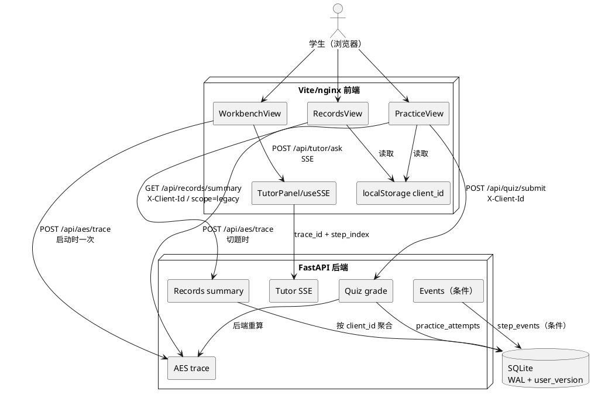
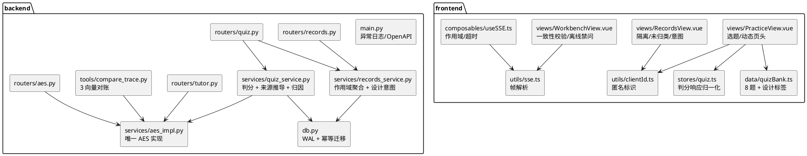
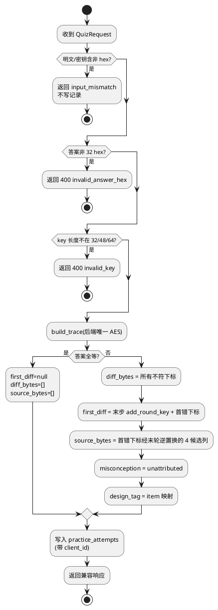
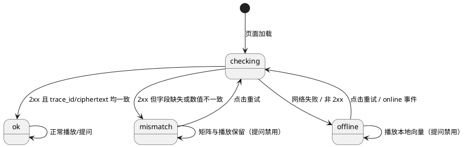
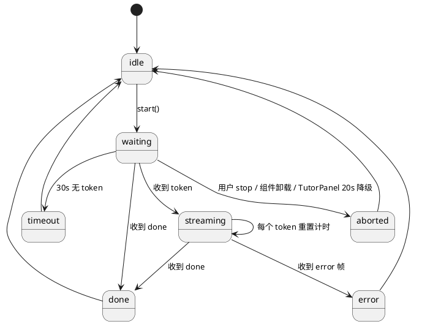
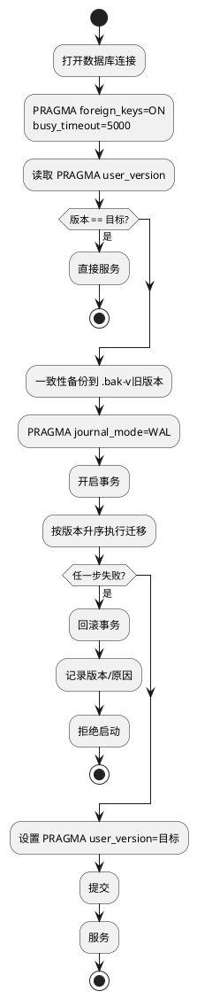
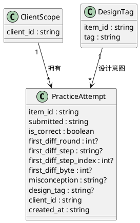

# CipherLens 代码审查优化 · 实现方案（技术设计）

> 文档编号：CL-OPT-DESIGN-v1.0
> 状态：**设计评审中，未进入实现**
> 日期：2026-11-09
> 输入基线：`docs/specs/code-review-optimization-v1/requirements.md`（CL-OPT-REQ-v1.0，1297 行）
> 规范镜像：`.codeartsdoer/specs/code_review_opt_v1/spec.md`
> 项目基线：F0–F24、B1–B3 已验收；`evidence/acceptance/` 原文不得删除或改写
> 本文件只回答「怎么做、改哪里、怎么验收、怎么回滚」，不写业务源码

---

## 0. 设计边界与阅读方式

### 0.1 本设计的定位

本设计把需求文档第 11.1 节「本轮建议做」的 15 项，以及第 5 节 D-01–D-08 的待决策项，转成可落地的技术方案。所有 D 项均以**设计假设**出现，标注「待用户确认」，不写成既成事实。

### 0.2 设计前置结论

| 结论 | 说明 |
|---|---|
| 默认不接真实 LLM | 设计假设 D-01=B；保留 `meta.source="local"` 与本地模板降级 |
| 双引擎保留但对账 | 设计假设 D-03=C；不把工作台改为后端唯一真相源 |
| 错因先「未归类」 | 设计假设 D-04=A+B；算法诊断与题目设计意图分栏，不混为一谈 |
| 匿名隔离不做登录 | 设计假设 D-06=A；`client_id` 不是鉴权，不宣称已解决安全问题 |
| 埋点默认不纳入本轮 | 设计假设 D-05=A 但条件纳入；默认只写依赖与可选方案 |
| CI 默认不接平台 | 设计假设 D-07=A；先提供本地可重复脚本，平台流水线待确认 |

### 0.3 术语冻结（本轮设计统一使用）

| 术语 | 定义 | 禁止用法 |
|---|---|---|
| 差异字节 `diff_bytes` | 学生答案与后端重算密文在所有下标上不一致的集合 | 不得把「首个差异之后的所有下标」称为差异字节 |
| 来源字节 `source_bytes` | 由首个差异下标经末轮逆置换推导出的、上一轮列混合输入的 4 个候选下标 | 不得称为「受污染」；不得声称已证明因果 |
| 首错位置 `first_diff` | 现有字段，定位到最终 `add_round_key`；不反推更早轮次 | 不得由最终密文伪造「第 4 轮列混合」 |
| 未归类 `unattributed` | 现有可观测数据不足以归因时的记录值 | 不得默认写入 `key_timing` |
| 题目设计意图 `design_tag` | 出题时给题目打的专项标签 | 不得表述为「你的错因是 X」 |
| 兼容字段 `propagated` | 旧口径「首个差异之后的下标」，保留一个版本 | 不得驱动新文案或新渲染 |

---

# 一、需求与存量功能关系分析

## 1.1 需求功能与存量功能对比

### 1.1.1 已实现功能

| 需求功能 | 存量功能 | 代码位置 | 匹配度 |
|---|---|---|---|
| 后端唯一判分入口 | `POST /api/quiz/submit` 调 `grade()` 并写记录 | `backend/routers/quiz.py:12-26` | 100% |
| AES-128/192/256 加密 trace | `build_trace()` 支持三种密钥长度与 40/48/56 步 | `backend/services/aes_impl.py:176-239` | 100% |
| 首错字节定位 | `first_diff` 给末步 `step_index/round/op/byte_index` | `backend/services/quiz_service.py:68-90` | 100% |
| 输入合法性校验 | 非 hex、key 长度、key_bits 与 key 长度一致性 | `backend/services/quiz_service.py:13-55`、`backend/services/aes_impl.py:184-195` | 100% |
| 学习记录三态 | `total=0/2/10` 对应 empty/insufficient/full | `backend/services/records_service.py:76-140`、`frontend/src/views/RecordsView.vue:129-135` | 100% |
| 错题回看跳工作台 | `first_diff_step_index` 落库并拼 `?step&byte` | `backend/services/records_service.py:27-58`、`frontend/src/views/RecordsView.vue:177-186` | 100% |
| SSE 四事件 | `meta → token×N → done`，异常 `error` | `backend/routers/tutor.py:33-146` | 100% |
| 前端 SSE 读取 | fetch + ReadableStream + AbortController | `frontend/src/composables/useSSE.ts:14-59` | 75% |
| 工作台离线兜底 | 无后端时本地 engine 渲染内置向量 | `frontend/src/views/WorkbenchView.vue:195-220`、`F23.md` §3 | 100% |
| 前后端 trace 对账（单向量） | `compare_trace.py` 对 C.1 逐字段比较 | `backend/tools/compare_trace.py:12-74` | 50% |
| 题库单题 | `QUIZ_ITEMS[0]` + 写死 AES-128 页头 | `frontend/src/data/quizBank.ts:9-16`、`frontend/src/views/PracticeView.vue:6,133` | 25% |
| 批量埋点收包 | `/api/events` 校验后返回 204 | `backend/routers/events.py:12-20` | 25% |
| SQLite 表结构 | 7 张表 `CREATE TABLE IF NOT EXISTS` | `backend/db.py:6-88` | 75% |
| 统一错误响应 | `{error:{code,message,field}}` | `backend/main.py:60-86` | 100% |
| Docker 全栈与 SSE 不缓冲 | nginx `/api` 关缓冲、关 gzip | `docker/nginx.conf:11-24`、`F24.md` §2 | 100% |

### 1.1.2 需要扩展的功能

| 需求功能 | 存量功能 | 差异说明 | 扩展方向 |
|---|---|---|---|
| P0-2 差异/来源字节 | `propagated = range(first+1,16)` | 输入输出：新增 `diff_bytes/source_bytes`；业务逻辑：来源改为末轮逆置换 4 候选列；边界：多差异只标注首错来源 | `quiz_service.py` 增加来源推导；响应保留 `propagated`；前端改用 `source_bytes` |
| P0-3 三向量对账 | 脚本固定 C.1 与 128 位 | 输入输出：循环 C.1/C.2/C.3；业务逻辑：`step_count` 按响应读取；边界：任一向量差异即非零退出 | `compare_trace.py` 改为向量表驱动；`dump_frontend_trace.mjs` 接受三元组参数 |
| P0-3 运行时一致性 | 工作台只取 `trace_id` | 输入输出：同时比较 `trace_id` 与 `ciphertext`；业务逻辑：区分网络失败与内容不一致；边界：校验不扰动播放状态 | `WorkbenchView.vue` 增加 `consistency` 状态；`WorkbenchLayout/TutorPanel` 接收禁用原因 |
| P0-4 未归类 | `misconception_for(step)` 将 `add_round_key` 映射为 `key_timing` | 输入输出：记录新增 `unattributed`；业务逻辑：最终密文无法归因；边界：旧记录保留原值 | `record_attempt` 真实路径写 `unattributed`；`summary` 增加第四桶；`RecordsView` 增加未归类与设计意图分栏 |
| P1-2 匿名隔离 | `summary()` 全表聚合；请求无客户端维度 | 输入输出：新增 `X-Client-Id` 与 `scope`；业务逻辑：按客户端过滤；边界：无/非法/旧数据三种路径 | `db.py` 加列；`records_service` 增加 scope；`records.py` 读请求头；前端生成并持久化 `client_id` |
| P1-3 DB 加固 | 启动即 `executescript(SCHEMA)`，无版本、无 WAL、无索引 | 输入输出：`PRAGMA user_version`、`journal_mode`；业务逻辑：幂等迁移；边界：失败拒绝启动 | `db.py` 拆 schema 与迁移；连接设置 `busy_timeout`；迁移前备份 |
| P1-4 题库扩充 | 单题写死、页头写死 AES-128、密钥标签写死 32 位 | 输入输出：8 题、三种密钥长度；业务逻辑：切题重载 trace 与清空判分；边界：192/256 密钥输入长度 | `quizBank.ts` 扩表；`PracticeView` 选题与动态页头；`quiz.ts` 切题清理 |
| P1-5 SSE 规范 | `data: ` 强制空格、多行直接拼接、残留帧丢弃、全局控制器集合 | 输入输出：解析规则与超时；业务逻辑：每个调用方独立作用域；边界：20s 降级优先于 30s 超时 | `utils/sse.ts` 解析器；`useSSE.ts` 作用域与计时器；新增单测 |
| P1-6 第 0 步禁问 | `stepIndex=0` 仍可发送，后端退到 `steps[0]` | 输入输出：`askDisabled` 与提示；业务逻辑：步 0 不发请求；边界：`Math.max(0, step-1)` 映射不能误伤步 1 | `TutorPanel.vue` 禁用态与 guard；`WorkbenchLayout` 透传 |
| P2-1 异常日志 | 全局 handler 吞异常 | 补充 `logger.exception`，响应形状不变 | `main.py` |
| P2-2 死代码 | `assert_answer_length` 无调用 | 删除，保留 pydantic 长度校验 | `quiz_service.py` |
| P2-6 错误文档 | 有统一结构但未进 OpenAPI | 增加 `ErrorResponse` 模型与 `responses` 声明 | `models/schemas.py`、各 router |
| P2-10 交付卫生 | `tokens.css:50,69` 有「待用户批准」 | 改为正式依据说明，依据迁入本设计 | `tokens.css`、本文件 |
| P2-11 页面元信息 | `favicon` 为 `data:,`，无 description/OG/theme-color | 增加 4 项 meta 与非空 favicon | `frontend/index.html`、`frontend/public/favicon.svg` |
| P2-16 构建配置 | `vite.config.ts` 无 `base/target` | 增加可选环境变量，默认行为不变 | `frontend/vite.config.ts` |

### 1.1.3 需要新增的功能或接口

**A. 判分响应扩展（P0-2 / P0-4）**

- 输入：现有 `QuizRequest` 不变；响应新增 `diff_bytes/source_bytes/source_step_index/source_round/source_step/design_tag/misconception`。
- 输出：旧字段 `summary/first_diff/propagated/input_mismatch/expected_ciphertext` 全部保留。
- 核心逻辑：差异集合由 16 字节逐位比较得到；来源集合由首错下标经末轮逆置换得到；归因默认 `unattributed`。
- 依赖：`build_trace` 的 `steps` 与 `rounds`；前端 `types/api.ts` 同步类型。

**B. 记录作用域（P1-2）**

- 输入：`GET /api/records/summary` 的 `X-Client-Id` 请求头与可选 `scope=legacy`；`POST /api/quiz/submit` 的 `X-Client-Id`。
- 输出：`scope` 字段；无客户端时返回空汇总（不是全库聚合）。
- 核心逻辑：写路径缺省归入 `legacy-default` 以兼容旧探针；读路径缺省返回空，避免泄露。
- 依赖：P1-3 迁移增加 `practice_attempts.client_id`。

**C. SSE 客户端能力（P1-5）**

- 输入：现有四类事件与后端帧格式不变。
- 输出：新增 `timeout` 错误码；`window.__sse.active` 计数准确。
- 核心逻辑：每调用方独立控制器集合；30s 无 token 超时；主动中止不报超时。
- 依赖：无后端改动。

**D. 题目设计意图（P0-4 增强 / P1-4）**

- 输入：`item_id` 与前端题库。
- 输出：判分响应与记录中的 `design_tag`；记录页「题目设计意图」分栏。
- 核心逻辑：后端常量映射 `item_id → design_tag`；未知题返回 `null`。
- 依赖：D-04 确认；P1-4 题库表。

**E. 埋点落库（P1-1，条件纳入）**

- 输入：前端事件队列；`POST /api/sessions`；`POST /api/events`。
- 输出：`step_events` 行、`diagnoses.responded` 更新。
- 核心逻辑：会话整数主键映射；批量 10 条/10 秒；页面隐藏 `sendBeacon`。
- 依赖：D-05、P1-3、P1-2；默认不纳入本轮。

## 1.2 存量功能详细分析

### 1.2.1 判分服务（`backend/services/quiz_service.py`）

| 维度 | 现状 | 约束/扩展点 |
|---|---|---|
| 接口契约 | `grade(payload)` 返回 dict；`quiz.py` 直接 JSON 序列化 | 可加字段；不可删除旧字段 |
| 业务规则 | 先做明文/密钥非 hex 检查，再查答案长度与 key 长度，最后 `build_trace` | `input_mismatch` 分支不写记录 |
| 首错 | `wrong[0]` 对应最终 `add_round_key` | 没有学生中间态，不能反推更早轮次 |
| 兼容字段 | `propagated` 由 `range(first+1,16)` 生成，B3/F19 已验收 | 新口径必须保留一个版本 |
| 错误 | `AesInputError` 映射 400 | 新错误码需同步 OpenAPI |
| 扩展点 | `build_trace` 返回完整 `steps`，可按 `rounds` 推导上一轮列混合步 | 来源集合可由 trace 计算，不需前端复算 |

### 1.2.2 记录服务（`backend/services/records_service.py`）

| 维度 | 现状 | 约束/扩展点 |
|---|---|---|
| 写入 | `record_attempt(payload, result)` 仅写非输入错误 | 需增加 `client_id` 与 `design_tag` 参数 |
| 归因 | `misconception_for(step)` 把 `add_round_key` 固定为 `key_timing` | 真实路径必须改为 `unattributed` |
| 聚合 | `summary()` 全表读取，趋势最近 20、错题最近 10 | 需按 `client_id` 过滤并增加未归类桶 |
| 三态 | `sample_threshold=3` 由后端返回 | 不得改阈值 |
| 兼容 | 旧记录无 `client_id`，`misconception` 为三类之一 | 迁移归入 `legacy-default`，不得重写 |

### 1.2.3 数据库（`backend/db.py`）

| 维度 | 现状 | 约束/扩展点 |
|---|---|---|
| 建表 | `SCHEMA` 七张表，`CREATE TABLE IF NOT EXISTS` | 可加列/索引；不可删已有字段 |
| 连接 | 每次 `sqlite3.connect`，`foreign_keys=ON` | 需加 `busy_timeout`、WAL |
| 迁移 | 无版本 | 用 `PRAGMA user_version`，幂等 |
| 数据 | `practice_attempts` 在用；`quiz_items` 为空 | 不把「建表」当「已实现」 |
| 失败 | 启动时异常直接冒泡 | 迁移失败应拒绝启动并给可读原因 |

### 1.2.4 SSE 客户端（`frontend/src/utils/sse.ts`、`useSSE.ts`）

| 维度 | 现状 | 约束/扩展点 |
|---|---|---|
| 帧解析 | 只识别 `event: ` / `data: `（带空格）；多行直接 `+=`；结尾残留丢弃 | 需按 SSE 规范解析，保留现有事件 |
| 作用域 | 模块级 `controllers` 集合；`abort()` 清空所有流 | 跨组件会互相中断，必须改为每调用方独立 |
| 计数 | `activeCount` 全局；abort 直接清零 | 需按流去重计数，避免重复减 |
| 超时 | 无；TutorPanel 20s 总降级 | 30s 无 token 超时；20s 必须优先 |
| 兼容 | 后端四事件格式不变 | 不得改后端帧格式 |

### 1.2.5 工作台与辅导面板（`WorkbenchView.vue`、`TutorPanel.vue`、`WorkbenchLayout.vue`）

| 维度 | 现状 | 约束/扩展点 |
|---|---|---|
| trace 来源 | 本地 `buildTrace` 渲染；后端只取 `trace_id` | 可比较 `trace_id/ciphertext`，不改变渲染源 |
| 离线 | `offlineMode` 仅显示标识，提问仍可用 | 离线必须禁用提问 |
| 步 0 | `traceStepIndex = Math.max(0, stepIndex - 1)`，步 0 仍可发送 | 步 0 禁用；步 1 映射保持 |
| 20s 降级 | `armTimers` 20s abort + 本地模板 | 30s 超时不能抢在 20s 前 |
| 卸载 | `onScopeDispose` abort | 只清自己的流 |
| 视觉 | 七态 border 1px、`--cell-gap` 6px、格子不位移 | 新增来源标签不得改几何 |

### 1.2.6 练习页与题库（`PracticeView.vue`、`quizBank.ts`、`quiz.ts`）

| 维度 | 现状 | 约束/扩展点 |
|---|---|---|
| 题目 | `QUIZ_ITEMS[0]` 单题 | 需 8 题、可切换 |
| 页头 | 写死「AES-128 · 16 字节」 | 需按 `key_bits` 动态 |
| 密钥标签 | 写死「32 位十六进制」 | 192/256 需 48/64 位 |
| 判分 | 后端唯一；前端无 engine | 切题不得引入复算 |
| 判分叠加 | `overlayArmed + step_index` 绑定，切步撤场 | 切题必须清空旧响应/叠加 |
| 答案 | 前端题库不含 `expected_ciphertext` | 新增题同样不得含答案 |

### 1.2.7 记录页与 Docker

| 维度 | 现状 | 约束/扩展点 |
|---|---|---|
| 记录页 | 直接 `fetch('/api/records/summary')` | 需带 `X-Client-Id` |
| 三态 | 0/2/10 已验收 | 不得改门槛与布局 |
| 健康检查 | backend healthcheck 请求 `/api/records/summary` 无客户端头 | 无头必须返回 200 空汇总，不能 400 |
| nginx | `/api` 关缓冲、关 gzip | 不改 `/api` 行为 |
| compose | 不改用户桌面 Docker | 本轮只验证，不改造 |

---

# 二、增量设计方案

## 2.1 实现模型

### 2.1.1 上下文视图



**通信约束**

| 链路 | 协议 | 频率 | 说明 |
|---|---|---|---|
| 工作台 trace | HTTP JSON | 页面加载 1 次 | 只用于一致性校验，不替代本地渲染 |
| 提问 | SSE over POST | 用户触发 | 事件仍为 `meta/token/done/error` |
| 判分 | HTTP JSON | 每次提交 | 唯一判分入口 |
| 记录 | HTTP JSON | 进入记录页/重试 | 必须带客户端作用域 |
| 埋点 | HTTP / sendBeacon | 条件纳入 | 默认不纳入本轮 |
| SQLite | 本地文件 | 每请求短连接 | WAL + `busy_timeout` |

### 2.1.2 服务/组件总体架构



**职责边界**

| 组件 | 职责 | 不负责 |
|---|---|---|
| `aes_impl.py` | 唯一 AES 加密/密钥扩展/trace | 判分、归因、记录 |
| `quiz_service.py` | 判分、差异/来源推导、输入校验 | 前端渲染、题库存储 |
| `records_service.py` | 记录写入、按客户端聚合、未归类桶 | 算法推导 |
| `WorkbenchView` | 本地矩阵渲染、一致性校验、离线/不一致状态 | 判分复算 |
| `PracticeView` | 选题、提交、展示三层反馈 | 计算正确答案 |
| `useSSE` | 每个调用方独立流、超时、计数 | 业务状态机（TutorPanel 负责） |

### 2.1.3 实现设计

#### A. 判分状态流



#### B. 工作台一致性状态流



**关键约束**

- `checking/offline/mismatch` 都禁用提问；`ok` 才解禁。
- 校验只改一致性状态，不改 `currentStep`、播放状态、URL。
- 网络失败与内容不一致必须区分：前者提示「离线演示」，后者提示「前后端数值不一致」。
- 离线仍用本地 engine 渲染矩阵与播放；**不使用本地 engine 判分**。

#### C. SSE 客户端状态流



**优先级**

1. TutorPanel 20s 总降级先于 useSSE 30s 无 token 超时；20s 触发 `abort()` 后不得再报 `timeout`。
2. 用户主动停止/卸载只报 `interrupted` 或静默，不报 `timeout`。
3. `done/error` 清理计时器；`token` 重置计时；`meta` 不重置 token 计时。

#### D. 数据库迁移流程



## 2.2 接口设计

### 2.2.1 总体设计

| 接口 | 方法 | 稳定性 | 本轮变化 | 兼容策略 |
|---|---|---|---|---|
| `/api/aes/trace` | POST | 稳定 | 无形状变化 | 旧客户端不受影响 |
| `/api/quiz/submit` | POST | 稳定 | 响应新增字段；读 `X-Client-Id` | 新字段可选；旧字段保留 |
| `/api/records/summary` | GET | 稳定 | 读 `X-Client-Id`/`scope`；返回 `scope` | 无头返回空汇总，不返回全库 |
| `/api/tutor/ask` | POST SSE | 稳定 | 无后端变化 | 前端兼容现有四事件 |
| `/api/events` | POST | 实验 | 条件落库（D-05） | 默认保持 204 |
| `/docs` | GET | 稳定 | 补错误响应 schema | 实际响应不变 |

### 2.2.2 `POST /api/quiz/submit`

**请求（不变）**

```json
{
  "item_id": "q_042",
  "answer_hex": "3925841d02dc09fbdc118597196a0b32",
  "plaintext_hex": "3243f6a8885a308d313198a2e0370734",
  "key_hex": "2b7e151628aed2a6abf7158809cf4f3c",
  "key_bits": 128
}
```

**请求头（新增，可选）**

| 头 | 取值 | 缺省行为 |
|---|---|---|
| `X-Client-Id` | `c_<32 位小写 hex>` | 写记录归入 `legacy-default`（兼容旧探针） |

**响应 200（新增字段为加法）**

```json
{
  "summary": { "total_bytes": 16, "wrong_count": 1 },
  "first_diff": {
    "step_index": 39,
    "round": 10,
    "step": "add_round_key",
    "byte_index": 7,
    "expected": 48,
    "actual": 49
  },
  "diff_bytes": [7],
  "source_bytes": [8, 9, 10, 11],
  "source_step_index": 35,
  "source_round": 9,
  "source_step": "mix_columns",
  "propagated": [8, 9, 10, 11, 12, 13, 14, 15],
  "input_mismatch": null,
  "expected_ciphertext": "69c4e0d86a7b0430d8cdb78070b4c55a",
  "misconception": "unattributed",
  "design_tag": "key_timing"
}
```

**字段语义**

| 字段 | 类型 | 语义 | 兼容 |
|---|---|---|---|
| `diff_bytes` | number[] | 所有不符下标，升序 | 新增 |
| `source_bytes` | number[] | 首错下标经末轮逆置换得到的 4 个候选来源下标（上一轮列混合输入的整列） | 新增 |
| `source_step_index` | number | 来源所在步（上一轮 `mix_columns`） | 新增 |
| `source_round` | number | 来源轮次（`rounds-1`） | 新增 |
| `source_step` | string | 固定 `mix_columns` | 新增 |
| `propagated` | number[] | **兼容字段**，旧口径「首个差异之后的下标」 | 保留一个版本，前端不再驱动文案 |
| `misconception` | string | 算法归因；本轮真实路径为 `unattributed` | 新增 |
| `design_tag` | string\|null | 题目设计意图；未知题为 `null` | 新增 |

**来源字节推导（后端唯一实现）**

以首错下标 `i` 为准：

1. `row = i % 4`，`col = i // 4`。
2. 末轮 `ShiftRows` 的逆映射给出上一轮 `MixColumns` 输出位置所在列：`source_col = (col - row) mod 4`。
3. 该列在上一轮 `MixColumns` 输入中的 4 个下标为 `source_col*4 + r`（`r=0..3`）。
4. 上一轮列混合步下标由 `rounds` 推导：`1 + (rounds - 2) * 4 + 2`；AES-128 为 35，AES-192 为 43，AES-256 为 51。
5. `source_bytes` 是这 4 个下标，指向该步 `state_before` 的对应值；UI 用它渲染来源候选列，不声称因果已证。

**多差异规则**

- `diff_bytes` 列出全部差异。
- `source_bytes` 只针对首错下标给出 4 个候选；其余差异由文案「还有 N 个差异字节」说明，不标成 `error` 或 `downstream`。
- 这是本轮教学口径边界；若后续要逐差异来源集合，另立需求。

**错误码（不变）**

| 场景 | HTTP | code | field |
|---|---|---|---|
| 答案含非 hex | 400 | `invalid_answer_hex` | `null` |
| key 长度非法 | 400 | `invalid_key` | `key` |
| 明文/密钥非 hex | 200 | 响应内 `input_mismatch` | 不适用 |
| 请求体字段缺失/超长 | 400 | `validation_error` | `plaintext/key/null` |

### 2.2.3 `GET /api/records/summary`

**请求**

| 参数 | 位置 | 必填 | 说明 |
|---|---|---|---|
| `X-Client-Id` | 请求头 | 否 | 当前匿名客户端 |
| `scope` | query | 否 | `legacy` 时读取迁移前 `legacy-default` 数据 |

**响应 200**

```json
{
  "scope": "client",
  "total": 3,
  "correct": 1,
  "accuracy": 0.3333,
  "misconceptions": [
    { "key": "key_timing", "label": "轮密钥时机", "hint": "轮密钥加的时机与顺序", "count": 0 },
    { "key": "mix_coefficient", "label": "列混合系数", "hint": "列混合系数与扩散方向", "count": 0 },
    { "key": "key_schedule", "label": "密钥扩展方向", "hint": "轮密钥的来源与扩展方向", "count": 0 },
    { "key": "unattributed", "label": "未归类", "hint": "现有数据不足以归因", "count": 2 }
  ],
  "design_tags": [
    { "key": "key_timing", "label": "轮密钥专项", "count": 2 }
  ],
  "most_stuck": { "round": 10, "step": "add_round_key", "byte": 7, "count": 2, "label": "第 10 轮 轮密钥加 · 字节 7" },
  "trend": [{ "index": 1, "is_correct": false, "created_at": "..." }],
  "wrong": [],
  "sample_threshold": 3
}
```

**作用域规则**

| 场景 | 返回 |
|---|---|
| 有合法 `X-Client-Id` | 该客户端记录；`scope="client"` |
| 无 `X-Client-Id` 且无 `scope=legacy` | **空汇总**（`total=0`，`scope="none"`），HTTP 200；保证 Docker healthcheck 不失败 |
| `scope=legacy` | `client_id='legacy-default'` 的记录；`scope="legacy"` |
| `X-Client-Id` 存在但格式非法 | 400 `invalid_client_id` |

> 读路径无头不回退到全库，满足「不返回 A+B 合计」；写路径无头回退到 `legacy-default`，保证旧探针与旧客户端仍可写入。这一不对称是刻意兼容策略，必须在接口文档中写明。

### 2.2.4 `POST /api/tutor/ask`（SSE）

**请求（不变）**：`trace_id`、`step_index`、`question`。不新增 16 字节；`client_id` 本轮不写入提问请求，避免改变 B2 契约。

**事件（不变）**

| 事件 | 数据 | 前端行为 |
|---|---|---|
| `meta` | `trace_id/step_index/quotes_values/source/cache/step_label` | 更新阶段；不重置 30s token 计时 |
| `token` | `{"t":"..."}` | 追加文本；重置计时 |
| `done` | `finish/tokens/degraded` | 结束；清计时 |
| `error` | `code/message` | 错误态；清计时 |

**客户端错误码（新增）**

| code | 触发 | 行为 |
|---|---|---|
| `timeout` | 30s 未收到 token | abort + 单次 `onError('timeout')` |
| `network_error` | fetch/HTTP/流异常 | 现有行为 |
| `AbortError` | 用户停止/卸载/20s 降级 | 不报错，不报 timeout |

**超时优先级**：TutorPanel 20s > useSSE 30s。20s 到点由 TutorPanel 调 `abort()`，useSSE 标记为主动中止，不产生第二个错误态。

### 2.2.5 `POST /api/events`（条件纳入）

默认不改变：校验后 204，只打日志。若 D-05 确认 A：

- 新增 `POST /api/sessions`：`{client_id, mode}` → `{session_id}`（整数）。
- `POST /api/events` 落 `step_events`，`session_id` 使用整数；不接受字符串直接落库。
- 诊断接受/拒绝更新 `diagnoses.responded`。
- 失败返回 204 或 5xx 均不阻塞前端；前端只 `console.warn`。

### 2.2.6 错误响应与 OpenAPI

统一结构不变：

```json
{ "error": { "code": "invalid_key", "message": "...", "field": "key" } }
```

新增 `ErrorDetail/ErrorResponse` 模型，并在 `aes/quiz/records` 路由声明 400/500 响应；`/docs` 可见，实际响应不改。

## 2.3 数据模型

### 2.3.1 设计目标

| 目标 | 说明 |
|---|---|
| 不破坏已验收字段 | `practice_attempts` 现有列与类型保持不变 |
| 可作用域 | 每条练习记录带 `client_id`；旧数据归入 `legacy-default` |
| 可解释归因 | `misconception` 与 `design_tag` 分离，前者只写可验证结论 |
| 可幂等迁移 | `PRAGMA user_version` 版本化；重复启动不重复执行 |
| 可回滚 | 迁移前一致性备份；失败拒绝启动；不半迁移 |

### 2.3.2 模型实现



**生命周期**

- `PracticeAttempt` 在每次非输入错误的判分后创建；输入错误不创建。
- `client_id` 由前端生成并持久化，后端只信任请求头用于**分组**，不做鉴权。
- `design_tag` 只来自后端 `item_id` 常量映射，不信任前端提交值。

**持久化策略**

- SQLite 单文件；WAL 模式；短连接；不使用 ORM。
- 迁移增加列与索引，不重建表；旧行默认值 `legacy-default`。
- 备份文件与 `-wal/-shm` 不纳入版本控制（`backend/data/` 已被忽略）。

## 2.4 逐条需求映射

### 2.4.1 P0-2 最小口径追记（REQ-01）与完整方案（REQ-02）

**模块/文件**

- 文档：本文件、`docs/specs/.../requirements.md`（只读）、新增 `evidence/acceptance/B3-opt1.md`、`F19-opt1.md`、`F20-opt1.md`。
- 后端：`backend/services/quiz_service.py`、`backend/models/schemas.py`（文档化）。
- 前端：`frontend/src/types/api.ts`、`frontend/src/stores/quiz.ts`、`frontend/src/views/PracticeView.vue`、`frontend/src/components/region-c/QuizMatrix.vue`、`frontend/src/components/region-c/MatrixStage.vue`。

**阶段 0（无代码）**

1. 在本文件与证据追加说明中冻结「差异字节/来源字节」术语。
2. 在 B3/F19/F20 末尾追加「口径变更说明（2026-11-09）」：旧口径、新口径、生效日期、影响字段；不删除原段落。
3. 在接口文档标注 `propagated` 为「兼容/deprecated」，并说明「保留一个版本，不再驱动文案」。

**阶段 2（代码，需 D-02 确认）**

| 项 | 设计 |
|---|---|
| 数据结构 | 响应新增 `diff_bytes/source_bytes/source_step_index/source_round/source_step` |
| 来源推导 | 首错下标 → 逆 `ShiftRows` → 上一轮 `MixColumns` 输入整列（4 个） |
| 错误路径 | `first_diff=null` 时 `diff_bytes=[]`、`source_bytes=[]`、来源字段 `null` |
| 兼容 | `propagated` 原值保留；旧客户端仍按旧口径渲染 |
| 前端 | `sourceBytes` 优先；缺失时回退 `propagated`；文案改为「差异字节」「来源候选字节」 |
| 视觉 | 来源字节继续用 `is-downstream` 样式；不改 border 宽度、`--cell-gap`、不位移 |
| 多差异 | 只标首错 `is-error`；`is-downstream` 数量 = `source_bytes.length`（4）；其余差异只文字说明 |
| 验收 | `quiz_probe` 断言 C.1 `diff_bytes=[7]`、`source_bytes=[8,9,10,11]`；Playwright `.is-error=1`、`.is-downstream=4` |

**回滚**

- 后端保留 `propagated` 一个版本；前端可临时回退到 `propagated`。
- 回滚代码不影响新字段存在；证据追记只删新增段落，原文不动。

### 2.4.2 P0-3 三组向量对账 + 运行时一致性 + 离线禁问（REQ-06/07/08）

**模块/文件**

- `backend/tools/compare_trace.py`、`backend/tools/dump_frontend_trace.mjs`。
- `frontend/src/views/WorkbenchView.vue`、`frontend/src/components/layout/WorkbenchLayout.vue`、`frontend/src/components/region-e/TutorPanel.vue`、`frontend/src/stores/ui.ts`（只读状态）。

**三向量对账设计**

| 向量 | plaintext | key_bits | 期望 ciphertext | step_count |
|---|---|---|---|---|
| C.1 | `00112233445566778899aabbccddeeff` | 128 | `69c4e0d86a7b0430d8cdb78070b4c55a` | 40 |
| C.2 | `00112233445566778899aabbccddeeff` | 192 | `dda97ca4864cdfe06eaf70a0ec0d7191` | 48 |
| C.3 | `00112233445566778899aabbccddeeff` | 256 | `8ea2b7ca516745bfeafc49904b496089` | 56 |

- 脚本以向量表循环，`key_bits` 由 key 长度推导后显式传给后端。
- `step_count` 不写死；按响应/前端 dump 比较。
- 任一字段差异打印 `向量 + 字段 + 下标 + 双方值`，退出码非 0。
- 保持 B1 比较字段范围：`trace_id/ciphertext/key_bits/direction/rounds/step_count/key_schedule` 与每步 `index/round/op/state_before/state_after/changed/key_indices/key_words/label`。

**运行时一致性设计**

| 状态 | 触发 | UI | 提问 |
|---|---|---|---|
| `checking` | 页面加载 | 无额外提示 | 禁用（短暂） |
| `ok` | 2xx 且 `trace_id`、`ciphertext` 均等于本地 | 无提示 | 可用 |
| `offline` | fetch 失败/非 2xx | 「离线演示：本地矩阵可用，提问已禁用」 | 禁用 |
| `mismatch` | 2xx 但字段缺失或数值不一致 | 「前后端数值不一致，已禁用提问」 | 禁用 |

- 校验只比较两个字段，不比较 40 步、不复算判分。
- 不一致时保留本地矩阵与播放；不改变 `currentStep`、`isPlaying`、URL。
- 恢复：提供「重新校验」按钮；监听 `online` 事件再次校验；成功后解禁。
- `TutorPanel` 新增 `askDisabled` 与 `disabledReason` props；`send()` 先检查 disabled。
- 离线/不一致时点击发送不得发 `/api/tutor/ask`。

**验收**

- `python backend/tools/compare_trace.py`：三组 `differences=0`，退出码 0。
- 人为改后端某一步 `label`：退出码非 0，打印字段与下标。
- Playwright 拦截 `/api/aes/trace` 返回不一致 `ciphertext`：出现提示，发送无请求。
- `vite preview` 无代理：离线标识 + 提问禁用；矩阵 40 步可播放。

### 2.4.3 P0-4 未归类（REQ-03）

**模块/文件**

- `backend/services/records_service.py`、`backend/services/quiz_service.py`、`backend/routers/quiz.py`。
- `frontend/src/types/api.ts`、`frontend/src/views/RecordsView.vue`。

**设计**

| 项 | 设计 |
|---|---|
| 真实归因 | 只有最终密文，无法验证三类误解；`record_attempt` 写 `misconception='unattributed'` |
| 设计意图 | 后端 `QUIZ_ITEM_META` 按 `item_id` 给 `design_tag`；与 `misconception` 分开存储 |
| 旧记录 | 迁移不改 `misconception`；旧三类标签继续显示 |
| 聚合 | `misconceptions` 固定 4 桶：三类 + 未归类；未归类不增加三类计数 |
| 设计意图聚合 | 新增 `design_tags` 计数；页面标题明确「题目设计意图，不是算法诊断」 |
| 三态 | `total=0/1–2/≥3` 与 F20 一致；`sample_threshold=3` 不变 |
| `records_probe` | 保留 `misconception_for` 仅用于合成 0/2/10 数据；真实路径不再调用 |

**验收**

- 真实答错后 SQL：`misconception='unattributed'`，不是 `key_timing`。
- 记录页出现「未归类」桶；三类桶不因未归类增加。
- 旧记录标签不变；F20 三态仍通过。

### 2.4.4 P1-2 匿名 `client_id` 隔离（REQ-13）

**生成与持久化**

| 项 | 设计 |
|---|---|
| 存储键 | `localStorage['cipherlens.client_id']` |
| 格式 | `c_` + 32 位小写 hex；优先 `crypto.getRandomValues`，无则时间戳+随机数 |
| 生成时机 | 首次进入练习页/记录页/提交判分前 |
| 刷新 | 读取已有值，不重新生成 |
| 传递 | 请求头 `X-Client-Id`；不改请求体（保持 `extra="forbid"`） |
| 旧数据 | 迁移默认 `legacy-default`；记录页提供「迁移前记录」入口（`scope=legacy`） |
| 非鉴权 | 不引入用户名/密码/JWT/登录页；不宣称安全 |

**后端**

- `records.py` 读取请求头，传给 `summary(client_id, scope)`。
- `quiz.py` 读取请求头，传给 `record_attempt(..., client_id)`。
- 校验格式；非法头 400；缺省读空、写 `legacy-default`。

**验收**

- 刷新后 `localStorage` 值不变。
- 客户端 A 做 2 题、B 做 3 题：A `total=2`，B `total=3`。
- 无头请求 `total=0`，不是 A+B。
- F20 三态、正确率、趋势、错题回看仍可用。
- 路由无 `/login`；依赖清单无 bcrypt/JWT。

### 2.4.5 P1-3 数据库 WAL / 索引 / 幂等迁移（REQ-14）

**设计摘要**（详细见第五章）

| 项 | 设计 |
|---|---|
| 版本 | 本轮目标 `user_version=1`；P1-1 条件纳入时 `2` |
| WAL | 迁移时 `PRAGMA journal_mode=WAL`；连接 `busy_timeout=5000` |
| 新列 | `practice_attempts.client_id TEXT NOT NULL DEFAULT 'legacy-default'`、`design_tag TEXT` |
| 新索引 | 客户端、题目、会话、诊断、attempts 常用查询 |
| 幂等 | 先查 `user_version`；列存在性用 `PRAGMA table_info`；索引 `IF NOT EXISTS` |
| 失败 | 事务回滚、记录原因、拒绝启动 |
| 旧库 | 备份 → 迁移 → 校验行数与关键字段 |
| Docker | volume 重启保留；不改 compose |

### 2.4.6 P1-4 题库扩充（REQ-04）

**题库设计（8 题，前端不含答案）**

| item_id | key_bits | plaintext_hex | key_hex | 设计标签 | 对账密文（仅设计/证据） |
|---|---|---|---|---|---|
| `q_042` | 128 | `00112233445566778899aabbccddeeff` | `000102030405060708090a0b0c0d0e0f` | `key_timing` | `69c4e0d86a7b0430d8cdb78070b4c55a` |
| `q_043` | 128 | `3243f6a8885a308d313198a2e0370734` | `2b7e151628aed2a6abf7158809cf4f3c` | `mix_coefficient` | `3925841d02dc09fbdc118597196a0b32` |
| `q_044` | 192 | `00112233445566778899aabbccddeeff` | `000102030405060708090a0b0c0d0e0f1011121314151617` | `null` | `dda97ca4864cdfe06eaf70a0ec0d7191` |
| `q_045` | 192 | `3243f6a8885a308d313198a2e0370734` | `8e73b0f7da0e6452c810f32b809079e562f8ead2522c6b7b` | `mix_coefficient` | `585e9fb6c2722b9af4f492c12bb024c1` |
| `q_046` | 256 | `00112233445566778899aabbccddeeff` | `000102030405060708090a0b0c0d0e0f101112131415161718191a1b1c1d1e1f` | `key_timing` | `8ea2b7ca516745bfeafc49904b496089` |
| `q_047` | 256 | `3243f6a8885a308d313198a2e0370734` | `000102030405060708090a0b0c0d0e0f101112131415161718191a1b1c1d1e1f` | `null` | `9a198830ff9a4e39ec1501547d4a6b1b` |
| `q_048` | 128 | `00112233445566778899aabbccddeeff` | `2b7e151628aed2a6abf7158809cf4f3c` | `mix_coefficient` | `8df4e9aac5c7573a27d8d055d6e4d64b` |
| `q_049` | 192 | `00112233445566778899aabbccddeeff` | `8e73b0f7da0e6452c810f32b809079e562f8ead2522c6b7b` | `null` | `eb1b03f2acb64bcf28c9991cc8a4fa50` |

**覆盖核对**：128 位 3 题、192 位 3 题、256 位 2 题；`mix_coefficient` 3 题、`key_timing` 2 题，满足 ≥8、各长度 ≥2、两类专项各 ≥2。

**前端设计**

- `quizBank.ts` 增加 `design_tag`、`tag_label`；不增加 `expected_ciphertext`。
- `PracticeView` 增加题目选择器；选中项写入 `?item=`（`router.replace`，不污染历史栈）。
- 页头动态 `AES-128/192/256 · 16 字节`；密钥输入标签动态 `32/48/64 位十六进制`。
- 切题：`quiz.clear()`、清答案、清矩阵 key、重新 `POST /api/aes/trace`；用 `:key="item.id + response.first_diff?.step_index"` 强制重挂判分矩阵，杜绝残留 `.is-error`。
- 提交仍只走后端；`PracticeView`/`quiz.ts` 不得引用 `engine/`。

**后端**

- `grade` 已支持 192/256；新增 `QUIZ_ITEM_META` 常量给 `design_tag`。
- 未知 `item_id`：判分仍可按请求向量计算，`design_tag=null`；不把未知题标成某类。

**验收**

- 题库 8 题、覆盖满足；切换后页头/明文/密钥/输入全部更新；无上一题 `.is-error`。
- 连续做 3 道不同题，记录页趋势 ≥3 点。
- 任意题全对/单错/输入非法三分支与 B3 一致。
- 前端检索不到 `expected_ciphertext`；`engine` 引用 0。

### 2.4.7 P1-5 SSE 规则（REQ-09/10/11）

**解析器设计**

| 规则 | 设计 |
|---|---|
| `data:` 无空格 | `line.startsWith('data:')`，去掉一个可选前导空格 |
| 多行 `data:` | 用 `\n` 连接，不直接拼接 |
| 帧分隔 | 同时支持 `\n\n` 与 `\r\n\r\n`；跨 chunk 的 CRLF 不误判 |
| 残留帧 | 流结束且缓冲区非空时派发最后一帧，不静默丢弃 |
| 注释行 | 以 `:` 开头的行忽略 |
| 事件分派 | 保持 `meta/token/done/error` 行为；未知事件忽略 |
| 解码 | 流结束时 flush TextDecoder |

**作用域设计**

- `useSSE()` 内的 `controllers` 集合改为**每次调用独立**，不再模块级共享。
- `abort()` 只中止本调用方的流；`start()` 只中止本调用方上一次流。
- 全局 `activeCount` 保留用于 `window.__sse.active`；每条流用 `settled` 标记保证只减一次。
- `onScopeDispose(abort)` 只清自己的流。

**超时设计**

- `start(url, payload, handlers, options?)`；`options.tokenTimeoutMs` 默认 30000。
- 计时器在请求开始时启动；每个 `token` 重置；`meta` 不重置；`done/error` 清理。
- 超时：标记 `timedOut` → abort → `onError('timeout', '30 秒未收到内容')`，只一次。
- 主动 abort：标记 `manual`，catch 中不报 `network_error`，不报 timeout。
- TutorPanel 20s 降级调用 `abort()`，因此不会触发 30s timeout。

**单测设计**（不新增依赖）

- `utils/sse.spec.ts`：无空格、多行、残留、CRLF 跨 chunk、现有四事件。
- `useSSE.spec.ts`：两个独立作用域，卸载 A 不影响 B；重复 start 只中止本作用域；30s 超时一次；主动中止无 timeout；计数归零。
- 通过注入 fake fetch/ReadableStream 与 `vi.useFakeTimers`，不依赖 jsdom。

### 2.4.8 P1-6 第 0 步禁问（REQ-12）

**设计**

- `TutorPanel` 计算 `stepZero = props.stepIndex === 0`。
- `askDisabled = props.askDisabled || stepZero`；`disabledReason` 优先级：数值不一致 > 离线 > 步 0。
- 步 0：textarea `disabled`、发送按钮 `disabled`、提示「先走一步，我才能讲你看到的东西」。
- `send()` 首行 guard；步 0 不发起 `/api/tutor/ask`。
- 步 ≥1：`traceStepIndex = Math.max(0, stepIndex - 1)` 保持不变；步 1 映射 `steps[0]`。
- 离线/不一致：同样禁用，提示对应原因；矩阵与播放不受影响。

**验收**

- 步 0 输入框 disabled、发送按钮不可用、点击无 ask 请求。
- 步 1 起可提问；回答引用第 1 步数值。
- F16/F17 原有断言可复现；F24 提问用例需先步进到 1。

### 2.4.9 P2 工程收口（REQ-17/18/19/20/21/22）

| 需求 | 设计 | 文件 | 验收 |
|---|---|---|---|
| P2-1 异常日志 | `logger.exception` 记录路径/方法/堆栈，不记录请求体与密钥 | `backend/main.py` | 人为抛错日志含 traceback；500 响应体不变 |
| P2-2 死代码 | 删除 `assert_answer_length`；保留 pydantic 32 位长度约束 | `backend/services/quiz_service.py` | 全库命中 0；非法长度仍 400 |
| P2-6 错误文档 | 新增 `ErrorDetail/ErrorResponse`，路由声明 400/500 | `models/schemas.py`、routers | `/docs` 可见；字段与实测一致 |
| P2-8 `.env.example` | 根目录样例：DB 路径、备份开关、LLM 占位、`VITE_BASE/VITE_BUILD_TARGET`；注明「预留，未启用」 | `.env.example` | 文件存在、无真实 Key |
| P2-10 交付卫生 | 删除「待用户批准」；依据迁入本文件 §9.3 | `tokens.css` | 全库命中 0 |
| P2-11 页面元信息 | description、og:title、og:description、theme-color；新增 `public/favicon.svg` | `index.html`、`public/favicon.svg` | 4 项 meta 存在；favicon 非空 |
| P2-16 构建配置 | `loadEnv` 读取 `VITE_BASE` 默认 `/`；`VITE_BUILD_TARGET` 未设置时保持默认 | `vite.config.ts` | 默认构建不变；子路径构建资源带前缀 |

### 2.4.10 P1-1 埋点落库（条件纳入，默认不做）

**默认结论**：本轮不纳入。依赖 D-05；前端当前 `/api/events` 调用为 0；完整闭环涉及会话模型、迁移 v2、前端队列与 F21 性能回归，工作量按需求文档重估。

**若用户确认 A，设计如下**

| 项 | 设计 |
|---|---|
| 会话 | `POST /api/sessions` 创建整数 `session_id`；`sessions.client_id` 关联匿名标识 |
| 事件 | 前端队列 10 条或 10 秒 flush；`visibilitychange=hidden`/`beforeunload` 用 `sendBeacon` |
| 落库 | `step_events(session_id, step_index, event_type, dwell_ms, created_at)` 事务插入 |
| 诊断 | 诊断接受/拒绝更新 `diagnoses.responded`；触发新增行 |
| 失败 | 后端 5xx 不阻塞操作；前端 `console.warn`；后端记录可诊断日志 |
| 迁移 | `user_version=2`：`sessions.client_id`、事件/诊断索引 |
| 验收 | 事件行数增加；同会话按时间可取；F21 p95/长帧/写批次不退化；F18/F20/F24 回归 |

---

# 三、前端设计

## 3.1 SSE 客户端修复

**文件边界**

| 文件 | 职责 |
|---|---|
| `frontend/src/utils/sse.ts` | 纯解析器 + 流读取；不依赖 Vue |
| `frontend/src/composables/useSSE.ts` | 每个调用方作用域、AbortController、30s 超时、全局计数 |
| `frontend/src/utils/sse.spec.ts` | 帧解析单测 |
| `frontend/src/composables/useSSE.spec.ts` | 作用域/超时单测 |
| `frontend/src/components/region-e/TutorPanel.vue` | 20s 降级、步 0/离线/不一致禁用、错误态 |

**解析器接口**

```ts
interface SSEHandlers {
  onMeta?: (data: Record<string, unknown>) => void
  onToken?: (text: string) => void
  onDone?: (data: Record<string, unknown>) => void
  onError?: (code: string, message: string) => void
}

function parseFrame(frame: string): { event: string; data: string } | null
function dispatchFrame(frame: string, handlers: SSEHandlers): void
function consumeSSE(response: Response, handlers: SSEHandlers): Promise<void>
```

**边界行为**

| 输入 | 期望 |
|---|---|
| `data:{"t":"x"}` | `onToken('x')` |
| `event: token\ndata: a\ndata: b` | `onToken('a\nb')` |
| 缓冲区末尾无空行 | 流结束派发残留帧 |
| `\r\n\r\n` 跨 chunk | 正确切帧，不吞字符 |
| `event:` 无空格 | 正确识别 |
| 未知事件/空事件 | 忽略，不抛错 |
| JSON 解析失败 | 当前行为：忽略该帧，不崩溃 |

**作用域接口**

```ts
interface SSEClient {
  start(url: string, payload: Record<string, unknown>, handlers: SSEHandlers, options?: { tokenTimeoutMs?: number }): void
  abort(): void
}

function useSSE(): SSEClient
```

- `useSSE()` 内创建独立 `Set<AbortController>`；`abort()` 只清本集合。
- 全局 `activeCount` 与 `window.__sse.active` 保留；每条流 `settled` 去重减计数。
- `start()` 先中止本作用域上一次流；不触碰其他作用域。
- `onScopeDispose` 调本作用域 `abort`。
- 超时错误码 `timeout`；主动中止不回调错误。
- 单测通过注入 fake fetch/stream 与 fake timers，不引入 jsdom。

**与 TutorPanel 的协作**

- TutorPanel 的 3s `slow`、20s `offline` 计时器保持不变。
- 20s 到点调用 `abort()`，useSSE 标记主动中止；30s 超时不会触发。
- `done/error/stop` 均清理计时器，避免双错误态。
- 切步/卸载：只中止本面板流；不中止其他组件（未来练习页 SSE 可复用）。

## 3.2 Quiz 商店多题与标签

**状态形状**

| 状态 | 类型 | 说明 |
|---|---|---|
| `phase` | `idle/submitting/graded/error` | 不变 |
| `response` | `QuizSubmitResponse \| null` | 新增字段兼容 |
| `activeItemId` | `string \| null` | 当前题 |
| `error` | `string` | 不变 |
| `counted` | `boolean` | 输入错误不计入 |
| `stats` | `{done, correct}` | 会话累计，跨题保留 |
| `firstDiff` | computed | 保持单格 |
| `diffBytes` | computed `Set<number>` | 所有差异 |
| `sourceBytes` | computed `Set<number>` | 来源候选；优先新字段，回退 `propagated` |
| `errorBytes` | computed `Set<number>` | 只含首错 |
| `inputMismatch` | computed | 不变 |
| `designTag` | computed `string \| null` | 来自响应或题库 |
| `allCorrect` | computed | 不变 |

**响应归一化规则**

| 场景 | 处理 |
|---|---|
| `source_bytes` 存在且为数组 | 过滤 0–15 整数后使用 |
| `source_bytes` 缺失（旧后端） | 回退 `propagated`，并 `console.warn` 一次 |
| `diff_bytes` 缺失 | 回退 `[first_diff.byte_index]` |
| `propagated` 缺失 | 按 `[]` 降级（保持 F19 既有行为） |
| `design_tag` 缺失 | 用当前题库的 `design_tag` |
| 响应缺 `summary`/`first_diff` | 进入 `error`，提示「判分响应格式不正确」 |

**切题生命周期**

1. 选择题目 → 校验 item 存在 → `quiz.clear()` → 清空答案与展示答案。
2. 更新 `?item=`（`router.replace`，300ms 节流可复用工作台逻辑或直接替换）。
3. 重新请求 `/api/aes/trace`；失败只影响定位矩阵，不影响判分。
4. `QuizMatrix` 用 `:key="item.id + ':' + (first_diff?.step_index ?? 'none')"` 重挂，清除旧叠加。
5. 切题后 `stats` 保留（会话累计），`response` 清空（不叠加）。

**题库与标签**

- `QuizItem` 增加 `design_tag: 'key_timing' | 'mix_coefficient' | 'key_schedule' | null` 与 `tag_label`。
- 题库不含 `expected_ciphertext`；答案只在后端。
- 页头与密钥标签按 `key_bits` 动态；明文始终 32 位。
- 题目选择器手写 CSS（无 UI 库）；键盘可达；`aria-label` 明确。

**错误路径**

| 场景 | UI |
|---|---|
| 答案长度 ≠32 | 前端表单提示，不发请求（现有） |
| 后端 400 | `quiz.error` 显示后端 message |
| 网络失败 | 保留作答，提示重试 |
| 1 题 `trace` 加载失败 | 显示「定位矩阵暂不可用」，仍可提交判分 |
| 切题时旧响应残留 | 由 `clear()` + 重挂保证无 `.is-error` |

## 3.3 第 0 步、一致性与离线

**WorkbenchLayout props 扩展**

| prop | 类型 | 用途 |
|---|---|---|
| `offline` | `boolean` | 现有离线标识 |
| `askDisabled` | `boolean` | 禁用 TutorPanel 提问 |
| `disabledReason` | `string` | 提示文案 |
| `consistency` | `'checking'\|'ok'\|'offline'\|'mismatch'` | A 区状态 |

**WorkbenchView 状态**

| 状态 | 来源 | 提问 |
|---|---|---|
| `checking` | 初始 | 禁用 |
| `ok` | trace 响应两字段一致 | 可用（步 ≥1） |
| `offline` | fetch 异常/非 2xx | 禁用 |
| `mismatch` | 2xx 但字段缺失/不一致 | 禁用 |

- `checkTrace()` 只读 `trace_id/ciphertext`；不修改 `trace`、`playback`、URL。
- 失败重试：A 区「重新校验」按钮；`window.addEventListener('online', checkTrace)`。
- `traceId` 仅在 `ok` 时更新为后端值；`mismatch/offline` 保留本地值但禁用提问。
- 步 0 禁用由 TutorPanel 自身判断；全局 `askDisabled` 只表达一致性/离线。
- 离线/不一致仍可：40 步播放、首格、矩阵、时间轴、抽屉、导出 trace。
- 禁止：用本地 engine 计算判分、把 `checking` 当成 `mismatch` 提示。

**TutorPanel 禁用态**

| 条件 | 提示 | 输入 | 发送 |
|---|---|---|---|
| 步 0 | 先走一步，我才能讲你看到的东西 | disabled | disabled |
| 离线 | 离线演示：提问已禁用 | disabled | disabled |
| 不一致 | 前后端数值不一致，已禁用提问 | disabled | disabled |
| 正常步 ≥1 | 现有提示 | 可用 | 可用 |

**错误路径**

- `mismatch`：提示可读、可重试；点击发送无请求。
- `offline`：区分网络失败；不显示「数值不一致」。
- 恢复：重试成功 → `ok` → 解禁；不重播、不改步。

## 3.4 记录页隔离与迁移后展示

**数据加载**

- `RecordsView` 加载时读取 `getClientId()`，请求头 `X-Client-Id`。
- 默认 `scope=client`；无记录时显示空态，并提供「查看迁移前记录」链接（`?scope=legacy`）。
- `scope=legacy` 时显示提示：「迁移前记录为旧版本本机数据，未绑定匿名标识」。
- 顶部徽标保留「本机数据（未同步）」。

**展示变化**

| 区块 | 变化 |
|---|---|
| 统计四块 | 不变 |
| 三态 | 不变（0 / <3 / ≥3） |
| 错因分布 | 标题改「错因分布（含未归类）」；固定 4 桶；未归类单独计数 |
| 设计意图 | 新增面板「题目设计意图（不是算法诊断）」，仅在有 `design_tags` 时显示 |
| 趋势 | 不变；跨题记录自然形成多点 |
| 错题回看 | 跳转逻辑不变；`first_diff_step_index` 仍由后端落库 |
| 迁移前记录 | 入口 + 只读提示；不合并到当前客户端 |

**错误路径**

| 场景 | UI |
|---|---|
| 无 `client_id`（异常环境） | 仍生成并持久化，不请求空作用域 |
| 400 `invalid_client_id` | 显示错误 + 重试；不自动改 id |
| 网络失败 | 现有错误态 + 重试 |
| 迁移前数据为空 | 空态，不误报错误 |

**视觉约束**

- 新增面板、选择器、提示均手写 CSS；不引入组件库。
- 不改 `--cell-gap`、七态 border 宽度、格子几何。
- 来源字节只用既有 `is-downstream` 样式；不新增虚线、角标、`≠`。
- 不改变错误/来源的边框取色 token。

## 3.5 前端错误路径汇总

| 场景 | 期望 | 不得出现 |
|---|---|---|
| 后端不可用（工作台） | 离线标识、矩阵可播放、提问禁用 | 白屏、判分复算、误报「数值不一致」 |
| 后端数值不一致 | 可读提示、提问禁用、可重试 | 自动重播、改 URL、发 ask 请求 |
| 步 0 提问 | 提示、输入/发送禁用 | ask 请求 |
| SSE 30s 无 token | `timeout` 一次 | 重复错误、无限等待 |
| 用户停止/卸载 | 静默/中断态 | timeout 提示 |
| 判分输入非法 | 字段级提示、不计入分母 | 画成算法错误 |
| 切题 | 全量更新、旧叠加清除 | 上一题 `.is-error` 残留 |
| 记录无客户端 | 空汇总/空态 | 全库聚合 |
| 记录迁移前数据 | 独立入口与提示 | 混入当前客户端 |

---

# 四、D-01–D-08 设计假设（全部待用户确认）

> 以下均为**设计假设**，不是既成事实。未确认前，对应完整方案不实施；本轮只做无争议的最小项。

| 决策 | 设计假设 | 若用户选择不同 | 影响 |
|---|---|---|---|
| D-01 真实 LLM | **B：本轮不接**，保留 `meta.source="local"` 与本地模板；不引 SDK/Key | 选 A/C 时另立设计：适配器、Key 管理、B2 重录、成本与网络 | F16/F17/B2/F24 |
| D-02 口径/字段 | **A 分两步**：先 REQ-01 追记；确认后加 `diff_bytes/source_bytes`；`propagated` 保留一版 | 选 B 只改文案、不改字段；选 C 只改文档 | B3/F19/F20/F24 |
| D-03 真相源 | **C：双引擎 + 对账**；不改工作台数据源 | A 后端唯一真相源需重做工作台/离线；B 前端唯一真相源违反 B2 不重复传 16 字节 | F13/F16/F21/F23 |
| D-04 标签来源 | **A+B**：真实归因 `unattributed`；后端 `item_id→design_tag` 常量映射；题库仍在前端 | C 题库迁后端需 `GET /api/quiz/items`；D 中间态需新交互 | B3/F19/F20 |
| D-05 埋点会话 | **A（条件纳入）**：若本轮纳入，建 `sessions` 整数会话；默认**不纳入** | B 加 `client_session_id TEXT`；C 只前端上报；D 不做 | B3/F18/F20/F21/F24 |
| D-06 匿名 vs 登录 | **A 匿名 `client_id`**；不做登录 | B 真登录需 bcrypt/JWT/新依赖，超出本轮 | F20/F24 |
| D-07 CI | **A 本地脚本 + 文档**；不接平台 | B GitHub Actions；C CodeArts 流水线；需平台/凭证 | F21/F24 |
| D-08 P2 范围 | 只做 REQ-17/18/19/20/21/22；其余不做 | 用户逐项确认后调整 | F0/F7/F15 |

**确认方式建议**：在需求文档 §10.1 勾选 D-01–D-08；未勾选项在本设计实施时保持「不纳入」，不阻塞阶段 1 的无争议项。

---

# 五、数据库迁移详细设计

## 5.1 版本与范围

| 版本 | 内容 | 触发条件 |
|---|---|---|
| `0` | 现有七表、无 `client_id/design_tag`、无 WAL 版本记录 | 当前库 |
| `1` | WAL、`busy_timeout`、`practice_attempts.client_id/design_tag`、常用索引 | 本轮 P1-3 必做 |
| `2` | `sessions.client_id`、事件/诊断索引 | 仅 D-05 确认纳入 P1-1 |

## 5.2 迁移步骤（版本 1）

1. **连接准备**：`foreign_keys=ON`、`busy_timeout=5000`。
2. **读取版本**：`PRAGMA user_version`。等于目标则直接返回，不重复迁移。
3. **备份**：若库文件存在且版本低于目标，使用 SQLite 一致性备份到 `backend/data/cipherlens.db.bak-v{旧版本}-{UTC}`；保留最近 2 份。
4. **WAL**：在事务外执行 `PRAGMA journal_mode=WAL`；返回 `wal` 才继续；同时 `PRAGMA synchronous=NORMAL`。
5. **事务开始**：`BEGIN IMMEDIATE`。
6. **补列**：`PRAGMA table_info(practice_attempts)` 检查；缺失则：
   - `ALTER TABLE practice_attempts ADD COLUMN client_id TEXT NOT NULL DEFAULT 'legacy-default'`
   - `ALTER TABLE practice_attempts ADD COLUMN design_tag TEXT`
7. **补索引**：`CREATE INDEX IF NOT EXISTS`（见 5.3）。
8. **校验**：迁移前后行数一致；`client_id` 非空；关键字段抽样一致。
9. **设版本**：`PRAGMA user_version=1`。
10. **提交**：成功才提交；任一步异常回滚事务，记录版本、步骤、原因，抛启动错误。

**新鲜库**：`SCHEMA` 直接包含新列；迁移只补索引与版本，不执行 `ALTER`。
**旧库**：先 `SCHEMA` 的 `CREATE TABLE IF NOT EXISTS`（不改变旧表），再迁移补列。

## 5.3 索引设计

| 索引 | 表/列 | 服务查询 |
|---|---|---|
| `idx_practice_client` | `practice_attempts(client_id, id)` | 按客户端取记录、趋势、错题 |
| `idx_practice_item` | `practice_attempts(item_id, id)` | 按题目检索（P1-4/后续） |
| `idx_step_events_session` | `step_events(session_id, created_at)` | 同会话按时间取事件（P1-1） |
| `idx_diagnoses_session` | `diagnoses(session_id, step_index)` | 诊断历史（P1-1/16） |
| `idx_attempts_item` | `attempts(item_id, id)` | 旧 attempts 按题检索（预留） |
| `idx_sessions_client`（v2） | `sessions(client_id, id)` | 会话按客户端（P1-1） |

**验收**：`EXPLAIN QUERY PLAN` 对 `SELECT ... FROM practice_attempts WHERE client_id=? ORDER BY id` 出现 `USING INDEX idx_practice_client`，不出现 `SCAN practice_attempts`。

## 5.4 旧库升级与数据兼容

| 场景 | 处理 |
|---|---|
| 旧 `practice_attempts` 行 | `client_id='legacy-default'`；`design_tag=NULL`；`misconception` 原值保留 |
| 旧 `propagated` 证据 | 不涉及数据库；接口字段保留 |
| 旧 `quiz_items` 空表 | 本轮不依赖；题库仍在前端，标签在后端常量 |
| 旧 `sessions/step_events` | 本轮不改；P1-1 条件纳入时 v2 处理 |
| Docker volume | 迁移在容器启动时执行；volume 内备份文件保留；不改 compose |
| `.gitignore` | `backend/data/` 已忽略；`-wal/-shm` 不提交 |

## 5.5 失败与回滚

| 失败点 | 行为 | 回滚 |
|---|---|---|
| 备份失败 | 拒绝启动，记录路径/权限原因 | 不写库 |
| WAL 设置失败 | 拒绝启动 | 不改数据 |
| 补列/索引失败 | 事务回滚，拒绝启动 | 保留备份 |
| 校验失败 | 回滚，拒绝启动 | 用备份恢复 |
| 运行期 `database is locked` | `busy_timeout` 重试；超时返回 500 并记录 | 不半写 |
| 需要整体回退 | 停服 → 用 `.bak-v0-*` 替换 → 重启 | 版本回到 0 |

**禁止**：删除旧列、重建 `practice_attempts`、用 `DROP TABLE` 迁移、在失败后继续服务。

## 5.6 迁移验收命令

| 验收 | 命令/断言 |
|---|---|
| WAL | `PRAGMA journal_mode` 返回 `wal` |
| 版本 | `PRAGMA user_version` 为 1；重复启动不变 |
| 行数 | 迁移前后 `SELECT COUNT(*)` 一致 |
| 列 | `PRAGMA table_info(practice_attempts)` 含 `client_id/design_tag` |
| 索引 | `EXPLAIN QUERY PLAN` 命中 `idx_practice_client` |
| 并发 | 两个并发写不出现用户可见 500；`busy_timeout` 生效 |
| 失败诊断 | 人为制造迁移错误，启动失败且日志含版本/步骤/原因 |
| Docker | volume 重启后记录仍在 |

---

# 六、验证设计

## 6.1 验证层次与命令

| 层次 | 命令/方式 | 适用 |
|---|---|---|
| 前端单测 | `cd frontend && npm test` | SSE 解析、作用域、超时、现有 engine |
| 类型/构建 | `npm run typecheck && npm run build` | 全前端 |
| 后端 API 探针 | `python backend/tools/quiz_probe.py 8000` | 判分三分支 |
| 记录探针 | `python backend/tools/records_probe.py --summary` | 三态、未归类、隔离 |
| 引擎对账 | `python backend/tools/compare_trace.py` | C.1/C.2/C.3 |
| SSE 原始帧 | `python backend/tools/tutor_probe.py 8000` | 逐帧、首字、缓存 |
| 断连 | `python backend/tools/disconnect_probe.py` | B2 取消 |
| Playwright | `cd frontend && npx playwright test --config=e2e/playwright.config.ts` | 4 条冒烟 |
| Docker | `docker compose up -d --build` + curl | F24 |
| DB 回读 | `PRAGMA`/`SELECT`/`EXPLAIN QUERY PLAN` | P1-3/P1-2 |
| Lighthouse | F21 原命令（`vite preview` 4174） | 性能/无障碍预算 |

> Playwright 仍用系统 Chrome、`npm install --no-save --no-package-lock @playwright/test@1.55.0`；不写入 `package.json`。

## 6.2 需求→验收映射

| 需求 | 验收命令/断言 | 证据 |
|---|---|---|
| REQ-01 P0-2 追记 | 学生可见源码/新增说明检索「受污染」=0；B3/F19/F20 原段落仍在；新增说明含日期/影响字段；接口文档标注 `propagated` 兼容 | `B3-opt1.md`、`F19-opt1.md`、`F20-opt1.md` |
| REQ-02 差异/来源 | C.1 单错：`diff_bytes=[7]`、`source_bytes=[8,9,10,11]`、`source_step_index=35`；多字节：`diff_bytes` 等于实际不符集合；前端 `.is-error=1`、`.is-downstream=4`；其余差异有文字说明 | `F19-opt1.md`、Playwright 3 |
| REQ-03 未归类 | 真实答错 SQL `misconception='unattributed'`；记录页 4 桶，未归类不增加三类；旧记录标签不变；0/2/10 三态通过 | `F20-opt1.md` |
| REQ-04 题库 | 题库 8 题；128/192/256 各 ≥2；mix/key 专项各 ≥2；切题后页头/明文/密钥/答案更新；连续 3 题趋势 ≥3 点；`engine` 引用 0；前端无 `expected_ciphertext` | `F19-opt1.md`、`F20-opt1.md` |
| REQ-06 三向量 | `compare_trace.py` 输出 3 组 `differences=0`，退出码 0；人为改 `label` 退出码非 0 并打印字段/下标 | 新增 `B1-opt1.md` 或 `compare_trace.txt` |
| REQ-07 运行时一致性 | 正常：无提示、提问可用、40 步；拦截返回不一致：提示出现、输入/发送禁用、无 ask 请求；`currentStep/isPlaying/URL` 不变 | `F23-opt1.md` |
| REQ-08 离线禁问 | `vite preview` 无代理：离线标识、矩阵 40 步、提问禁用、无 ask；恢复后重试解禁；判分不经过校验 | `F23-opt1.md` |
| REQ-09 SSE 解析 | 单测 I1–I3；现有四事件通过；`npm test` 全绿 | `sse.spec.ts` |
| REQ-10 作用域 | 两个作用域 A/B，卸载 A 后 B 仍收 token；重复 start 只中止本作用域；`__sse.active` 归零 | `useSSE.spec.ts` |
| REQ-11 超时 | 30s 无 token：`onError('timeout')` 一次；主动中止无 timeout；TutorPanel 20s 后无第二错误；正常流不超时 | `useSSE.spec.ts`、`F17.md` 回归 |
| REQ-12 步 0 | 步 0 输入 disabled、发送不可用、无 ask 请求、有提示；步 1 恢复且引用第 1 步数值 | `F16/F17` 回归、Playwright |
| REQ-13 隔离 | 刷新 `client_id` 不变；A=2、B=3；无头 `total=0`；F20 页面正常；无 `/login`、无 JWT/bcrypt | `F20-opt1.md` |
| REQ-14 DB | WAL=`wal`；`user_version=1` 重复启动不变；行数一致；索引命中；并发无可见 500；迁移失败拒绝启动；Docker volume 重启保留 | `B1-opt1.md`、`F24-opt1.md` |
| REQ-17 日志 | 人为抛错日志含 traceback；500 响应体不变；日志不含密钥/完整明文 | 探针输出 |
| REQ-18 死代码 | 函数名全库命中 0；非法答案长度仍 400 | `quiz_probe.py` |
| REQ-19 错误文档 | `/docs` 显示 400/500 schema；字段与实测一致 | 截图 |
| REQ-20 `.env.example` | 文件存在；变量齐全；无真实 Key | 文件检查 |
| REQ-21 交付卫生 | 「待用户批准/待批准」命中 0；4 项 meta；favicon 非空；构建通过 | `npm run build` |
| REQ-22 构建配置 | 默认构建产物与 F21/F24 一致；`VITE_BASE=/cipherlens/` 后资源带前缀；TS 0 error；gzip 预算不退化 | 构建日志 |
| REQ-15/16/23 | 条件纳入：事件行数、批量、隐藏 flush、失败不阻塞、F21 不退化；CI 平台待 D-07 | 条件证据 |
| REQ-24 守护 | 七态 border 1px、`--cell-gap` 6/10、格子无位移；`engine` 不进判分；依赖无新增；F0–F24/B1–B3 可复现 | 回归清单 |

## 6.3 关键验收脚本设计

### A. 引擎三向量对账

- 正常：三组 `differences=0`，退出码 0。
- 可失败：将后端某一步 `label` 临时改错，脚本必须退出非 0，并输出 `向量/字段/steps[i]/双方值`。
- 字段范围不得小于 B1 现有范围；`step_count` 按响应读取，不写死 40。

### B. 判分来源字节

- C.1 单错：`diff_bytes=[7]`、`source_bytes=[8,9,10,11]`、`source_step_index=35`、`source_round=9`。
- C.2/C.3 各做一次单错：来源步分别为 43/51，来源列仍为 4 个，数量 1–4。
- 多字节错：`diff_bytes` 等于实际不符；`source_bytes` 仍为首错 4 个；其余差异文字说明。
- 全对：`first_diff=null`、`diff_bytes=[]`、`source_bytes=[]`、来源字段 `null`。
- 输入非法：`input_mismatch` 非空；不写记录。

### C. 运行时一致性/离线

- 正常路径：等待 `/api/aes/trace` 后步进到 1；无提示；发送可用。
- 不一致路径：Playwright `route` 把 `ciphertext` 改一位；提示出现；步进到 1 后点击发送；断言无 `/api/tutor/ask` 请求；`aria-valuenow` 不变。
- 离线路径：`vite preview` 无 `/api`；离线标识；提问禁用；矩阵首格 00；播放可走 40 步。
- 恢复：恢复代理后点击「重新校验」；提示消失；发送可用。

### D. 记录隔离与迁移

- 两个客户端头分别提交 2/3 题；`summary` 分别 total=2/3。
- 无头请求 total=0，不是 5。
- `scope=legacy` 只返回 `legacy-default`；当前客户端不合并。
- F20 三态：用 `records_probe.py --seed 10 --client-id legacy-default` 后，页面以 `scope=legacy` 复现 4/1/1 + 未归类 0。

### E. DB 回读

- `PRAGMA journal_mode` → `wal`。
- `PRAGMA user_version` → 1；重启后仍 1。
- `SELECT COUNT(*)` 迁移前后一致。
- `SELECT client_id, COUNT(*) FROM practice_attempts GROUP BY client_id` 出现 `legacy-default` 与新 id。
- `EXPLAIN QUERY PLAN` 命中 `idx_practice_client`。

### F. Playwright 4 条调整

| # | 原断言 | 本轮调整 |
|---|---|---|
| 1 载入播放 | 不变 | 不变 |
| 2 提问流式 | 默认步 0 直接提问 | **先按 ArrowRight 到步 1**，等待 trace 校验 `ok`，再提问；断言 `streaming` |
| 3 练习判分 | `.is-downstream=8` | **改为 4**（来源候选列），`.is-error=1` 不变；影响范围 16 字节不变 |
| 4 键盘标记 | 不变 | 不变 |

> 这 4 条仍应 4/4 通过；断言值变化必须在 `F24-opt1.md` 中记录旧值/新值与原因。

## 6.4 回归清单（RG-01–RG-12）

| 编号 | 回归对象 | 必须复现 | 本轮触发 |
|---|---|---|---|
| RG-01 | B1 | C.1 `trace_id=t_b8f9cffc`、`ciphertext=69c4…c55a`、`step_count=40`、C.1 `differences=0` | REQ-06 |
| RG-02 | B2 | `meta→token×N→done`；断连取消；缓存首字 <100ms | REQ-09/10/11 |
| RG-03 | B3 | 全对/单错/输入非法；`first_diff` 1 格；`propagated` 仍为旧口径且不返回 null | REQ-02/03 |
| RG-04 | F16 | 第 13 步回答引用真实字节；卸载 `__sse.active=0` | REQ-09/10/12 |
| RG-05 | F17 | 11 态；3s 慢提示；20s 离线讲解；降级后问题不清空 | REQ-09/10/11/12 |
| RG-06 | F19 | `.is-error=1`；`.is-downstream=source_bytes.length`（4）；key 不参与让位；切步撤场 | REQ-02/04 |
| RG-07 | F20 | 0/2/10 三态；正确率与 DB 一致；三类 + 未归类；错题跳转 | REQ-03/04/13/14 |
| RG-08 | F21 | step p95 <100ms；长帧 0；写批次 1；入口 gzip ≤150KB；工作台 ≤220KB | REQ-15/22 |
| RG-09 | F23 | URL 刷新恢复；错误边界；离线标识 + 提问禁用 | REQ-07/08 |
| RG-10 | F24 | `docker compose up`；SSE 不缓冲；volume 重启保留；Playwright 4/4 | REQ-13/14/15/23 |
| RG-11 | F7/F15 | 七态 border 1px；演示态 2px；downstream 与普通格边框同色 | REQ-21/24 |
| RG-12 | F5/F10/F13 | 单 rAF 写；MixColumns 零 stagger；倍速不改动效时长 | REQ-15/24 |

**证据命名**：新增 `B1-opt1.md`、`B3-opt1.md`、`F19-opt1.md`、`F20-opt1.md`、`F23-opt1.md`、`F24-opt1.md`；原文件只追加「口径变更说明」，不删改。

---

# 七、分阶段实施与回滚

> 排序原则：先无外部依赖、可独立验收、回归面小；再教学正确性；最后数据/隔离；架构选型与 CI 留待决策。

## 阶段 0 · 口径冻结与证据追记（无代码）

**范围**：REQ-01；D-01–D-08 决策记录；冻结术语与不做清单。

**改动文件**

- 本设计文档；`evidence/acceptance/B3.md`、`F19.md`、`F20.md` 末尾追加口径说明（只追加）。
- 不修改业务源码。

**退出条件**：用户确认 D-01–D-08 或明确「按建议执行」；证据追记完成。

**回滚**：删除新增段落；文档版本回退；原文不动。

## 阶段 1 · 无外部依赖的独立修正

**范围**（每项独立提交、可单独 revert）：

1. REQ-09/10/11 SSE 解析、作用域、30s 超时 + 单测。
2. REQ-12 第 0 步禁用提问。
3. REQ-06 三组向量对账脚本。
4. REQ-07/08 运行时一致性校验与离线禁用提问。
5. REQ-17 异常日志；REQ-18 死代码；REQ-19 错误文档；REQ-20 `.env.example`；REQ-21 交付卫生；REQ-22 构建配置。

**改动文件范围**

- `frontend/src/utils/sse.ts`、`useSSE.ts`、新增 `sse.spec.ts`/`useSSE.spec.ts`。
- `frontend/src/components/region-e/TutorPanel.vue`、`WorkbenchLayout.vue`、`WorkbenchView.vue`。
- `backend/tools/compare_trace.py`、`dump_frontend_trace.mjs`。
- `backend/main.py`、`backend/services/quiz_service.py`（只删死代码）、`backend/models/schemas.py`、routers。
- `frontend/index.html`、`frontend/public/favicon.svg`、`vite.config.ts`、`tokens.css`、`.env.example`。
- `frontend/e2e/smoke.spec.ts`（仅步骤 2/3 断言调整）。

**验收**：`npm run build`、`npm test`、`quiz_probe.py`、`compare_trace.py` 三组 `differences=0`；F16/F17/F23 回归；Lighthouse 不退化。

**回滚点**：每项独立 commit；SSE 改动保留旧实现注释一个版本；P2 改动无数据影响；`vite.config` 默认值不变。

## 阶段 2 · 教学正确性与题库

**顺序**：2A REQ-03 → 2B REQ-02 → 2C REQ-04 → 2D REQ-05（均需 D-02/D-04 确认后进入完整项）。

### 2A 未归类（可先于 P0-2）

- 改动：`records_service.py`（真实路径 `unattributed`、`design_tag`、4 桶）、`quiz_service.py`（来源/设计标签映射）、`types/api.ts`、`RecordsView.vue`、`records_probe.py`（seed 兼容）。
- 验收：真实答错写 `unattributed`；F20 三态与 4 桶；旧记录不变。
- 回滚：保留旧 `misconception_for` 供 seed；真实路径单点改回（不推荐）。

### 2B 差异/来源字节

- 改动：`quiz_service.py`、`types/api.ts`、`quiz.ts`、`PracticeView.vue`、`QuizMatrix.vue`、`MatrixStage.vue`。
- 验收：C.1 `source_bytes=[8..11]`；Playwright `.is-downstream=4`；F19 新旧断言并存。
- 回滚：保留 `propagated`；前端回退到 `propagated`；证据追记可删。

### 2C 题库扩充

- 改动：`quizBank.ts`、`PracticeView.vue`、`quiz.ts`、`types/api.ts`；后端 `QUIZ_ITEM_META`。
- 验收：8 题覆盖；切题无残留；3 题趋势；任意题判分三分支。
- 回滚：保留 `q_042` 为默认题；题库可回退到 1 题，不影响判分接口。

### 2D 题库标签（D-04 B）

- 改动：`records_service.py`（`design_tags` 聚合）、`RecordsView.vue`、`quizBank.ts`。
- 验收：标签落库；页面区分「题目设计意图」与「未归类」；无标签题写 `unattributed`。
- 回滚：删除设计意图面板；`misconception` 不受影响。

## 阶段 3 · 数据与匿名隔离

**顺序**：3A REQ-14 → 3B REQ-13 → 3C P1-1（仅 D-05 确认后）。

### 3A 数据库加固

- 改动：`backend/db.py`、`backend/main.py`（迁移失败启动失败）、`backend/services/records_service.py`（查询列）、`backend/tools/records_probe.py`（client_id 参数）。
- 验收：WAL、`user_version`、行数、索引、并发、失败诊断、Docker volume。
- 回滚：停服 → 用 `.bak-v0-*` 恢复 → 重启；迁移代码保留但版本回 0。

### 3B 匿名隔离

- 改动：新增 `frontend/src/utils/clientId.ts`；`quiz.ts`、`RecordsView.vue`、`records.py`、`quiz.py`、`records_service.py`。
- 验收：A=2/B=3；无头 total=0；刷新 id 不变；F20 回归。
- 回滚：读路径可临时回退到 `legacy-default`（仅演示）；保留 `client_id` 列不删。

### 3C 埋点（条件）

- 仅在 D-05 确认 A 时进入；改动 `events.py`、新增 sessions 路由、迁移 v2、前端事件队列。
- 回滚：事件写入降级为日志；删除 v2 迁移代码；不影响主链路。

## 阶段 4 · 架构选型与外部依赖（本轮默认不进入）

- D-01 LLM、D-03 A/B 完整真相源。
- 退出条件：用户明确选择、可复现验收环境（mock 或真实 Key）。
- 回滚：适配器默认关闭；工作台保留本地 trace。

## 阶段 5 · CI 与工程收口（待 D-07）

- A：本地脚本 + 文档；B/C：平台流水线。
- 回滚：删除 workflow 文件；不影响运行时。

## 阶段依赖图

```text
阶段0（口径/决策）
  ├─> 阶段1（SSE/步0/对账/一致性/P2）
  ├─> 阶段2（3A? 否，2A→2B→2C→2D）
  └─> 阶段3（3A→3B→3C?）
                         └─> 阶段4（LLM/真相源，需 D-01/D-03）
阶段1/3 ─> 阶段5（CI，需 D-07）
```

---

# 八、风险与待决策

## 8.1 会推翻现有证据/契约的点

| 点 | 现状 | 新设计 | 必须先做 |
|---|---|---|---|
| P0-2 downstream 数量 | B3/F19/F24 断言 8 | 4（来源候选列） | 先补 B3/F19 口径说明，再改代码；F24 断言同步 |
| P0-2 语义 | `propagated` 驱动 downstream | `source_bytes` 驱动；`propagated` 兼容 | 接口文档标 deprecated；前端不再用旧字段驱动文案 |
| P0-4 归因 | 真实错写 `key_timing` | 真实错写 `unattributed` | 先改 F20/B3 证据说明；`records_probe` 仍可合成旧分布 |
| P1-2 记录范围 | 全库聚合 | 按 `client_id`；无头空汇总 | 先改 F20/F24 证据与 healthcheck 说明 |
| P1-6 步 0 | 可提问 | 禁用 | 先改 F24 提问用例（先步进到 1） |
| P1-4 默认题/页头 | 单题 AES-128 | 8 题动态 | 先确认 `q_042` 仍为默认，F19 回归不受影响 |
| P1-3 版本 | 无版本 | `user_version=1` | 先备份；B1 建表证据补版本说明 |
| REQ-07 前端校验 | 前端规格 §11.4「不校验」 | 仅比较 `trace_id/ciphertext` | 先在本文件冲突说明登记，限定不参与判分 |
| P2-11 favicon/meta | `data:,` | 正式图标/meta | 无证据冲突，但需视觉确认 |

**总原则**：先改文档/证据，再改代码；旧证据只追加，不删改；任何「为了让验收通过」而改阈值/删功能一律禁止。

## 8.2 技术风险

| 编号 | 风险 | 触发 | 缓解 | 回归 |
|---|---|---|---|---|
| R1 | 教学口径变更引发「旧证据失效」质疑 | P0-2 | 只追加说明；保留兼容字段一版；新旧断言并存 | B3/F19/F20 |
| R2 | 题库扩充牵动练习页 | P1-4 | 先 q_042 保持默认；逐题对账；切题重挂矩阵 | F19/F20/F24 |
| R3 | 迁移损坏数据 | P1-3 | 备份；事务；版本；失败拒绝启动 | B1/F20/F24 |
| R4 | 隔离导致旧数据不可见 | P1-2 | `legacy-default` + `scope=legacy` 入口 | F20 |
| R5 | SSE 解析破坏现有流 | P1-5 | 保留四事件测试；逐帧对比；旧行为单测 | F16/F17/F24 |
| R6 | 一致性校验误伤正常后端 | P0-3 | 区分网络/内容；仅两字段；可重试 | F16/F17/F23 |
| R7 | 步 0 禁用误伤步 1 | P1-6 | 只判 `stepIndex===0`；步 1 映射不变 | F16/F17 |
| R8 | 构建 base 导致 404 | P2-16 | 默认 `/`；子路径实测 | F24 |
| R9 | 埋点影响性能 | P1-1 | 默认不纳入；纳入时批量+非高频 watcher | F21 |
| R10 | 记录 healthcheck 失败 | P1-2 | 无头返回 200 空汇总 | F24 |
| R11 | 题库/标签双处维护漂移 | P1-4/D-04 | 后端常量唯一；探针校验 item 覆盖 | F19/F20 |
| R12 | SSE 30s 与 20s 双计时冲突 | P1-5 | 20s 优先；主动 abort 不报 timeout | F17 |

## 8.3 待用户决策（未确认前不实施完整方案）

- D-01 是否接真实 LLM（建议 B）。
- D-02 是否按方案 A 分两步改字段/UI（建议 A）。
- D-03 真相源选型（建议 C）。
- D-04 错因标签来源（建议 A+B）。
- D-05 埋点会话模型（建议 A，条件纳入；默认不做）。
- D-06 匿名 vs 真登录（建议 A）。
- D-07 CI（建议先 A）。
- D-08 P2 范围（只做已列项）。

## 8.4 不建议在本轮做

| 项 | 理由 |
|---|---|
| P0-1 真实 LLM | 无 Key/网络/成本；引 SDK 违反 H6；B2 需重录 |
| P1-2 真登录 | bcrypt/JWT 新依赖；改路由/UI/证据；超出匿名本机定位 |
| P1-1 埋点落库（默认） | 前端当前 0 调用；会话模型未决；工作量被低估 |
| P1-7 CI（平台） | 平台/凭证未定；先本地脚本 |
| P2-3 `both` 分支 | 契约变更牵动 F19 文案；收益低 |
| P2-4 解密算法 | 独立功能点；本轮不动 |
| P2-5 pytest | 项目约定不引；用现有探针/对账 |
| P2-7 容器非 root | 需重建镜像复验 F24；收益低于回归成本 |
| P2-9/P2-12 开发依赖/格式工具 | 违反「不新增依赖」 |
| P2-13 组件拆分 | 大范围影响 F5–F23 |
| P2-14 bundle 分析 | 需新增插件 |
| P2-15 skip link | F22 已验收；可后续补 |
| P2-17/P2-18 compose/启动脚本 | `docker compose up` 已可用；不动桌面 Docker |
| P2-19/P2-20 README/LICENSE、evidence 体积 | 低价值/未到门槛 |
| P0-3 A/B 真相源 | 回归面大；本轮 C 足够发现分叉 |

---

# 九、与现有文档冲突说明

## 9.1 冲突清单（继承需求文档并补充本设计新增）

| 编号 | 冲突点 | 现有口径 | 本设计处理 |
|---|---|---|---|
| C1 | `propagated` 语义 | B3/F19/前端规格 §11.4：首个差异之后的下标 / 受污染下游 | 新增 `source_bytes`（4 候选列）；`propagated` 保留一版并标 deprecated；先追记证据 |
| C2 | 后端测试框架 | B1/B3：不引 pytest，用探针 | 继续不引；`compare_trace.py` + 探针 |
| C3 | 真实 LLM | PRD/ B2：开发期本地模板 | D-01=B；不谎称已接模型 |
| C4 | 登录 | PRD PG-9 要登录；项目匿名本机 | 只做匿名 `client_id`；交付说明标注 PRD 未兑现 |
| C5 | 埋点现状 | B3：后端只日志 204；前端无调用 | 设计记录「前端 0 调用」；P1-1 默认不纳入 |
| C6 | 题库工作量 | 审查文档称纯数据 2 小时 | 实际 `PracticeView` 写死单题/页头；P1-4 按 UI+数据重估 |
| C7 | 错因归因 | 审查文档按 `source_bytes` 归因 | `source_bytes` 只覆盖末轮；REQ-03 先 `unattributed`，标签仅设计意图 |
| C8 | F19 定位文案 | 手册「第 4 轮列混合」；B3 实测「第 10 轮轮密钥加」 | 维持 B3 实测；不靠改算法伪造第 4 轮 |
| C9 | F21 每步 Layout ≤1 | F21 实测 2.47 未达 | 本轮不动；禁止删 F10 60ms 或隐藏步头凑指标 |
| C10 | P2-10 注释位置 | 审查文档称 3 处 | 实测 2 处（tokens.css:50,69）；以检索为准 |
| C11 | `docs/` 只读 | 手册禁止改 docs | 仅新增 `docs/specs/...`；不改既有 8 份设计文档 |
| C12 | Docker | 用户不改桌面 dify/docker | 不改 compose；只回归验证 |
| C13 | 第 7 张表 | 审查文档称 8 表 7 张未写入 | `practice_attempts` 在用；`quiz_items` 空；不把建表当实现 |
| C14 | F17 降级文案 | `meta.source="local"`，降级「离线讲解」 | 保留；D-01=B 时交付说明明确本地模板 |
| **C15** | 前端「不校验」 | 前端规格 §11.4：前端不复算、不校验、不对账 | REQ-07 仅比较 `trace_id/ciphertext`，不参与判分；在本文件登记为**有意收窄的例外** |
| **C16** | `downstream` 数据源 | 前端规格：`propagated[]` 驱动 | 新 `source_bytes` 驱动；`propagated` 仅兼容；F19/F24 断言由 8 改 4 |
| **C17** | 记录页三类分布 | F20：固定三类 4/1/1 | 新增第四桶「未归类」；F20 合成数据仍 4/1/1 + 0 |
| **C18** | 记录接口无作用域 | F20/F24：全库 summary | 新增 `client_id/scope`；无头返回空汇总（healthcheck 兼容） |
| **C19** | 练习页单题/页头 | F19：`QUIZ_ITEMS[0]`、AES-128 | 8 题动态页头；q_042 仍默认；F19 回归路径不变 |
| **C20** | 步 0 可提问 | F16 记录步 0 退到 `steps[0]` | REQ-12 起步 0 禁用；F24 提问用例先步进到 1 |
| **C21** | 练习判分写记录 | 真实错写 `key_timing` | 真实路径改 `unattributed`；`design_tag` 另存；F20 证据说明 |
| **C22** | F23 离线仅标识 | F23：离线只验证标识+矩阵 | 新增提问禁用；补 F23 证据 |
| **C23** | `compare_trace` 单向量 | B1：只 C.1 | 扩到 C.1/C.2/C.3；输出格式与退出码变化 |

## 9.2 冲突处理原则

1. 旧证据只追加「口径变更说明」，不删改原文。
2. 新术语先冻结，再改代码；避免「代码已改、证据旧口径」空窗。
3. 旧字段保留一个版本；前端优先新字段、缺失回退旧字段。
4. 任何改变 F19/F20/F24 断言值的变化，必须在新增证据中写旧值、新值、原因。
5. 不修改 `docs/` 下既有 8 份设计文档；只新增本设计。

## 9.3 有意偏离登记（替代「待用户批准」注释）

`tokens.css` 第 50、69 行的 `--st-idle-border/--st-done-border` 使用 `--rule-region-ink`，属于有意偏离视觉 §10。依据：README 五条硬约束第 2 条、前端规格 §10.6/§10.12、视觉规范 §7.1；本设计 §9.3 为正式登记处。代码注释改为「依据见 specs/code-review-optimization-v1/design.md §9.3」，不再保留「待用户批准」。

---

# 十、不做清单

## 10.1 本轮明确不做

- P0-1 真实 LLM 调用（除非 D-01 选 A/C）。
- P1-2 真登录（bcrypt/JWT/注册/跨设备同步）。
- P1-1 埋点落库（默认；仅 D-05 确认 A 后条件纳入）。
- P1-7 平台 CI（默认；仅 D-07 确认 B/C 后）。
- P2-3 `both` 分支契约变更。
- P2-4 解密方向算法（`inv_sub_bytes/inv_shift_rows/inv_mix_columns`）。
- P2-5 pytest/httpx/ruff/mypy。
- P2-7 容器非 root。
- P2-9 开发依赖拆分。
- P2-12 ESLint/Prettier/ruff。
- P2-13 组件拆分（`TutorPanel/WorkbenchView/Timeline`）。
- P2-14 bundle 分析与新插件。
- P2-15 skip link。
- P2-17 一键启动脚本。
- P2-18 compose restart/资源限制/端口改造。
- P2-19 README LICENSE。
- P2-20 evidence LFS/体积治理。
- P0-3 A/B 真相源改造（后端/前端唯一真相源）。
- P1-4 C/D（题库迁后端、中间态提交）。
- 任何新依赖、UI 组件库、动画库、axios、图表库。
- 修改 `--cell-gap`、七态 border 宽度、格子几何、判分阈值。
- 删除或改写 `evidence/acceptance/` 原文。
- 修改用户桌面 dify/docker 环境。
- 把本地 `engine/` 接入判分路径。
- 提交代码/分支/推送。

## 10.2 不做但必须留依赖说明

| 项 | 依赖 | 后续入口 |
|---|---|---|
| P1-1 埋点 | D-05 + 迁移 v2 + 会话模型 + 前端队列 | 阶段 3C |
| P1-7 CI | D-07 + 平台/凭证 | 阶段 5 |
| P0-1 LLM | D-01 + Key/网络/成本 | 阶段 4 |
| P0-3 A/B | D-03 + 工作台数据源重做 | 阶段 4 |
| P2-13 组件拆分 | 独立重构计划 + F5–F23 回归 | 后续 |

---

# 十一、设计假设汇总（待用户确认）

| 编号 | 假设 | 状态 | 影响阶段 |
|---|---|---|---|
| D-01 | 本轮不接真实 LLM，保留本地模板 | **待确认** | 阶段 4 不进入 |
| D-02 | 方案 A 分两步：先追记，再改 `diff_bytes/source_bytes`，`propagated` 兼容一版 | **待确认** | 阶段 0/2B |
| D-03 | 方案 C：双引擎 + 对账，不改真相源 | **待确认** | 阶段 1 |
| D-04 | 方案 A+B：`unattributed` + 后端设计标签 | **待确认** | 阶段 2A/2D |
| D-05 | 方案 A 条件纳入；本轮默认不做埋点落库 | **待确认** | 阶段 3C |
| D-06 | 匿名 `client_id`，不做真登录 | **待确认** | 阶段 3B |
| D-07 | 先本地脚本，不接平台 CI | **待确认** | 阶段 5 |
| D-08 | 只做已列 P2 项 | **待确认** | 阶段 1 |

> 本设计到此结束。下一步不是写代码，而是等待用户对 D-01–D-08 与「本轮建议做」清单的确认；未确认项不得作为既成事实进入实施。

