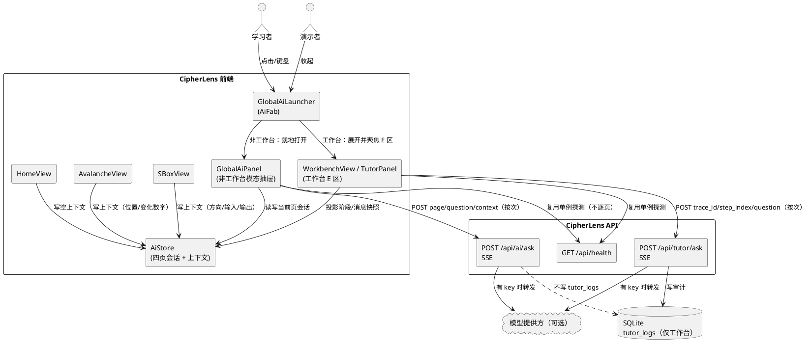
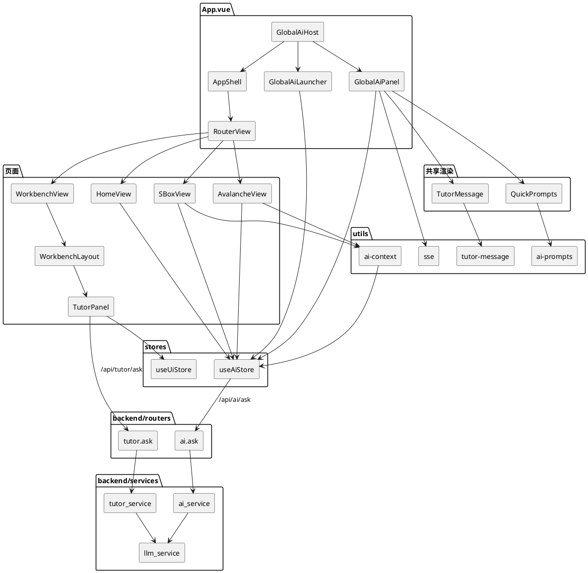
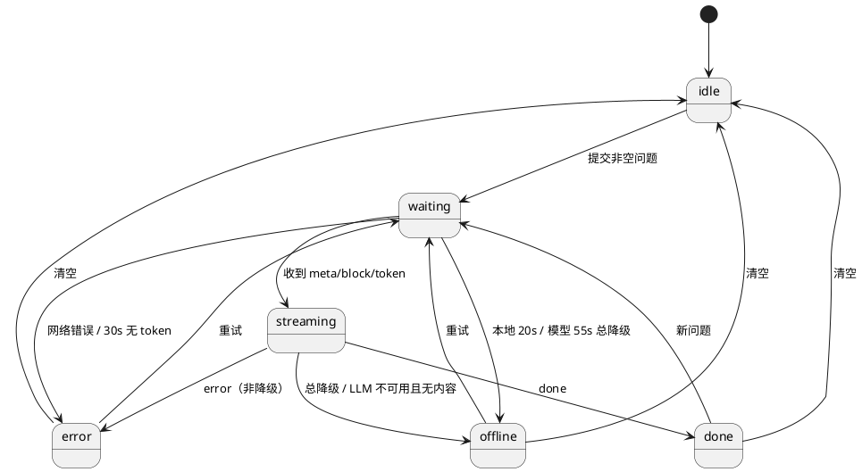
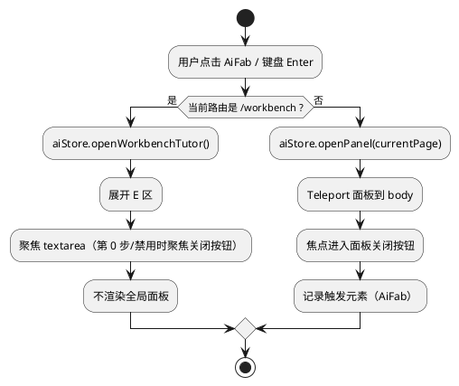
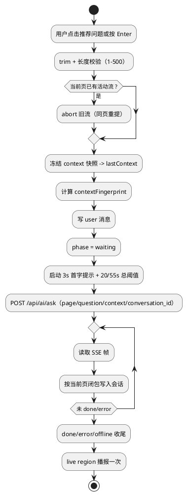
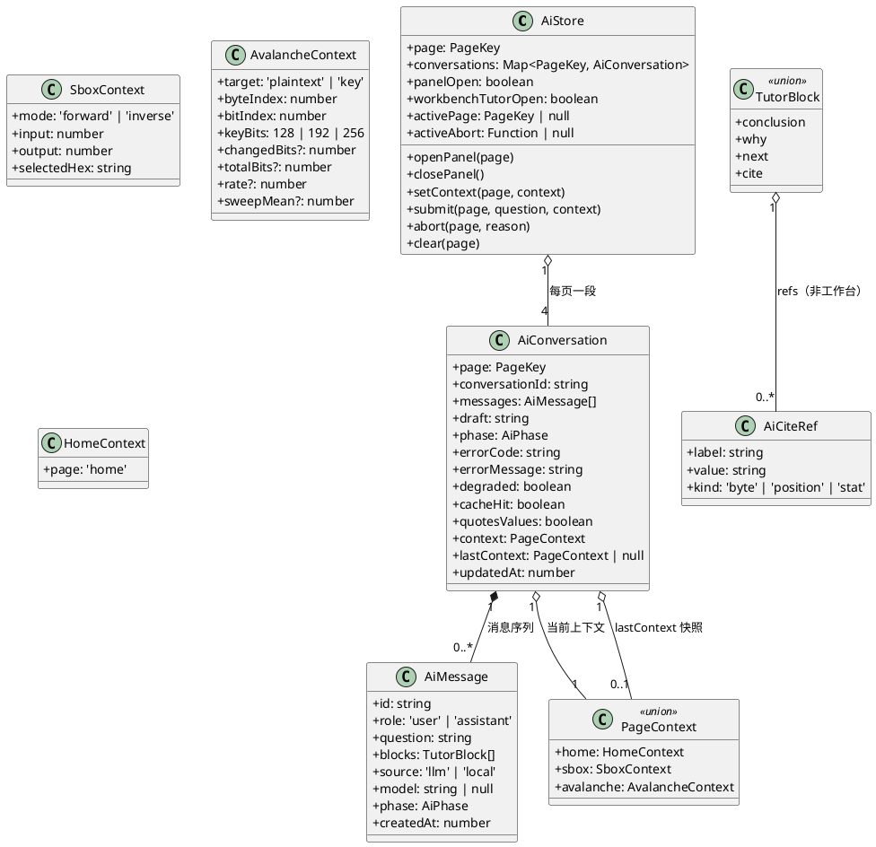
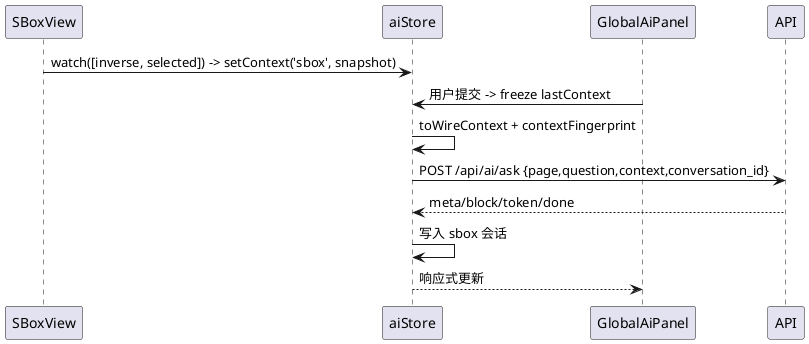
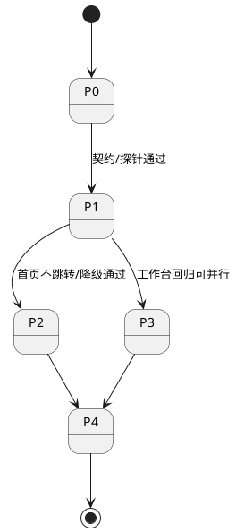

# CipherLens 全站 AI 助手（每页独立对话）· 技术设计

> 文档编号：CL-GAI-DESIGN-v1.0
> 状态：**设计评审中，未进入实现**
> 日期：2026-11-22
> 上游输入：`docs/specs/global-ai-assistant-v1/requirements.md`（D-G1–D-G11）、`.codeartsdoer/specs/global_ai_assistant_v1/spec.md`
> 基线：F0–F24、B1–B3 已验收；`evidence/acceptance/` 原文不得删改
> 本文件只回答「怎么实现」，不修改业务源码、不提交、不写 tasks.md

---

## 一、需求与存量功能关系分析

### 1.1 需求功能与存量功能对比

#### 1.1.1 已实现功能

下表只列与本需求直接相关、可在现状基线上复用的能力。匹配度按「需求语义是否已被现有实现覆盖」判定。

| 需求功能 | 存量功能 | 代码位置 | 匹配度 |
|---|---|---|---|
| 全站存在一个可点击的 AI 入口 | `AppShell` 渲染 `AiFab`，四栏目（非工作台）可见 | `frontend/src/components/layout/AppShell.vue:38`、`frontend/src/components/shared/AiFab.vue:2-11` | 100% |
| 工作台当前步讲解与 11 态 | `TutorPanel` 完整实现 waiting/slow/streaming/done/cache/generic/offline/error/interrupted/collapsed 与 idle | `frontend/src/components/region-e/TutorPanel.vue:141-153、202-229、336-359、403-493` | 100% |
| 3s 首字提示、20s 本地 / 55s 配置模型总降级 | `armTimers()` 按健康状态选择总阈值；`slowHint` 在 3s 出现 | `TutorPanel.vue:336-359`；口径见 `evidence/acceptance/F17.md` §1、§6 | 100% |
| 缓存命中整块直出 | `meta.cache=true` 直接进入 `cache` 态，block 逐块发送、不走打字机 | `TutorPanel.vue:431-443、458-467`；`backend/routers/tutor.py:97-115` | 100% |
| 四块结构化回答与引用 chip | conclusion/why/next/cite 四类块；cite 可点开字节抽屉 | `frontend/src/utils/tutor-message.ts:9-56、62-93`、`frontend/src/components/region-e/TutorMessage.vue:9-57` | 100% |
| 来源徽标（AI / 本地）与模型名 | `TutorMessage` 根据 `source`、`model` 渲染 | `TutorMessage.vue:77-86`；`TutorPanel.vue:430-436` | 100% |
| SSE 事件协议与前端分派 | `meta / block / token / done / error` 五类事件；按调用方隔离控制器 | `frontend/src/utils/sse.ts:1-10、42-103`、`frontend/src/composables/useSSE.ts:23-137` | 100% |
| 30s 无 token 超时且只报一次 | `armTokenTimeout()` + `timedOut` 防重复；block/token 都重置计时 | `useSSE.ts:76-108` | 100% |
| 后端能力探测单例 | `/api/health` 只报 `llm.enabled/model`；模块级单例、3s 超时、失败按本地 | `frontend/src/composables/useHealth.ts:22-65`、`backend/routers/health.py:16-22` | 100% |
| 工作台当前步上下文 | `trace_id/step_index/step_label/op/before/after/changed` 已由 View 传入 Panel | `frontend/src/views/WorkbenchView.vue:242-600`、`WorkbenchLayout.vue:135-149` | 100% |
| 工作台提问接口与本地模板 | `/api/tutor/ask` 校验 trace/step；`build_local_blocks()` 按当前步生成四块 | `backend/routers/tutor.py:61-266`、`backend/services/tutor_service.py:168-255` | 100% |
| 工作台审计 | 每次 tutor 调用写 `tutor_logs`，写失败不影响回答 | `backend/services/tutor_log.py:16-52`、`backend/db.py:98-110` | 100% |
| 模型不可用自动降级 | 未配置 key 直接本地；LLM 首字前失败重试一次；已有内容时保留部分 | `backend/services/llm_service.py:33-80、345-387`、`backend/routers/tutor.py:133-237` | 100% |
| 抽屉无障碍范式 | `role=dialog`、`aria-modal`、焦点陷阱、Esc、焦点归还 | `frontend/src/components/shared/AppDrawer.vue:90-135` | 100% |
| 快捷键拦截范式 | `blocked()` 只吞非 Esc 键；可编辑元素聚焦时除 Esc 外全部让位 | `frontend/src/composables/useHotkeys.ts:34-53` | 100% |
| 匿名客户端标识 | `client_id` 持久化、仅用于归类 | `frontend/src/utils/clientId.ts:16-31` | 100% |
| S 盒当前方向与选中字节 | `inverse`、`selected`、`values`、输出计算均已存在 | `frontend/src/views/SBoxView.vue:111-186`、`SBoxDetail.vue:157` | 100%（数据可用，尚未接 AI） |
| 雪崩当前参数与结果 | target/byteIndex/bitIndex/keyBits 与 result 全字段已在前端 | `frontend/src/views/AvalancheView.vue:258-474` | 100%（数据可用，尚未接 AI） |
| 首页概念文案 | AES 是什么、16 字节分组、密钥关系均已有静态文案 | `frontend/src/views/HomeView.vue:34-45` | 100%（可作为本地模板语料） |

#### 1.1.2 需要扩展的功能

| 需求功能 | 存量功能 | 差异说明 | 扩展方向 |
|---|---|---|---|
| 点击入口不跳转 | `AppShell.openAi()` 执行 `router.push('/workbench?ai=1')` | 输入是「点击」；输出从「路由跳转」改为「就地打开面板 / 展开 E 区」；边界是工作台 bare 路由没有 `AiFab` | 移除 `openAi()` 的 `router.push`；把入口提升到 `App.vue` 全局宿主；按 `route.name` 分派到全局面板或工作台 E 区 |
| 四栏目独立会话 | 工作台 `TutorPanel` 内部 `ref`；非工作台无会话 | 现有状态只覆盖工作台且随组件卸载消失；非工作台没有消息、阶段、错误容器 | 新增 `stores/ai.ts` 按 `PageKey` 维护会话；工作台阶段仍由 `TutorPanel` 11 态唯一驱动，store 只做投影与消息快照 |
| 工作台入口统一 | E 区收起时右上 44px 按钮；`AiFab` 右下 44px | 两个入口、两种位置；工作台 bare 不渲染 `AiFab` | 保留 E 区；工作台收起态入口由全局 `AiFab` 承担，展开态由 E 区头部关闭按钮承担；避免双入口 |
| 消息渲染复用 | `TutorMessage` 只认 `cite.bytes`（0–15 字节格） | 非工作台引用是 `0x53 → 0xED`、`第 3 字节 · 62/128 位`，不是矩阵格下标 | 扩展 `TutorBlock` 的 cite 为 `bytes? + refs?`；`TutorMessage` 增加只读 refs 分支；工作台 bytes 分支不变 |
| 推荐问题随页面/上下文变化 | `QuickAsk` 按工作台 `op/stepAfter` 生成问题 | 非工作台没有 `op`、`stepAfter` | 新增 `data/ai-prompts.ts`，按 `PageKey + 上下文` 生成 3 条序号化问题；`QuickAsk` 的样式与序号结构可复用 |
| 页面上下文注入 | 工作台已有完整上下文；`TutorRequest.client` 预留但后端未读取 | 非工作台没有 trace/step；现有 `extra="forbid"` 会拒绝新字段 | 新增 `AiAskRequest` 与 `sanitize_context()`；工作台请求字段与语义不变 |
| 通用问答本地模板 | `build_local_blocks()` 只接受 trace + step_index | 非工作台没有 trace/step；需要首页概念、S 盒查表、雪崩结论三类模板 | 新增 `services/ai_service.py`；工作台模板与函数不动 |
| 通用缓存键 | `cache_key(trace_id, step_index, question)` | 不含 page/context，跨页同问题会串答案 | 新增 `ai_cache_key(page, context_fingerprint, normalized_question)`；工作台旧键语义不变 |
| 通用 LLM 提示词与审计 | `llm_service.build_messages()` 只描述当前步；`allowed_hex()` 依赖 trace | 通用页没有 before/after，不能沿用「允许字节集合」 | 新增 `build_general_messages()` / `stream_general_answer()`；按 context 白名单生成允许值集，审计只记账 |
| 非工作台阶段命名 | `TutorPanel` 11 态 | 需求要求四页共用命名；但非工作台没有 slow/cache/generic/interrupted/collapsed 的完整语义 | 非工作台只定义 6 态：idle/waiting/streaming/done/error/offline；工作台继续用 11 态，store 只做投影 |
| 页面上下文采集 | S 盒/雪崩有数据但未写入任何共享状态 | 需要「当前页实时上下文」与「最近一次请求快照」分离 | SBoxView/AvalancheView/HomeView `watch` 后写 `aiStore.setContext(page, snapshot)`；提交时冻结为 `lastContext` |
| 页面动作 | 工作台有 `goto-step/open-sbox` 动作，且 `openInSBox` 直接 `router.push` | 非工作台没有动作协议；直接自动跳转违反 D-G8 | 扩展 `TutorAction.kind`；所有动作必须是用户显式点击；页内动作只改本地选中，不改变 URL |
| 无障碍宿主 | `AppDrawer` 已有完整焦点陷阱 | 新面板若直接写在 `AppShell` 内会受 stacking context/overflow 影响 | 新增 `GlobalAiPanel`，`Teleport to body`；复用 `AppDrawer` 的焦点陷阱逻辑（抽 composable，不改 AppDrawer 行为） |

#### 1.1.3 需要新增的功能或接口

**A. 会话与入口层（前端）**

| 功能点 | 输入 | 输出 | 核心逻辑 | 依赖 |
|---|---|---|---|---|
| `useAiStore` | 页面 key、问题、上下文快照、SSE 事件 | 每页会话、阶段、错误、降级标识、会话标识 | 按 `PageKey` 隔离写入；切页只中止活动流；刷新由 Pinia 内存自然清空 | Pinia、`useSSE` |
| `GlobalAiLauncher`（AiFab） | 点击 / 键盘 Enter | 打开全局面板或展开工作台 E 区 | 读取 `route.name` 分派；工作台 E 区展开时隐藏 | `vue-router`、`aiStore` |
| `GlobalAiPanel` | 当前页会话、上下文、推荐问题 | 模态抽屉、消息列表、输入区 | `Teleport body`；焦点陷阱；Esc；live region；移动端全宽 | `aiStore`、`TutorMessage`、`QuickPrompts` |
| `GlobalAiMessage` | `AiMessage` | 用户问题行 + 助手四块 | 复用 `TutorMessage`；历史只读 | `TutorMessage` |
| `useDialogFocusTrap` | 面板 ref、open | 焦点进入、Tab 循环、关闭归还 | 从 `AppDrawer` 抽出的通用逻辑；不改 `AppDrawer` 调用方 | 无新增依赖 |

**B. 上下文层（前端）**

| 功能点 | 输入 | 输出 | 核心逻辑 | 依赖 |
|---|---|---|---|---|
| `ai-context.ts` | 页面原始状态 | 白名单 `PageContext` | 只挑白名单字段；数值范围钳位/丢弃；不传明文密钥 | SBox/Avalanche 页面状态 |
| `contextFingerprint()` | `PageContext` | 稳定字符串 | 固定字段顺序 + NFKC + 紧凑 JSON + SHA-256 前 16 位；不含 client/session | Web Crypto 或纯 JS 稳定哈希 |
| `ai-prompts.ts` | `PageKey`、`PageContext` | 3 条序号化问题 | 首页概念、S 盒当前字节、雪崩当前结果/无结果提示 | 无 |

**C. 后端层**

| 功能点 | 输入 | 输出 | 核心逻辑 | 依赖 |
|---|---|---|---|---|
| `AiAskRequest` | `page/question/context/conversation_id/client_id` | 校验后的请求 | `page` 枚举；`question` 1–500 且非空白；未知顶层字段忽略 | Pydantic |
| `sanitize_context()` | 原始 dict、page | 规范化上下文 + missing 列表 | 白名单字段、类型/范围校验；非法字段丢弃而非 500 | 无 |
| `POST /api/ai/ask` | 请求 | SSE `meta/block/token/done/error` | 与 tutor 相同事件协议；不要求 trace_id | FastAPI `StreamingResponse` |
| `services/ai_service.py` | page/context/question | 四块本地模板、缓存、事件迭代器 | 页面级模板；LRU 缓存；整块直发 | `glossary`、`sbox` 数据（后端可复算或使用常量表） |
| `llm_service.stream_general_answer()` | 通用 messages、允许值集 | block/token 事件 + audit | 复用 `BlockAssembler`；提示词只允许引用 context 值 | `httpx`（已有） |
| 结构化日志 | page/source/cache/context_valid/qlen/qhash | 一行日志 | 不打印问题全文、不打印 context 值、不打印 key | `logging` |

**D. 测试与证据层**

| 功能点 | 输入 | 输出 | 核心逻辑 | 依赖 |
|---|---|---|---|---|
| `stores/ai.spec.ts` | 模拟提交/切页 | 隔离、中止、清空断言 | 纯 store 单测 | Vitest |
| `utils/ai-context.spec.ts` | 页面快照 | 序列化/指纹断言 | 白名单与稳定性 | Vitest |
| `utils/ai-message.spec.ts` | SSE 事件序列 | 块拼装断言 | 复用现有事件拼装函数 | Vitest |
| `backend/tools/ai_probe.py` | HTTP 请求 | 本地/缓存/白名单/非法参数报告 | 不新增测试框架 | 标准库 `http.client` |
| `frontend/e2e/global-ai.spec.ts` | 浏览器 | 不跳转/会话隔离/E 区回归/Esc 焦点 | Playwright（临时安装，不入依赖） | 现有 Playwright 配置 |

### 1.2 存量功能详细分析

#### 1.2.1 `AppShell` 与 `AiFab`

- **接口契约**：`AiFab` 只暴露 `open` 事件；固定 `right/bottom: var(--sp-4)`、44×44、`z-index: 40`、`aria-label="打开 AI 答疑小助手"`（`AiFab.vue:2-11、18-40`）。`AppShell` 在 `shell__main` 之后渲染它（`AppShell.vue:34-39`）。
- **业务规则**：`AppShell` 只包裹非 `bare` 路由（`App.vue:3-8`）。工作台 `meta.bare=true`（`router/index.ts:7-11`），因此工作台没有 `AiFab`。
- **扩展点**：`AiFab` 的 `open` 事件是唯一耦合点；改为调用 `aiStore`/路由分派即可，不需要改按钮内部结构。
- **约束**：入口必须 44×44（需求 A2/A18）；`z-index: 40` 与 `AppDrawer` 的 30、帮助浮层的 40 同级，全局面板必须高于它们（设计取 60/55）；移动端右下 `--sp-3`。

#### 1.2.2 工作台 E 区与 `TutorPanel`

- **接口契约**：`TutorPanel` props 为 `traceId/stepIndex/stepLabel/op/stepBefore/stepAfter/changed/askDisabled/disabledReason/minimal`；emits 为 `cite/goto/sbox`（`TutorPanel.vue:154-172`）。`WorkbenchLayout` 在 `minimal` 模式下传入当前步数据（`WorkbenchLayout.vue:135-149`）。
- **业务规则**：
  - 第 0 步禁用提问（`TutorPanel.vue:205-211`）；`askDisabled` 由 `consistency !== 'ok'` 驱动（`WorkbenchView.vue:174-180`）。
  - `busy` 只在 waiting/slow/streaming，或 `(generic|cache) && !finished` 时为真（`TutorPanel.vue:218-229`）。
  - 3s 首字提示；总阈值本地 20s、配置模型 55s（`TutorPanel.vue:336-359`）。
  - 缓存命中 `meta.cache=true` 直接 `cache` 态；`quotes_values=false` 直接 `generic` 态（`TutorPanel.vue:431-443`）。
  - `stepIndex` 变化时中止当前流并把已有回答折叠（`TutorPanel.vue:566-582`）。
  - 组件卸载时 `abort()` 并清空通道（`TutorPanel.vue:594-599`）。
- **扩展点**：`minimal` 只隐藏头部/提示，保留消息与输入；emits 可承载页面动作；`useSSE` 可按调用方隔离。
- **约束**：11 态命名、3s/20s/55s 优先级、缓存直出、MORE、cite chip、`goto-step`/`open-sbox` 动作不得改动。工作台会话必须仍是「同一栏目一段会话」，不能因为 store 引入第二套消息源。

#### 1.2.3 后端 `/api/tutor/ask` 与本地模板

- **接口契约**：`TutorRequest` 为 `extra="forbid"`，`trace_id` 非空、`step_index >= 0`、`question` 1–500（`schemas.py:40-46`）。响应是 SSE：`meta → block/token × N → done`，异常 `error`（`tutor.py:61-266`）。
- **业务规则**：
  - `trace_not_found`、`step_out_of_range` 在流内以 `error` 帧返回。
  - 缓存键 `(trace_id, step_index, question.strip())`；只缓存本地模板，不缓存 LLM（`tutor_service.py:32-47`、`tutor.py:199-203`）。
  - LLM deadline 45s、本地 deadline 20s；超时发 `done.finish=timeout`；LLM 失败且无内容时用本地模板顶上；已有内容时保留部分并发 `error.llm_unavailable`（`tutor.py:35-38、133-237`）。
  - 每次调用写 `tutor_logs`（`tutor.py:106-114、209-253`）；`trace_id` 为 `NOT NULL`（`db.py:98-110`）。
- **扩展点**：`sse()`、`iter_block_events()`、`BlockAssembler`、`LLMUnavailable` 可复用；但 `build_local_blocks()` 与 `cache_key()` 绑定 trace/step，不能直接用于通用页。
- **约束**：工作台旧请求（仅三字段）行为完全不变；不得修改 `TutorRequest` 的 `extra="forbid"`；不得复用 `tutor_logs` 写通用页。

#### 1.2.4 SSE 与健康探测

- **接口契约**：`useSSE.start(url, payload, handlers, options)` 每次启动先 `abort()` 自己的旧控制器；每个调用方一个实例；30s token 超时；`onBlock/onToken` 重置计时（`useSSE.ts:41-137`）。`consumeSSE` 只解析命名事件（`sse.ts:42-103`）。
- **业务规则**：`useHealth` 是模块级单例，四栏目共享一次 `/api/health`；失败按本地处理，不阻塞渲染（`useHealth.ts:22-65`）。
- **扩展点**：全局面板可直接复用 `useSSE`；但 per-page 中止需要 store 持有当前页的 `abort` 引用。
- **约束**：不得为每页单独探测；不得改变 30s 超时语义；不得新增 EventSource（现有 fetch + ReadableStream 已满足 F24 不缓冲）。

#### 1.2.5 无障碍与快捷键

- **接口契约**：`AppDrawer` 在打开后聚焦关闭按钮；`focusables()` 收集可交互元素；Tab/Shift+Tab 循环；Esc `preventDefault + stopPropagation` 后 `emit('close')`（`AppDrawer.vue:90-135`）。
- **业务规则**：`useHotkeys` 在 `event.defaultPrevented` 时让位；Esc 永远先交给 `onEscape`；`blocked()` 只吞非 Esc；输入框/文本域/下拉/contenteditable 聚焦时除 Esc 外全部失效（`useHotkeys.ts:34-53`）。工作台 `onEscape` 有严格优先级：引导 > 小结 > 帮助 > 密钥抽屉 > 字节抽屉 > AI 生成 > 批注 > 演示 > 播放（`WorkbenchView.vue:839-874`）。
- **扩展点**：全局面板的焦点陷阱可复用 `AppDrawer` 的结构；`useHotkeys.blocked` 不需要为全局面板扩展，因为全局面板只出现在非工作台页面（这些页面没有 `useHotkeys`）。
- **约束**：面板打开时 Esc 只关面板；不得抢页面 Space/→；关闭后焦点必须回到触发入口；live region 只在完成/错误/降级时各播报一次。

#### 1.2.6 S 盒与雪崩页面数据

- **S 盒**：`inverse`、`selected`、`values`、`output` 已在 View 内；`SBoxGrid` 的 `cell.input` 是表格键、`cell.output` 是格子印出的值（`SBoxGrid.vue:73-94`）；`SBoxDetail` 的 `output = inverse ? INV_SBOX[value] : SBOX[value]`（`SBoxDetail.vue:157`）。切换方向时保持同一对字节（`SBoxView.vue:168-176`）。URL `?b=` 可定位（`SBoxView.vue:178-186`）。
- **雪崩**：`result` 含 `target/byte_index/bit_index/key_bits/input_byte_before/after/changed_bits/changed_bytes/total_bits/rate`；`sweep` 含 `mean/min_bits/max_bits`（`AvalancheView.vue:258-300`）。输入变化 220ms 防抖后自动重算；无结果时 `result=null`（`AvalancheView.vue:433-452`）。
- **约束**：不改 S 盒格子几何、缩放、选中逻辑；不改雪崩位图与色阶；AI 上下文只读这些状态，不反过来驱动页面（D-G10 不做页面动作）。

---

## 二、增量设计方案

### 2.1 实现模型

#### 2.1.1 上下文视图



**调用频率与协议**

| 链路 | 协议 | 频率 | 说明 |
|---|---|---|---|
| Launcher → Panel | 组件事件 | 每次点击 | 不产生网络请求 |
| Panel → `/api/ai/ask` | POST + SSE | 每次提交 | 同一页同一时刻最多 1 条流 |
| TutorPanel → `/api/tutor/ask` | POST + SSE | 每次提交 | 与现状一致 |
| `/api/health` | GET JSON | 模块单例，一次 | 四页共享；不因切页增加 |
| API → LLM | HTTPS SSE | 有 key 时 | 通用页与工作台各自独立请求 |
| `/api/ai/ask` → SQLite | — | 不写 | D-G7=A |

#### 2.1.2 服务/组件总体架构



**组件归属与职责**

| 组件/模块 | 归属 | 职责 | 不负责 |
|---|---|---|---|
| `App.vue` | 根组件 | 渲染 `GlobalAiHost`（Launcher + Panel Teleport）、`AppShell` / bare `RouterView` | 不持有页面业务状态 |
| `AppShell.vue` | 布局 | 顶栏、导航、移动端菜单 | 不再渲染 `AiFab`；不再执行 `router.push` |
| `GlobalAiLauncher.vue`（由 `AiFab.vue` 演进） | 全局 | 四栏目常驻入口；按路由分派打开行为 | 不直接发请求 |
| `GlobalAiPanel.vue` | 全局 | 模态抽屉、消息、推荐问题、输入、错误/降级、live region | 不解析 SSE 字节流（交给 store/`useSSE`） |
| `stores/ai.ts` | 全局 | 每页会话、上下文、阶段、错误、活动流、会话标识 | 不渲染；不替代工作台 11 态 |
| `WorkbenchLayout.vue` | 工作台 | 五区布局；E 区容器；收起态入口协调 | 不弹全局面板 |
| `TutorPanel.vue` | 工作台 | 11 态、F17 计时、缓存直出、MORE、chip、动作 | 不改行为 |
| `TutorMessage.vue` | 共享 | 四块渲染、来源徽标、流式光标、cite bytes/refs | 不决定文案 |
| `QuickPrompts.vue` | 共享 | 序号化推荐问题（由 `QuickAsk` 演进或复用样式） | 不自动发送（点击才发） |
| `ai-context.ts` | 前端工具 | 页面状态 → 白名单上下文；指纹 | 不请求 |
| `ai_service.py` | 后端 | 通用本地模板、缓存、事件迭代 | 不写 `tutor_logs` |
| `routers/ai.py` | 后端 | 校验、SSE 响应、降级编排 | 不改工作台路由 |

**配置项与取值策略**

| 配置 | 取值 | 说明 |
|---|---|---|
| 全局面板宽度 | `min(420px, 100vw)`；≤700px 为 `100vw` | 桌面 420，移动端全宽 |
| 面板顶部 | 桌面 `var(--nav-h)`；≤700px `0` | 移动端全屏 |
| 遮罩 | `oklch(0.255 0.0180 258 / 0.34)`（复用 `--scrim-tour` 量级） | 模态；不引入新色板 |
| z-index | 遮罩 55、面板 60、Launcher 40 | 高于 AppDrawer 30 / 帮助 40 |
| 总降级 | 本地 20s、配置模型 55s | 沿用 F17 |
| SSE token 超时 | 30s | 沿用 `useSSE` |
| 缓存容量 | 128 条 LRU | 与 `MAX_CACHE` 一致 |
| 问题长度 | 1–500 字 | 前后端一致 |
| 上下文指纹 | SHA-256 前 16 位十六进制 | 稳定、短、不可逆 |

#### 2.1.3 实现设计文档

**A. 非工作台状态机（6 态）**



| 迁移 | 触发条件 | 处理策略 |
|---|---|---|
| idle → waiting | 提交非空问题 | 冻结 `lastContext`；写 user 消息；启动 3s/总阈值计时 |
| waiting → streaming | 首个 meta/block/token | 清首字计时；显示流式光标 |
| waiting/streaming → done | `done` 事件 | 停止光标；写 assistant 消息；live region 播报一次 |
| waiting/streaming → error | `error` 事件或网络错误 | 写 `errorCode/errorMessage`；保留问题；可重试 |
| waiting/streaming → offline | 20s/55s 总阈值或 `llm_unavailable` 无内容 | 写本地模板块；标 `degraded=true`；来源本地 |
| 任意 → waiting | 重试 | 复用同一问题；重新冻结上下文；不重写历史 user 消息（避免重复） |
| 任意 → idle | 清空当前对话 | 中止活动流；清 messages/draft/error/context 快照；保留 conversationId? 设计为重新生成 |
| 切页 | 离开当前页且流未完成 | `abort()`；该页 phase=error，`errorCode='interrupted'`，文案「上次生成已中断，可重试」 |

> 设计要点：非工作台不引入 `slow/cache/generic/interrupted/collapsed` 五个工作台阶段。3s 首字提示只改 `waiting` 的辅助文案；缓存命中仍归 `done`，用 `meta.cache` 标记展示「缓存命中」；无上下文仍归 `done`，用 `meta.quotes_values=false` 展示「通用讲解」。这样阶段名不与 F17 冲突。

**B. 工作台 11 态映射（只读投影）**

| TutorPanel 11 态 | store 投影阶段 | 用途 |
|---|---|---|
| idle | idle | 会话快照 |
| waiting | waiting | 会话快照 |
| slow | waiting | 会话快照（`slowHint` 由 TutorPanel 自己展示） |
| streaming | streaming | 会话快照 |
| done | done | 会话快照 |
| cache | done | 会话快照（`meta.cache` 标记） |
| generic | done | 会话快照（`meta.quotes_values=false` 标记） |
| offline | offline | 会话快照 |
| error | error | 会话快照 |
| interrupted | error | 会话快照（`errorCode='interrupted'`） |
| collapsed | done | 会话快照（`collapsed` 标记） |

**单一事实源规则**：工作台阶段、消息块、计时器、SSE 控制器仍由 `TutorPanel` 持有；`TutorPanel` 在每次阶段/消息变化时通过 `emit('snapshot', …)` 或 `aiStore.syncWorkbench(...)` 写入 store。store 不回写 `TutorPanel`。这样 F17 的 11 态与缓存逻辑零改动。

**C. 打开入口流程**



**D. 提交流程**



**E. 关闭与切页流程**

| 场景 | 行为 |
|---|---|
| 关闭面板 | 不中止当前页生成（会话仍在内存）；焦点归还 `AiFab`；live region 保留 |
| 切页（非工作台 → 非工作台/工作台） | 若离开页有活动流：`abort()`，该页 `phase=error`、`errorCode='interrupted'`；不把 token 写入目标页 |
| 刷新 | Pinia 内存清空；`client_id` 不变；入口仍在 |
| 清空当前对话 | 中止当前页流；清 messages/draft/error/degraded/lastContext；重新生成 `conversationId` |
| 工作台切步 | 沿用 `TutorPanel` 的 `watch(stepIndex)`：中止并折叠；store 同步投影 |

**F. 页面动作流程**

- 回答中的动作只以按钮形式出现；`TutorAction.kind` 扩展为：
  - `goto-step`：仅工作台；点击后 `playback.setStep`，不自动播放。
  - `open-sbox`：仅工作台；点击后 `router.push('/sbox?b=...&from=workbench')`（用户手势，允许）。
  - `open-workbench`：首页；点击后 `router.push('/workbench?step=...')`（用户手势）。
  - `focus-sbox-byte`：S 盒页内；点击后设置 `selected`，不改变 URL。
  - `focus-avalanche-byte`：雪崩页内；点击后设置 `byteIndex`，不改变 URL。
- 任何动作都不得在 `onDone` 中自动执行；`onDone` 只写消息与播报。

### 2.2 接口设计

#### 2.2.1 总体设计

| 接口 | 方法 | 稳定性 | 用途 | 变更策略 |
|---|---|---|---|---|
| `/api/ai/ask` | POST | 实验（v1） | 非工作台通用问答 SSE | 新增；字段只增不改；未知字段忽略 |
| `/api/tutor/ask` | POST | 稳定 | 工作台当前步问答 SSE | 不变；不新增必填字段 |
| `/api/health` | GET | 稳定 | 模型能力探测 | 不变；不回显 key/base_url |
| `useAiStore` | 前端 API | 实验 | 四页会话与上下文 | 内部 API；类型导出 |
| `GlobalAiLauncher` | 组件 API | 实验 | 入口 | props/emits 稳定 |
| `GlobalAiPanel` | 组件 API | 实验 | 面板 | props/emits 稳定 |

**接口分类依据**：按「是否需要 trace」分两条链路。工作台保留 `/api/tutor/ask`（C1 兼容），非工作台走 `/api/ai/ask`（D-G3=A）。两条链路共用 `meta/block/token/done/error` 事件语义与 `llm_service` 降级链。

#### 2.2.2 接口清单

##### 1）`POST /api/ai/ask`（新增）

**接口签名**

```text
POST /api/ai/ask
Content-Type: application/json
Accept: text/event-stream

{
  "page": "home" | "sbox" | "avalanche",
  "question": string,              // 1–500，trim 后非空
  "context": object,               // 按 page 白名单；可为空对象
  "conversation_id": string,       // 非空；仅用于区分对话
  "client_id": string | null       // 可空；仅用于归类
}
```

> 工作台不调用此接口；`page=workbench` 不属于本接口白名单（返回 400 `page_invalid`）。这样避免两条链路语义重叠。

**业务说明**：非工作台三页的就地问答。后端按 `page` 选择本地模板与提示词；有 key 时转发模型，无 key 或模型不可用时降级本地模板。

**前置条件**：`page` 必须是 `home/sbox/avalanche`；`question` trim 后 1–500 字；`context` 只允许白名单字段。`conversation_id` 非空；`client_id` 可空。

**后置条件**：不改变服务端持久化状态；不写 `tutor_logs`；仅可能写一条结构化日志（不含问题全文/上下文值/key）。本地模板结果可进入进程内 LRU 缓存。

**异常映射**

| 场景 | HTTP / 事件 | 错误码 | 前端表现 |
|---|---|---|---|
| `page` 非法/缺失 | 400 JSON | `validation_error` | 面板错误态「页面标识不合法」 |
| `question` 为空 | 400 JSON | `validation_error` | 输入区提示，不建消息 |
| `question` >500 | 400 JSON | `validation_error` | 输入区提示「最多 500 字」 |
| `conversation_id` 为空 | 400 JSON | `validation_error` | 内部错误，重试 |
| 上下文未知字段 | 200 SSE | — | 忽略；`meta.context_ignored` 列出字段名（可选） |
| 上下文必填缺失 | 200 SSE | — | `meta.quotes_values=false`；回答走无上下文模式 |
| 模型不可用且无内容 | 200 SSE | `llm_unavailable` | 本地模板 + `degraded=true` |
| 模型中途断开 | 200 SSE | `llm_unavailable` + `partial=true` | 保留部分内容，标「回答不完整」 |
| 30s 无 token | SSE 结束 | `timeout` | 错误态，可重试 |
| 后端不可达 | 网络错误 | `network_error` | 本地页面级兜底（前端模板） |

**调用示例（事件序列）**

```text
event: meta
data: {"page":"sbox","source":"local","quotes_values":true,"cache":false,"conversation_id":"conv_sbox_...","model":null,"context_valid":true,"context_missing":[],"structured":true}

event: block
data: {"type":"conclusion","text":""}

event: token
data: {"t":"S 盒","text":"S 盒"}

event: block
data: {"type":"why","items":[]}

event: token
data: {"t":"0x53","text":"0x53","item":true}

event: block
data: {"type":"next","text":""}

event: token
data: {"t":"可以切到逆向表验证","text":"可以切到逆向表验证"}

event: block
data: {"type":"cite","refs":[{"label":"输入","value":"0x53"},{"label":"输出","value":"0xED"}],"total":2}

event: done
data: {"finish":"stop","tokens":12,"elapsed_ms":180,"degraded":false}
```

**请求字段约束**

| 字段 | 类型 | 必填 | 约束 | 未知字段 |
|---|---|---|---|---|
| `page` | enum | 是 | `home/sbox/avalanche` | 顶层未知字段忽略 |
| `question` | string | 是 | trim 后 1–500 | — |
| `context` | object | 否 | 按 page 白名单 | context 内未知字段忽略并记录 |
| `conversation_id` | string | 是 | 1–128 | — |
| `client_id` | string/null | 否 | 0–64 | — |

##### 2）`POST /api/tutor/ask`（不变）

- 请求仍为 `{trace_id, step_index, question}`；`TutorRequest` 的 `extra="forbid"` 不变（`schemas.py:40-46`）。
- 响应事件、缓存键、`tutor_logs`、20s/45s deadline 全部不变（`tutor.py:23-266`）。
- 本设计不新增 `page` 到该请求；工作台上下文只在前端 store 中留存用于展示，不发往后端。

##### 3）前端 store 接口（TypeScript 签名）

```ts
export type PageKey = 'home' | 'sbox' | 'avalanche' | 'workbench'
export type AiPhase = 'idle' | 'waiting' | 'streaming' | 'done' | 'error' | 'offline'

export interface AiConversation {
  page: PageKey
  conversationId: string
  messages: AiMessage[]
  draft: string
  phase: AiPhase
  errorCode: string
  errorMessage: string
  degraded: boolean
  cacheHit: boolean
  quotesValues: boolean
  context: PageContext
  lastContext: PageContext | null
  updatedAt: number
}

export interface AiMessage {
  id: string
  role: 'user' | 'assistant'
  question: string
  blocks: TutorBlock[]
  source: 'llm' | 'local'
  model: string | null
  phase: AiPhase
  createdAt: number
}

export interface AiStoreApi {
  openPanel(page: PageKey): void
  closePanel(): void
  togglePanel(page: PageKey): void
  setContext(page: PageKey, context: PageContext): void
  submit(page: PageKey, question: string, context: PageContext): Promise<void>
  abort(page: PageKey, reason: 'interrupted' | 'cleared' | 'replaced'): void
  retry(page: PageKey): Promise<void>
  clear(page: PageKey): void
  syncWorkbench(snapshot: WorkbenchSnapshot): void
}
```

##### 4）`GlobalAiPanel` 组件契约

```ts
interface GlobalAiPanelProps {
  open: boolean
  page: PageKey
  conversation: AiConversation
  prompts: readonly string[]
  contextLine: string
  reducedMotion: boolean
}

interface GlobalAiPanelEmits {
  close: []
  submit: [question: string]
  retry: []
  clear: []
  action: [action: TutorAction]
}
```

**无障碍契约**：`role="dialog"`、`aria-modal="true"`、`aria-labelledby="global-ai-title"`、`tabindex="-1"`；打开后聚焦关闭按钮；Tab/Shift+Tab 循环；Esc `preventDefault + stopPropagation`；关闭后焦点由宿主归还 `AiFab`。

### 2.3 数据模型

#### 2.3.1 设计目标

1. **四页独立**：同一时刻只有一个活动流；每页消息、阶段、错误、未提交问题互不覆盖。
2. **单轮**：历史只展示，不作为模型上下文；请求只带当前问题与当前上下文（D-G4=A）。
3. **内存态**：刷新清空；不使用 `sessionStorage/localStorage` 保存会话（D-G5=A）；`client_id` 继续用 `localStorage`。
4. **上下文最小化**：只允许白名单字段；雪崩不传完整明文/密钥（D-G6=A）；日志不打印值。
5. **缓存不串**：键含 `page + context fingerprint + normalized question`；不含 `client_id/conversation_id`。
6. **工作台零回归**：工作台消息/阶段仍由 `TutorPanel` 驱动，store 只存投影。

**与存量数据的兼容策略**：`tutor_logs` 表结构不变；`/api/tutor/ask` 请求/响应不变；`?ai=1` 仍展开 E 区；`/api/health` 字段不变；`client_id` 格式不变。

#### 2.3.2 模型实现



**对象生命周期**

| 对象 | 创建 | 销毁 | 说明 |
|---|---|---|---|
| `AiStore` | 应用启动（Pinia 单例） | 页面刷新 | 全站唯一 |
| `AiConversation` | 首次访问某页 / 刷新后首次访问 | 刷新；清空只重置内容不删除对象 | 四页各一段 |
| `conversationId` | 会话创建时 `conv_<page>_<random>` | 清空/刷新时重建 | 非空；不作为权限 |
| `AiMessage` | 提交/收到 done/offline/error | 清空当前页时移除 | 单轮一对 user/assistant |
| `PageContext` | 页面 watch 写入 | 页面数据变化时覆盖 | 实时上下文 |
| `lastContext` | 提交时冻结 | 清空/刷新 | 请求快照，用于缓存键与展示 |
| `activeAbort` | 提交时设置 | done/error/abort 时清空 | 同一时刻最多一个活动流 |

**持久化策略**：仅内存；不写 SQLite、不写 `sessionStorage/localStorage`。`client_id` 沿用 `localStorage`（`clientId.ts`）。工作台审计仍写 `tutor_logs`；通用页不写。

**上下文字段与序列化**

| 页面 | 字段 | 类型/范围 | 来源 | 必填 |
|---|---|---|---|---|
| home | `page` | `'home'` | 常量 | 是 |
| sbox | `page` | `'sbox'` | 常量 | 是 |
| sbox | `mode` | `'forward' \| 'inverse'` | `inverse` | 是 |
| sbox | `input` | 0–255 | `selected`（当前表键） | 是 |
| sbox | `output` | 0–255 | `SBOX[selected]` / `INV_SBOX[selected]` | 是 |
| sbox | `selected_hex` | `0xNN` | `selected` | 否 |
| avalanche | `page` | `'avalanche'` | 常量 | 是 |
| avalanche | `target` | `'plaintext' \| 'key'` | `target` | 是 |
| avalanche | `byte_index` | 0–31 | `byteIndex` | 是 |
| avalanche | `bit_index` | 0–7 | `bitIndex`（当前固定 0） | 是 |
| avalanche | `key_bits` | 128/192/256 | `keyHex.length * 4` | 是 |
| avalanche | `changed_bits` | 0–128 | `result.changed_bits` | 否 |
| avalanche | `total_bits` | 0–128 | `result.total_bits` | 否 |
| avalanche | `rate` | 0–1 | `result.rate` | 否 |
| avalanche | `sweep_mean` | 0–128 | `sweep.mean` | 否 |
| workbench | `page/trace_id/step_index/direction` | 沿用现有 | `WorkbenchView` | 仅 store 展示 |

**序列化规则**：
1. 前端 `toWireContext(page, raw)` 只输出白名单字段，字段名使用 snake_case（与后端一致）。
2. 数值统一 `Math.trunc` + 范围校验；越界字段丢弃并记入 `context_missing`。
3. `sbox` 的 `input/output` 必须成对出现；缺一即视为无上下文。
4. `avalanche` 的 `changed_bits/total_bits/rate/sweep_mean` 必须同时存在才视为「有结论上下文」；只有位置字段时视为「未跑实验」。
5. 指纹：对 `toWireContext` 结果按固定字段顺序序列化，`JSON.stringify` 使用稳定字段顺序；再 `NFKC` 规范化问题；`SHA-256(page + '|' + contextJson + '|' + question)` 取前 16 位。
6. 不包含 `client_id`、`conversation_id`、时间戳、消息历史。
7. 雪崩不包含 `plaintext_hex/key_hex/input_byte_before/after`；S 盒不包含整张表。

**后端上下文校验**

- `sanitize_context(page, raw)` 返回 `(clean_context, missing_fields, ignored_fields)`。
- 未知字段只记录不报错（需求 6.3）；类型错误丢弃该字段并记 `missing`；不因上下文非法返回 500。
- `page=sbox` 时 `input/output` 任一缺失 → `context_valid=false`，`quotes_values=false`；回答提示「先在 S 盒选中一个字节」。
- `page=avalanche` 时 `changed_bits/total_bits/rate` 任一缺失 → `context_valid=true`（位置可用）但 `quotes_values=false`；回答提示「先跑一次实验」。
- `page=home` 永远 `quotes_values=false`，`context_valid=true`（无数据上下文是预期状态）。

**缓存键**

```text
ai_cache_key = (page, context_fingerprint, normalized_question)
context_fingerprint = sha256(stable_json(clean_context))[:16]
normalized_question = NFKC(trim(collapse_whitespace(question)))
```

- 只缓存本地模板结果（与 F17 一致）；LLM 结果不缓存。
- 容量 128，LRU；进程内，重启清空。
- 工作台 `cache_key` 保持 `(trace_id, step_index, question.strip())`，不与通用缓存共享命名空间。

---
### 2.4 全局入口与布局

#### 2.4.1 组件归属与 Teleport

| 位置 | 现状 | 设计后 |
|---|---|---|
| `App.vue` | `RouterView` 或 `AppShell` 二选一 | 增加 `<GlobalAiHost />`：渲染 `GlobalAiLauncher` + `<Teleport to="body"><GlobalAiPanel /></Teleport>`；`AppShell` / bare `RouterView` 不变 |
| `AppShell.vue` | 末尾渲染 `<AiFab @open="openAi" />`；`openAi()` 跳工作台 | 移除 `AiFab` 与 `openAi()`；只保留顶栏、导航、移动端菜单；Esc 处理增加「面板打开时不响应」 |
| `AiFab.vue` | 固定右下、只发 `open` | 演进为 `GlobalAiLauncher.vue`（或保留文件名 + 改语义）：保留 44×44/右下/z40/焦点环；增加 `aria-expanded`、`aria-controls`、动态 `aria-label`；读取 `route.name` 分派 |
| `WorkbenchLayout.vue` | E 区收起时右上 44px `AI` 按钮 | 收起态不再渲染该按钮（由全局 Launcher 承担唯一入口）；展开态保留 E 区头部 `×` 关闭按钮；`data-ai` 状态不变 |
| `GlobalAiPanel.vue` | 不存在 | 新增；`Teleport to body`；模态抽屉 + 遮罩；非工作台唯一面板 |
| `RouterView` | `App.vue` 内 | 不变；面板不在 `RouterView` 内，切页不销毁会话 |

**为什么 Teleport 到 body**：`AppShell` 的 `shell__main` 可能有页面级 `overflow` / 定位上下文；`WorkbenchLayout` 的 `[data-region="e"]` 在窄屏/演示态使用 `position: fixed`。全局面板若挂在 `AppShell` 内，会受父级 stacking context 和 `overflow-x: auto` 影响，移动端易出现横向滚动。Teleport 到 body 后，遮罩、面板、z-index 都以视口为基准，且不改变任何页面 DOM 几何（H3）。

#### 2.4.2 四页入口行为

| 页面 | 入口 | 点击/键盘行为 | 面板 | URL/history |
|---|---|---|---|---|
| `/` 首页 | 全局 AiFab 右下 44×44 | `aiStore.openPanel('home')` | 全局面板（模态抽屉） | 不变、不新增 history |
| `/sbox` S 盒 | 全局 AiFab 右下 44×44 | `aiStore.openPanel('sbox')` | 全局面板 | 不变、不新增 history |
| `/avalanche` 雪崩 | 全局 AiFab 右下 44×44 | `aiStore.openPanel('avalanche')` | 全局面板 | 不变、不新增 history |
| `/workbench` 工作台 | 全局 AiFab 右下 44×44（E 区收起时） | `aiStore.openWorkbenchTutor()`：展开 E 区并聚焦输入框 | 不弹全局面板 | 不变；`?ai=1` 仍可展开 |

**工作台单一入口的取舍**（按 D-G2=A 的「保留 E 区」前提）：

- 保留 E 区五区布局与 `TutorPanel` 的 11 态。
- 收起态：**不渲染** `WorkbenchLayout` 的右上 44px `AI` 按钮；由全局右下 `AiFab` 承担入口。这样四栏目入口形态一致（用户偏好常驻悬浮小按钮），也避免「右上 + 右下」双入口。
- 展开态：E 区头部保留 `×` 关闭按钮（`data-action="toggle-tutor"`、`aria-controls="ai-panel-body"`、`aria-expanded="true"`），并隐藏全局 `AiFab`（`workbenchTutorOpen=true`）。
- 不弹全局面板：工作台永远只有一个面板（E 区），不会出现 E 区 + 抽屉双面板、双输入框。
- `?ai=1`：沿用 `WorkbenchView.vue:186-196` 的 watch，把 `workbenchTutorOpen` 设为 true 并从 query 删除 `ai`（`router.replace`，与现状一致；这不是入口跳转，是旧链接兼容）。
- `F` 键：沿用 `onToggleAi -> toggleTutor()`；改为写 `aiStore.workbenchTutorOpen`，从而同步 Launcher 可见性。
- `A` 键：沿用 `focusAsk()`；第 0 步禁用时聚焦 E 区关闭按钮，不强行聚焦禁用 textarea。

> **与需求原文的差异**：D-G2=A 原文是「收起时的 44px 按钮即常驻入口」。本设计把这枚按钮从 E 区右上移到全局右下，功能仍属于 E 区入口。若评审要求严格保留右上按钮，则工作台隐藏全局 `AiFab`，等价 D-G2=A 原文；两种方案都满足「单一面板」，差异只在入口位置。此差异列入 §2.11 待确认。

#### 2.4.3 全局面板布局与尺寸

| 视口 | 遮罩 | 面板位置/宽度 | 圆角/边框 | 滚动 |
|---|---|---|---|---|
| ≥ 900px | 全屏半透明遮罩（`--scrim-tour` 量级） | 右侧抽屉，`top: var(--nav-h)`、`right: 0`、`bottom: 0`、`width: min(420px, 100vw)` | 左边框 1px `--line-strong`；无圆角（贴边） | 消息区 `overflow-y: auto`；输入区固定在底部 |
| 701–899px | 同上 | 右侧抽屉，宽度 `min(380px, 100vw)` | 同上 | 同上 |
| ≤ 700px（含 390×844） | 全屏遮罩 | 全宽 `100vw`，`top: 0`、`bottom: 0`；`height: 100dvh` | 无边框；底部 `env(safe-area-inset-bottom)` | 消息区滚动；输入区不遮安全区 |
| 演示态 `[data-mode="present"]` | 仅非工作台可能出现 | 全宽或 420px；不覆盖工作台 D 区（工作台不弹面板） | 同上 | 同上 |

**遮罩行为**：

- 遮罩覆盖视口，`z-index: 55`；面板 `z-index: 60`；`AiFab` 保持在 40。
- 点击遮罩关闭面板（移动端便利）；关闭按钮与 Esc 是显式关闭入口；三者语义一致，均调用 `closePanel()`。
- 遮罩使用 `oklch(0.255 0.0180 258 / 0.34)`（与 `--scrim-tour` 同量级），不引入新色板；不做 `backdrop-filter`，避免低端设备掉帧。
- 面板打开时 `document.documentElement` 不加 `overflow: hidden`？为避免页面布局跳动，设计为**加** `overflow: hidden` 并记录滚动位置，关闭时恢复；移动端同时锁定 `touch-action`。这是模态面板的标准行为，且不影响工作台（工作台不弹面板）。

**移动端 390 验收口径**：

- 面板 `width: 100vw`、`max-width: 100vw`、`box-sizing: border-box`；内部所有行使用 `min-width: 0` + `overflow-wrap: anywhere`。
- 推荐问题、引用 chip、动作按钮均 `flex-wrap: wrap`；不出现横向滚动条。
- 关闭按钮 44×44；输入框 `font-size: 16px`（避免 iOS 聚焦缩放）；发送/停止按钮最小 44×44。
- `AiFab` 在 390 下 `right: var(--sp-3)`、`bottom: var(--sp-3)`，不遮挡页面底部控件；面板打开时 `AiFab` 被遮罩覆盖，关闭后回到原位。

#### 2.4.4 焦点、Esc 与模态

| 项 | 设计 |
|---|---|
| 初始焦点 | 打开后聚焦关闭按钮（与 `AppDrawer` 一致）；若有未提交草稿，聚焦 textarea |
| 焦点陷阱 | `useDialogFocusTrap(panelRef, open)`：收集 `button, [href], input, select, textarea, [tabindex]:not([tabindex="-1"])`，过滤 disabled；Tab 末项回到首项，Shift+Tab 首项回到末项 |
| 关闭归还 | `GlobalAiHost` 记录触发元素（`AiFab` 或页面内显式按钮）；`closePanel()` 后 `nextTick` 聚焦该元素；若元素不存在，回退到 `AiFab` |
| Esc | 面板 `keydown` 捕获 Esc：`preventDefault + stopPropagation`，调用 `closePanel()`；`AppShell` 的 window `keydown` 在 `aiStore.panelOpen` 时直接 return，避免同一次 Esc 又关移动端菜单 |
| 页面快捷键 | 非工作台页面没有 `useHotkeys`；`AppShell` 菜单的 Esc 被面板拦截；Space/→ 不会触发工作台播放（工作台不弹面板）。工作台 E 区展开时不阻止 Space/→（它不是模态，F17 要求播放/步进可用） |
| 关闭时生成中 | 不中止生成（会话仍在内存）；面板可再次打开继续看流；切页/清空/重提才中止 |
| 滚动锁定 | 打开时记录 `document.body.style.overflow`，设为 `hidden`；关闭恢复；不改变页面宽度（用 `scrollbar-gutter: stable` 或记录 `padding-right`，避免布局跳动） |

#### 2.4.5 双面板/双输入框防护

- `aiStore.panelOpen` 与 `aiStore.workbenchTutorOpen` 互斥：`openPanel(page)` 只在 `page !== 'workbench'` 时置 `panelOpen=true`；`openWorkbenchTutor()` 只在 `route.name === 'workbench'` 时置 `workbenchTutorOpen=true`，并确保 `panelOpen=false`。
- `GlobalAiPanel` 渲染条件：`panelOpen && route.name !== 'workbench'`。即使路由切换瞬间状态未更新，工作台也不会渲染全局面板。
- `GlobalAiLauncher` 渲染条件：`!panelOpen && !(route.name === 'workbench' && workbenchTutorOpen)`。E 区展开时右下入口隐藏，避免遮挡 E 区。
- 验收断言：任意时刻 `document.querySelectorAll('[role="dialog"]').length <= 1`（工作台抽屉/密钥抽屉关闭时）；`textarea[aria-label="向 AI 提问"]` 数量 ≤1。

### 2.5 会话模型

#### 2.5.1 store 结构

`stores/ai.ts` 使用 Pinia setup store，导出只读 `conversations`、`panelOpen`、`workbenchTutorOpen`、`activePage`，以及动作。内部用 `reactive<Record<PageKey, AiConversation>>` 而不是 `ref` 嵌套，确保每页写入不触发其他页的引用变化。

| 字段 | 类型 | 说明 |
|---|---|---|
| `conversations` | `Record<PageKey, AiConversation>` | 四页独立；首次访问时懒创建 |
| `panelOpen` | `boolean` | 非工作台全局面板 |
| `workbenchTutorOpen` | `boolean` | 工作台 E 区展开状态；与 `WorkbenchView.tutorCollapsed` 互为反向 |
| `activePage` | `PageKey \| null` | 当前活动流所属页 |
| `activeAbort` | `(() => void) \| null` | 当前活动流的 abort（不放入 reactive，避免 Proxy 包函数） |
| `health` | `Readonly<HealthStatus>` | 直接复用 `useHealth` 的单例，不复制 |

**每页会话字段**：`messages`、`draft`、`phase`、`errorCode`、`errorMessage`、`degraded`、`cacheHit`、`quotesValues`、`conversationId`、`context`、`lastContext`、`updatedAt`。

**conversationId 规则**：`conv_<page>_<16 hex>`；每页独立；刷新后重建；不作为权限；请求携带但不进入缓存键。清空当前对话时重建。

**draft 规则**：输入区默认空串（用户偏好）；切页保留；刷新清空；清空对话一并清空；提交成功后清空；提交失败/降级保留（F17 的「降级后问题保留」口径延续）。

#### 2.5.2 切页、刷新、清空

| 场景 | 消息 | phase | 活动流 | conversationId | draft |
|---|---|---|---|---|---|
| A 页提交，切到 B 页 | A 保留；B 不变 | A 若在生成中 → `error(interrupted)`；B 不变 | `abort(A)` | 各自保留 | 各自保留 |
| 从 B 返回 A | A 历史仍在；显示「上次生成已中断，可重试」 | A=error；B 不变 | 无 | 各自保留 | A 草稿保留 |
| 刷新 | 四页清空 | idle | 无 | 重建 | 清空 |
| 清空当前对话 | 仅当前页清空 | idle | `abort(当前页,'cleared')` | 当前页重建 | 当前页清空 |
| 关闭面板 | 当前页保留 | 不变 | 不中止 | 保留 | 保留 |
| 工作台切步 | 由 TutorPanel 折叠/保留 | 11 态内部 | TutorPanel 自己 abort | 保留 | 保留 |

**中止实现**：`submit()` 在调用 `useSSE.start()` 前把 `activeAbort` 设为该实例的 `abort`；切页时 `router.afterEach` 调用 `aiStore.abort(previousPage, 'interrupted')`。`abort()` 只对 `activePage === page` 生效，确保不会误中止 B 页（B 页本来也没有活动流）。`onError` 若 `errorCode==='interrupted'` 不覆盖已写消息，只写错误提示。

> `useSSE` 的 `onScopeDispose(abort)` 会在组件卸载时中止；全局面板在切页时不会卸载（`App.vue` 常驻），所以必须由 store 显式 abort。`GlobalAiPanel` 不把 `useSSE` 放在面板组件内，而放在 `stores/ai.ts` 的 `submit()` 中（通过一次性 `useSSE` 实例或直接 `consumeSSE` + 自建 controller）。为避免 Vue 生命周期耦合，设计选择：**store 内使用 `consumeSSE` + 自建 `AbortController`**，并复用 `useSSE` 的 30s 超时逻辑（抽成纯函数 `armTokenTimeout` 或在 store 内实现同口径）。这样 store 不依赖组件 scope，切页 abort 可靠。`useSSE` 本身不改，工作台继续用。

#### 2.5.3 单轮消息结构

```text
AiMessage(user): { id, role:'user', question, blocks:[], source:'local', model:null, phase:'done', createdAt }
AiMessage(assistant): { id, role:'assistant', question, blocks:[conclusion, why, next, cite], source:'llm'|'local', model, phase:'done'|'offline'|'error', createdAt }
```

- 每次提交生成一对；重试复用同一条 user 消息，只替换/追加 assistant 消息？设计：重试时删除上一条 assistant 消息（若存在），保留 user 消息，重新写 assistant。这样历史不出现「同一问题两条回答」。
- 历史只渲染；提交请求只带 `question + context`，不带 `messages`（D-G4=A）。
- `error` 消息也保留 `question` 与 `blocks`（可能为空），供「重试/看本地讲解」。
- `degraded` 是 assistant 消息的属性，同时会话级 `degraded` 取最后一条 assistant 的值。

#### 2.5.4 与 F17 的关系

| 项 | 工作台 | 非工作台 |
|---|---|---|
| 阶段枚举 | 11 态（TutorPanel 唯一事实源） | 6 态（store 唯一事实源） |
| 3s 首字 | `slow` 态 + 本地要点 | `waiting` 态 + 辅助文案「模型较慢，可先看本地要点」 |
| 20/55s 总降级 | `offline` + 本地模板 | `offline` + 本地模板 |
| 缓存命中 | `cache` 态 | `done` + `cacheHit=true` + 徽标「缓存命中」 |
| 无上下文 | `generic` 态 | `done` + `quotesValues=false` + 徽标「通用讲解」 |
| 中断 | `interrupted` 态 | `error` + `errorCode='interrupted'` |
| 折叠 | `collapsed` 态 | 不做折叠（面板关闭即隐藏；历史完整） |

**禁止**：非工作台不得出现 `slow/cache/generic/interrupted/collapsed` 作为 phase 值；只能作为 UI 徽标/文案。工作台不得因为 store 引入而改成 6 态。

### 2.6 后端设计

#### 2.6.1 路由与模型

**新增文件**

| 文件 | 内容 |
|---|---|
| `backend/routers/ai.py` | `APIRouter(prefix="/api/ai")`；`POST /ask`；SSE headers 与 tutor 一致；调用 `ai_service` |
| `backend/services/ai_service.py` | 上下文清洗、缓存、页面本地模板、事件迭代、通用提示词组装协助 |
| `backend/models/schemas.py`（扩展） | `AiAskRequest`、`AiContext`（可选强类型）、`AiMeta`（可选） |
| `backend/main.py`（扩展） | `app.include_router(ai_router)` |
| `backend/services/llm_service.py`（扩展） | `build_general_messages()`、`stream_general_answer()`、通用 allowed values |
| `backend/tools/ai_probe.py` | 验收探针 |

**请求模型要点**

- `AiAskRequest`：`model_config = ConfigDict(extra="ignore")`（与 `TutorRequest` 的 `forbid` 不同，满足「未知字段忽略」）。
- `page: Literal["home","sbox","avalanche"]`；非法 page 由 FastAPI 返回 400 `validation_error`。
- `question: str = Field(min_length=1, max_length=500)`；`field_validator` 做 trim 后非空校验。
- `context: dict = Field(default_factory=dict)`；`conversation_id: str = Field(min_length=1, max_length=128)`；`client_id: str | None = None`。
- 不使用 `extra="forbid"`；但顶层未知字段不参与任何逻辑，也不回显。

#### 2.6.2 SSE 事件与 meta

| 事件 | 数据 | 说明 |
|---|---|---|
| `meta` | `page, source, quotes_values, cache, conversation_id, model, context_valid, context_missing, context_ignored, structured` | 首帧；`source` 为 `llm/local`；`cache` 为布尔 |
| `block` | `{type:'conclusion'|'why'|'next'|'cite', ...}` | 与工作台同构；cite 可带 `bytes` 或 `refs` |
| `token` | `{t, text, item?}` | 逐段文字；`item:true` 表示新列表项 |
| `done` | `{finish:'stop'|'timeout', tokens, elapsed_ms, degraded}` | 正常结束或超时 |
| `error` | `{code, message, retryable?, partial?, elapsed_ms?}` | 异常；`llm_unavailable` 可在内容后补发 |

**meta 字段说明**

| 字段 | 类型 | 语义 |
|---|---|---|
| `page` | string | 回显请求页 |
| `source` | `llm/local` | 本条回答实际来源 |
| `quotes_values` | boolean | 是否引用页面数值；home 固定 false |
| `cache` | boolean | 是否缓存命中 |
| `conversation_id` | string | 回显；仅用于区分对话 |
| `model` | string/null | 模型名；不泄露 key |
| `context_valid` | boolean | 上下文是否可用于回答 |
| `context_missing` | string[] | 缺失的必填/可选字段名，仅字段名不含值 |
| `context_ignored` | string[] | 被忽略的未知字段名（可空） |
| `structured` | boolean | 固定 true，表示按四块协议 |

**SSE headers**：`Cache-Control: no-cache`、`Connection: keep-alive`、`X-Accel-Buffering: no`，与 `tutor.py:25-29` 一致；nginx 沿用 F24 的 `/api` 不缓冲配置，不改 Docker。

#### 2.6.3 本地模板

`ai_service.build_local_blocks(page, context, question)` 返回四块：

| 页面 | 结论 | 为什么 | 下一步 | 依据 |
|---|---|---|---|---|
| home | AES 是 16 字节分组、密钥控制轮密钥 | 分组/密钥/轮的关系；不出现具体字节值 | 去工作台看一次真实加密（显式按钮）；或继续问概念 | `refs`：`通用讲解`、`无数据上下文` |
| sbox | 当前方向下 `input → output` 的查表结果 | 行=高 4 位、列=低 4 位；逆表是反查；双射 | 可切逆向表验证（显式文字，不自动切）；或选中另一个字节 | `refs`：`输入 0xNN`、`输出 0xNN`、`方向 正向/逆向` |
| avalanche（有结果） | 改 `target` 第 `byte_index` 字节第 `bit_index` 位，`changed_bits/total_bits` 位变化（`rate`%） | 扩散来自列混合+行移位；理想 50% 不是恰好一半 | 可改另一个字节再跑（显式按钮，不自动跑）；或看连做平均 | `refs`：`变化位数`、`总位数`、`比例`、`位置` |
| avalanche（无结果） | 还没有实验结果 | 雪崩需要先跑一次，才能引用真实数字 | 先点「改 1 位看看」；或问「为什么改 1 位会变一半」 | `refs`：`未跑实验`、`目标/位置` |
| sbox（无上下文） | 还没有选中字节 | 需要先在 S 盒里点一个格子 | 先选中一个字节再问 | `refs`：`未选中` |

**数值真实性**：本地模板只使用 `context` 中的值；home 不出现具体字节；模板不读取用户明文/密钥。`quotes_values` 由「模板是否实际引用了 context 数值」决定，而不是由 page 决定。

**页面级前端兜底**：后端不可达时，面板用 `data/ai-prompts.ts` 与当前 `lastContext` 在前端生成同样的最小四块（来源 `local`，`degraded=true`，`errorCode='network_error'`），保证四页不空白（R1）。前端兜底不依赖后端模板，也不请求 `/api/ai/ask`。

#### 2.6.4 LLM 通用提示词与审计

- `build_general_messages(page, context, question)`：
  - system：角色「AES 教学助手」；规则：只讲当前页面；只允许引用 context 中的数值；禁止编造；用中文；输出【结论】【为什么】【下一步】；不超过 220 字；home 不得出现具体字节值。
  - user：`{page, context, question}` 的 JSON；context 已清洗。
- `stream_general_answer()` 复用 `BlockAssembler`，但 cite 块由 `ai_service` 提供：
  - 有 `refs` 用 `refs`；无 refs 用 `bytes` 空数组 + `total=0`，避免误显示字节格。
  - `allowed_values`：从 context 收集所有数值（sbox input/output、avalanche 位置/位数/比例），加上问题中显式 `0xNN`；审计 `hex_outside` 与数值越界只记账，不中断回答（与 F10 一致）。
- 无 key：`llm_service.enabled()` 为 false → 直接本地模板，不发 LLM 请求（与 F10 一致）。
- 失败降级：首字前失败重试一次（沿用 `RETRY_FACTOR`）；仍失败且无内容 → 本地模板 + `degraded=true`；已有内容 → 保留部分 + `error.llm_unavailable(partial=true)`。
- 总 deadline：LLM 45s、本地 20s（沿用 `tutor.py` 常量；前端 3s/20s/55s 优先级不变）。通用路由可直接复用 `LOCAL_DEADLINE_S` / `LLM_DEADLINE_S`，避免数值漂移。

#### 2.6.5 缓存

- 模块级 `OrderedDict`，容量 128；`get_cached` 命中 `move_to_end`；`put_cached` 淘汰最旧。
- 只缓存 `source=local` 的完整块；LLM 不缓存。
- 命中：`meta(cache=true, source=local)` → 逐个 `block`（完整块，不逐字）→ `done`。与 F17 的缓存直出一致。
- 键：`(page, context_fingerprint, normalized_question)`；不含 `client_id/conversation_id`；不同页不互相命中。
- 工作台缓存：`tutor_service._cache` 保持独立；通用缓存不使用 `trace_id`。

#### 2.6.6 安全与日志

| 约束 | 设计 |
|---|---|
| 长度限制 | `question` 1–500；`conversation_id` 1–128；`context` 字段数值范围校验 |
| 仅白名单上下文 | `sanitize_context()` 只读取白名单键；未知键丢弃并记录字段名 |
| 日志不打印问题全文 | 记录 `qlen` 与 `qhash=sha256(question)[:8]`；不记录 `question` 原文 |
| 日志不打印密钥/明文 | 通用页日志只记录 `page/source/cache/context_valid/missing_fields`；不记录 context 值；不记录 `plaintext/key` |
| 无 key 不阻塞 | `enabled=false` 直接本地模板；不抛错、不等待网络 |
| 不写 `tutor_logs` | 通用路由不调用 `tutor_log.record()`；不新增表结构（D-G7=A） |
| health 不回显凭据 | `/api/health` 不变；`public_status()` 只回 `enabled/model` |
| 客户端标识 | `client_id` 只用于日志归类，不作为权限；不进入缓存键 |

**结构化日志示例**（字段名，不含值）：

```text
ai ask page=sbox source=local cache=false context_valid=true missing=[] qlen=18 qhash=3f9a1c2b
```

#### 2.6.7 后端错误处理

- `RequestValidationError` 沿用 `main.py:115-128` 的 400 JSON `validation_error`。
- 通用路由内部异常：不返回 500 给前端；在生成器内转成 `error` 帧（`code='internal_error'`），并记录 `logger.exception`（不含问题原文）。
- 客户端断开：检测 `request.is_disconnected()`，抛 `_ClientGone` 并 return；不写缓存、不写日志错误。
- 超时：`done.finish='timeout'` + `degraded=true`；不额外发 `error`（与 F17 的 `useSSE` 30s timeout 区分：后端 deadline 先行时发 done，前端总阈值到点时发 error/offline）。

### 2.7 页面上下文

#### 2.7.1 每页上下文与提示

| 页面 | 上下文 | 无上下文时 | 界面标识 | 推荐问题（示例） |
|---|---|---|---|---|
| 首页 | `{page:'home'}` | 无（本身就是无数据上下文） | 标题下「通用讲解 · 未引用本页数值」 | 1. AES 是什么？ 2. 为什么按 16 字节分组？ 3. 密钥和加密结果是什么关系？ |
| S 盒 | `{page:'sbox', mode, input, output, selected_hex}` | 未选中（默认选中 0x53，因此通常有上下文；若未来清空则无） | 「当前：0x53 → 0xED · 正向」 | 1. 0x53 为什么查表得到 0xED？ 2. 逆 S 盒为什么能还原？ 3. 为什么 S 盒不是随机的？ |
| 雪崩（有结果） | `{page:'avalanche', target, byte_index, bit_index, key_bits, changed_bits, total_bits, rate, sweep_mean?}` | — | 「当前：明文第 3 字节 · 62/128 位 · 48.4%」 | 1. 为什么改 1 位会变一半？ 2. 为什么不是正好 64 位？ 3. 连做平均说明了什么？ |
| 雪崩（无结果） | `{page:'avalanche', target, byte_index, bit_index, key_bits}` | `changed_bits` 等缺失 | 「先跑一次实验，才能引用真实数字」 | 1. 为什么改 1 位会变一半？ 2. 雪崩效应和扩散有什么关系？ 3. 先跑一次实验看数字 |
| 工作台 | `{page:'workbench', trace_id, step_index, direction, step_label, op}` | 第 0 步/离线/不一致时禁用提问 | 沿用 E 区「第 N 步 · label」 | 沿用 `QuickAsk` 的按 op 问题 |

**S 盒 input/output 定义**：`input` = 当前表格键（`selected`），`output` = 当前表查出的值（正向 `SBOX[selected]`，逆向 `INV_SBOX[selected]`）。这样「0x53 → 0xED」在正向成立；逆向下「0xED → 0x53」也能被解释为「逆表用 0xED 查出 0x53」。`selected_hex` 与 `input` 相同，保留为可选字段，便于前端展示与后端兼容。

**雪崩上下文安全**：只传 `target/byte_index/bit_index/key_bits/changed_bits/total_bits/rate/sweep_mean`；不传 `plaintext_hex/key_hex/input_byte_before/input_byte_after`（D-G6=A）。位置与结论数字足以回答「为什么改第 3 字节会变一半」，不需要看到明文。

**不自动跳转/不自动跑**：S 盒选中变化只更新上下文，不打开面板、不自动提问、不改变 URL；雪崩输入变化只更新上下文，不自动提问、不自动切换 target/byte；AI 回答里的动作只有按钮。

#### 2.7.2 前端类型

```ts
export type PageKey = 'home' | 'sbox' | 'avalanche' | 'workbench'

export interface HomeContext {
  page: 'home'
}

export interface SboxContext {
  page: 'sbox'
  mode: 'forward' | 'inverse'
  input: number
  output: number
  selected_hex: string
}

export interface AvalancheContext {
  page: 'avalanche'
  target: 'plaintext' | 'key'
  byte_index: number
  bit_index: number
  key_bits: 128 | 192 | 256
  changed_bits?: number
  total_bits?: number
  rate?: number
  sweep_mean?: number
}

export interface WorkbenchContext {
  page: 'workbench'
  trace_id: string
  step_index: number
  direction: 'encrypt' | 'decrypt'
  step_label: string
  op: string
}

export type PageContext =
  | HomeContext
  | SboxContext
  | AvalancheContext
  | WorkbenchContext
```

**强类型约束**：不使用 `any`；页面写入 store 时使用判别联合；`toWireContext()` 的返回类型为 `ApiPageContext`（只含 `home/sbox/avalanche`），工作台 context 不进入 `/api/ai/ask`。数值字段在序列化时用 `Number.isInteger` / `Number.isFinite` 校验，失败则丢弃。

#### 2.7.3 采集与提交时序



#### 2.7.4 后端校验与指纹

- `sanitize_context()` 对每个字段做「存在性 + 类型 + 范围」三重校验；非法字段丢弃，不抛 500。
- `context_fingerprint()` 使用清洗后的 context；字段按固定顺序输出；`sort_keys` 不适用于数组，但 context 是固定键对象，按 schema 顺序生成即可。
- 指纹不包含 `page` 之外的元数据；`page` 单独进入缓存键，避免 home 与空对象冲突。
- 规范化问题：`unicodedata.normalize('NFKC', question).strip()`，连续空白折叠为单个空格；不做大小写转换（避免改变英文缩写语义）。
- 指纹示例（不含真实用户数据）：`sha256('sbox|{"input":83,"mode":"forward","output":237,"page":"sbox","selected_hex":"0x53"}')[:16]`。

### 2.8 前端 UI

#### 2.8.1 组件清单

| 组件 | 文件 | 复用/新增 | 说明 |
|---|---|---|---|
| `GlobalAiLauncher` | `components/global-ai/GlobalAiLauncher.vue`（由 `shared/AiFab.vue` 演进） | 改造 | 四页常驻 44×44；按路由分派；`aria-expanded`/`aria-controls` |
| `GlobalAiPanel` | `components/global-ai/GlobalAiPanel.vue` | 新增 | 模态抽屉/遮罩/标题/推荐/消息/输入/错误/降级/live region |
| `GlobalAiMessage` | `components/global-ai/GlobalAiMessage.vue` | 新增 | 用户问题行 + `TutorMessage`；历史只读 |
| `GlobalAiPrompts` | `components/global-ai/GlobalAiPrompts.vue` | 新增（复用 `QuickAsk` 样式） | 序号化问题推荐；点击即发送 |
| `TutorMessage` | `components/region-e/TutorMessage.vue` | 扩展 | cite 支持 `refs`；工作台 bytes 分支不变 |
| `AiFab` | `components/shared/AiFab.vue` | 保留/改为薄封装 | 若保留文件名，内部只渲染按钮并发 `open`；全局行为在 `GlobalAiLauncher` |
| `WorkbenchLayout` | `components/layout/WorkbenchLayout.vue` | 小改 | 收起态入口移除；展开态关闭按钮保留；`data-ai` 不变 |
| `WorkbenchView` | `views/WorkbenchView.vue` | 小改 | `tutorCollapsed` 与 `aiStore.workbenchTutorOpen` 同步；`?ai=1`/F 键兼容 |
| `SBoxView` | `views/SBoxView.vue` | 小改 | watch 上下文写 store；不自动打开面板 |
| `AvalancheView` | `views/AvalancheView.vue` | 小改 | watch 上下文写 store；不自动跑/不自动跳 |
| `HomeView` | `views/HomeView.vue` | 小改 | 写 `{page:'home'}` |
| `AppShell` | `components/layout/AppShell.vue` | 小改 | 移除 AiFab；Esc 不抢面板 |
| `App.vue` | `App.vue` | 小改 | 挂 `GlobalAiHost` |

#### 2.8.2 共用消息渲染

- `TutorMessage` 新增 cite 渲染分支：
  - `block.bytes` 存在且非空：沿用现有 `#N` 可点击 chip + `共 N 格`，工作台行为不变。
  - `block.refs` 存在：渲染只读 chip，如 `输入 0x53`、`输出 0xED`、`变化 62/128`、`比例 48.4%`；若能定位（S 盒输入/输出、雪崩字节），可渲染为按钮并发出 `action`（但不自动执行）。
  - `block.total` 与 `bytes` 的 MORE 逻辑不变；`refs` 的 `total` 仅用于文案。
- 来源徽标：沿用 `source` + `model`；全局面板在标题右侧显示「AI · model」或「本地讲解」；缓存命中加「缓存」小徽标；`quotesValues=false` 加「通用讲解」徽标。
- 流式光标：沿用 `.msg__caret`；只在最后一块最后一条显示；`prefers-reduced-motion` 停止（现有媒体查询已覆盖）。
- 消息顺序：用户问题（`.global-ai__question`）→ 助手消息（`TutorMessage`）→ 错误/降级条 → 动作按钮。历史消息全部只读；最后一条可显示流式光标。

#### 2.8.3 面板结构与极简 UI

```text
┌──────────────────────────────────────────────┐
│ AI 助手 · S 盒                         [×]  │  ← 标题 + 唯一关闭按钮
│ 当前：0x53 → 0xED · 正向（有上下文时一行）   │  ← 可选上下文行
├──────────────────────────────────────────────┤
│ 1  0x53 为什么查表得到 0xED？                │  ← 序号化推荐（无消息时首屏）
│ 2  逆 S 盒为什么能还原？                     │
│ 3  为什么 S 盒不是随机的？                   │
│                                              │
│ （消息历史；空输入时只显示推荐）             │
├──────────────────────────────────────────────┤
│ [ 问点什么…                              ]  │  ← 默认空
│                              [停止] [发送]   │
└──────────────────────────────────────────────┘
```

- **只留标题 + 序号化推荐 + 空输入**：不堆「系统推测/我的提问/空格播放/逐步」等杂项；不显示工作台步进提示、播放控制、诊断批注。
- 标题：`AI 助手 · <页面短名>`；关闭按钮 `aria-label="关闭 AI 助手"`。
- 上下文行：仅在有上下文时显示一行；首页显示「通用讲解 · 未引用本页数值」；雪崩无结果显示「先跑一次实验」。不在输入区上方堆多行说明。
- 推荐问题：3 条，带序号；无消息时显示在消息区顶部；有消息后折叠为「再问一个」小列表或继续显示在输入区上方？设计：始终显示在输入区上方，最多 3 条，避免用户滚回顶部找推荐。点击即提交（与 `QuickAsk` 一致），不自动填充输入框（用户偏好「输入区默认留空」）。
- 输入区：`textarea rows=2`，默认空；Enter 发送、Shift+Enter 换行；生成中显示「停止」；发送按钮在空白/超长/生成中禁用。
- 错误/降级：行内条，不用 toast；错误码转人话（沿用 `TutorPanel` 的 `ERROR_TEXT` 口径）；提供「重试」「看本地讲解」。
- 清空：面板底部次级文字按钮「清空本页对话」；只清当前页；需二次确认？设计：单击即清，附 `aria-live` 播报「已清空本页对话」；不弹确认框，保持极简。

#### 2.8.4 推荐问题随上下文变化

`data/ai-prompts.ts` 导出 `promptsFor(page, context): readonly string[]`：

| 页面 | 条件 | 问题 |
|---|---|---|
| home | 恒定 | AES 是什么？ / 为什么按 16 字节分组？ / 密钥和加密结果是什么关系？ |
| sbox | 有 input/output | `0x{input} 为什么查表得到 0x{output}？` / 逆 S 盒为什么能还原？ / 为什么 S 盒不是随机的？ |
| sbox | 无上下文 | 先在网格里选中一个字节，再问我 / 正向和逆向 S 盒有什么区别？ / 为什么 S 盒能反查？ |
| avalanche | 有 changed_bits | 为什么改 1 位会变一半？ / 为什么不是正好 {total_bits/2} 位？ / 连做平均说明了什么？ |
| avalanche | 无结果 | 先跑一次实验，才能引用真实数字 / 为什么改 1 位会变一半？ / 雪崩效应和扩散有什么关系？ |
| workbench | 沿用 | `QuickAsk` 现有按 op/step 的问题；不改 |

- 推荐问题只依赖 context，不依赖历史；切页/上下文变化时响应式更新。
- 推荐问题文本使用 `0x` + 大写两位十六进制；与页面显示一致。

#### 2.8.5 页面动作按钮

| 动作 | 出现页面 | 行为 | 是否改变 URL |
|---|---|---|---|
| `goto-step` | 工作台回答「下一步」 | `playback.setStep(step)`，暂停播放 | 否 |
| `open-sbox` | 工作台回答依据/下一步 | `router.push('/sbox?b=0xNN&from=workbench')` | 是（用户点击） |
| `open-workbench` | 首页回答/推荐 | `router.push('/workbench?step=N')` | 是（用户点击） |
| `focus-sbox-byte` | S 盒回答 | `SBoxView.selected = value`，滚动到格子 | 否 |
| `focus-avalanche-byte` | 雪崩回答 | `AvalancheView.byteIndex = value`（触发 220ms 防抖重算） | 否 |
| `run-avalanche` | 雪崩回答（可选） | 不实现（D-G10 不做页面动作） | — |

**D-G8 口径**：需求建议 B（回答内显式动作按钮，绝不自动路由）。本设计提供 `open-workbench` 按钮，但只有用户点击才执行；任务文字若按 A（仅文字链接），则把按钮降级为文字链接，不影响其他设计。此差异列入 §2.11。

#### 2.8.6 无障碍与键盘

| 项 | 设计 |
|---|---|
| 语义 | `role="dialog"`、`aria-modal="true"`、`aria-labelledby="global-ai-title"`、`tabindex="-1"` |
| 标题 | `<h2 id="global-ai-title">AI 助手 · 页面名</h2>` |
| 初始焦点 | 关闭按钮；有草稿时 textarea |
| Tab | 焦点陷阱；`Tab`/`Shift+Tab` 不逃逸；禁用元素不进入循环 |
| Esc | 只关面板；`preventDefault + stopPropagation`；AppShell 不重复处理 |
| 归还 | 关闭后聚焦触发元素（`AiFab` 或页面按钮）；元素不存在则 `AiFab` |
| live region | 面板内 `<p class="sr-only" aria-live="polite" aria-atomic="true">`；done/error/offline 各写一次；token 不写 |
| 播报文案 | done：「回答完成，共 N 字」；error：「回答失败，可重试」；offline：「已切换本地讲解」；中断：「上次生成已中断」 |
| 入口 | `aria-label="打开 AI 助手（当前页面名）"`；`aria-haspopup="dialog"`（非工作台）；`aria-expanded` 反映面板/E 区 |
| 焦点环 | 沿用 `--focus-ring-*`；不新增样式 |
| 减少动效 | 光标闪烁、抽屉滑入动画在 `prefers-reduced-motion` / `[data-motion='reduced']` 下停止；面板不依赖动画完成即可操作 |
| 快捷键 | 面板打开时不接管 Space/→；不注册全局快捷键；Esc 由面板自己处理；AppShell 菜单 Esc 让位 |

#### 2.8.7 视觉与样式约束

- 手写 CSS；不引入 UI 库/Tailwind/GSAP（H1、偏好 12）。
- 复用现有 tokens：`--paper-0/1`、`--ink-1..4`、`--line-*`、`--accent*`、`--sp-*`、`--r-control`、`--shadow-1`；不新增色板。
- 面板沿用现有「纸感 + 青墨」视觉，不改全站主题。若后续要做深色科技风，另立视觉任务；本轮不混入，避免视觉硬约束回归。
- 不改变矩阵字节格几何、`--cell-gap`、七态样式阈值（H3）。
- 面板内 `font-family: var(--font-ui)`；数值/引用用 `--font-mono`；标题用 `--font-display`。

---
### 2.9 测试与回归

> 原则：不新增测试框架；单测用 Vitest，后端用标准库探针，浏览器用现有 Playwright 配置。用户已验收的浏览器项不重复跑，只在阶段 4 做一次全量回归；本节只列命令与新增用例。

#### 2.9.1 前端单测

| 文件（新增/扩展） | 用例 | 断言 | 命令 |
|---|---|---|---|
| `frontend/src/stores/ai.spec.ts` | 四页会话隔离 | 首页写消息后 S 盒会话 `messages.length===0`；切回首页消息仍在 | `npm test -- ai.spec` |
| 同上 | 切页中止 | A 页 `phase='streaming'`，调用 `abort('interrupted')` 后 A=`error` 且 `errorCode='interrupted'`，B 仍 `idle` | 同上 |
| 同上 | 清空当前页 | 清 S 盒后首页消息不变；S 盒 `messages=[]`、`draft=''`、`conversationId` 变化 | 同上 |
| 同上 | conversationId 独立 | 四页 id 互不相同；不含 `client_id` | 同上 |
| 同上 | 刷新语义 | `createPinia()` 新建 store 后四页均为 idle/空 | 同上 |
| `frontend/src/utils/ai-context.spec.ts` | 白名单序列化 | 传入含 `plaintext_hex/key` 的对象，输出不含这两个键；S 盒 `input/output` 成对 | `npm test -- ai-context` |
| 同上 | 指纹稳定性 | 同 page 同字段同问题 → 同指纹；交换键顺序 → 同指纹；不同 page/值 → 不同 | 同上 |
| 同上 | 雪崩无结果 | 只传位置 → `changed_bits` 等不出现；`hasResult=false` | 同上 |
| `frontend/src/utils/ai-message.spec.ts` | 事件块拼装 | `block(conclusion) → token×N → block(why) → token(item) → block(cite refs)` 拼成四块；未知块忽略 | `npm test -- ai-message` |
| 同上 | 文本视图 | `blocksToText` 含 refs 的 label/value；空 blocks 返回空串 | 同上 |
| `frontend/src/composables/useAiStream.spec.ts` | 30s 无 token | 只发 meta 不发 token，30s 后 `onError('timeout')` 一次 | `npm test -- useAiStream` |
| 同上 | 切页 abort | abort 后不再写 token，`onError` 不重复 | 同上 |

**现有测试回归**：`frontend/src/utils/tutor-message.spec.ts`、`frontend/src/composables/useSSE.spec.ts`、`frontend/src/utils/sse.spec.ts` 全绿；`TutorMessage` 的 bytes 分支单测若存在需保持。命令：`npm test`。

#### 2.9.2 后端 API 探针

新增 `backend/tools/ai_probe.py`（标准库 `http.client`，不新增依赖），启动后端后执行：

| 场景 | 请求 | 断言 |
|---|---|---|
| 无 key 本地 | 不设 `LLM_*`，`page=sbox`，context 0x53→0xED | `meta.source='local'`；回答含 `0x53`/`0xED`；`done.finish='stop'` |
| 缓存 | 同一请求连续两次 | 第二次 `meta.cache=true`；总耗时 ≤100ms；块完整、无逐字 token（或 token 数 0） |
| 上下文白名单 | `context` 含 `plaintext_hex/key_hex` | 200；`meta.context_ignored` 含字段名；回答不出现明文/密钥 |
| 未知字段 | 顶层多一个字段 | 200；行为不变 |
| 非法 page | `page='practice'` | 400 `validation_error` |
| 超长 question | 501 字 | 400 `validation_error` |
| 空问题 | `'   '` | 400 `validation_error` |
| 首页 | `page=home` | `meta.quotes_values=false`；回答不含 `0x` 字节值 |
| 雪崩有结果 | `changed_bits=62,total_bits=128,rate=0.484...` | 回答含 62/128/48.4%；`quotes_values=true` |
| 雪崩无结果 | 只传位置 | `meta.context_valid=true`、`quotes_values=false`；提示先跑实验 |
| 不写 tutor_logs | 任意通用请求前后查 `tutor_logs` 行数 | 行数不变 |
| 日志脱敏 | 读取后端 stdout | 不含问题全文、不含 `plaintext_hex` 值、不含 key |

命令（PowerShell / bash 均可）：

```bash
python backend/tools/ai_probe.py 8000
```

**工作台探针回归**：`python backend/tools/tutor_probe.py 8000` 仍通过；`/api/tutor/ask` 请求/响应不变。

#### 2.9.3 Playwright 用例

新增 `frontend/e2e/global-ai.spec.ts`，使用现有 `playwright.config.ts`（系统 Chrome、1440×900、baseURL 8080）：

| # | 场景 | 断言 |
|---|---|---|
| 1 | 首页点 AiFab | `page.url()` 仍为 `/`；`history.length` 前后不变；`[role=dialog]` 可见；焦点在关闭按钮 |
| 2 | 首页 Esc | 面板关闭；焦点回 `AiFab`；URL/history 不变 |
| 3 | S 盒点 AiFab | URL 仍 `/sbox`；标题「AI 助手 · S 盒」；上下文行含 `0x53 → 0xED` |
| 4 | S 盒提问 | 回答含 `0x53`、`0xED`；来源徽标「本地讲解」或「AI」；不自动跳转 |
| 5 | 四页会话隔离 | 首页问 A、S 盒问 B、雪崩问 C；返回各页只看到自己的问题；串页消息 0 条 |
| 6 | 切页不串流 | A 页生成中切 B；B 面板无 A 的 token；A 返回显示「上次生成已中断」 |
| 7 | 雪崩无结果 | 打开面板先显示「先跑一次实验」；不自动跑实验 |
| 8 | 雪崩有结果 | 跑一次后打开面板，上下文行含变化位数/比例；提问回答含数字 |
| 9 | 工作台 AiFab | 点击后 E 区展开；全局面板 `[role=dialog]` 数量 0；`textarea[aria-label="向 AI 提问"]` 数量 1 |
| 10 | 工作台 E 区回归 | 第 1 步提问 → `data-phase` 出现 `streaming` 后到 `done/cache`；chip/goto 仍可用 |
| 11 | 工作台 `?ai=1` | 直接访问 `/workbench?ai=1` 展开 E 区；URL 中 `ai` 被移除；无跳转 |
| 12 | 390 视口 | `width:390,height:844`；面板全宽；`document.documentElement.scrollWidth <= 390`；关闭按钮可点 |
| 13 | 面板打开 Space/→ | 非工作台页面无快捷键副作用；工作台 E 区不弹面板，Space 仍播放（回归项单独测） |
| 14 | 播报 | 完成/错误各 1 条 live region 文本；token 阶段不新增 |

命令：

```bash
cd frontend
npm install --no-save --no-package-lock @playwright/test@1.55.0
npx playwright test --config=e2e/playwright.config.ts e2e/global-ai.spec.ts
npx playwright test --config=e2e/playwright.config.ts e2e/smoke.spec.ts
```

> `smoke.spec.ts` 中练习页用例已与当前路由不符；本轮不重跑用户已验收的练习项，只跑工作台相关两条（或按现有基线口径执行）。若该文件仍含 `/practice`，阶段 4 只记录「基线已删除页面，不纳入本轮」，不修改用例（证据只增不改）。

#### 2.9.4 Docker / SSE / Lighthouse 回归

| 项 | 命令 | 口径 |
|---|---|---|
| 构建 | `docker compose up -d --build` | 前端 8080、后端 healthy；不新增服务 |
| SSE 不缓冲 | `curl -N http://127.0.0.1:8080/api/ai/ask -H "Content-Type: application/json" -d '{"page":"sbox","question":"0x53 为什么查表得到 0xED？","context":{"page":"sbox","mode":"forward","input":83,"output":237,"selected_hex":"0x53"},"conversation_id":"conv_probe_sbox"}'` | `Content-Type: text/event-stream`；token 逐帧；无 gzip |
| 工作台 SSE | 现有 `/api/tutor/ask` 探针 | 首 token <3s、总 <20s、帧序不变 |
| Lighthouse | 沿用 F24/F22 的 Desktop 配置 | Accessibility ≥95、Performance 不因面板降低；面板关闭时指标不回归 |
| 构建 | `cd frontend && npm run build` | `vue-tsc --noEmit` 0 error；`vite build` 通过；依赖数不变 |
| 单测 | `cd frontend && npm test` | 全绿 |

**不重复项**：F09 四块/chip、F10 状态点、F17 11 态逐态截图、F22 键盘链路、F24 Docker 基线——这些已由用户验收；本轮只做「工作台回归」与「新增全局能力」的增量证据，证据文件只追加、不删改。

#### 2.9.5 验收标准映射

| 需求验收 | 本设计覆盖 | 证据 |
|---|---|---|
| A1 不跳转 | 入口分派 + 面板不路由 | E2E #1/#3/#9 |
| A2 四栏目入口 | 全局 Launcher 四页常驻 | E2E #1/#3/#9；390 #12 |
| A3 会话隔离 | store 按页 | 单测 + E2E #5 |
| A4 切页不串流 | `abort(previousPage)` | 单测 + E2E #6 |
| A5 刷新口径 | 内存 store | 单测；手动刷新 |
| A6 工作台上下文 | TutorPanel 不变 | E2E #10；tutor_probe |
| A7 S 盒上下文 | context 白名单 | ai_probe + E2E #4 |
| A8 雪崩上下文 | context 白名单 | ai_probe + E2E #8 |
| A9 首页无上下文 | home 模板 + `quotes_values=false` | ai_probe + E2E #1 |
| A10 SSE 协议 | 复用五类事件 | ai_probe 帧序 |
| A11 降级 | 本地模板 + 前端兜底 | ai_probe 无 key；停后端手动 |
| A12 超时 | 30s token + 20/55s 总阈值 | 单测 `useAiStream` |
| A13 缓存 | LRU + 整块直发 | ai_probe 缓存 |
| A14 缓存不串 | 键含 page+fingerprint | ai_probe 跨页同问题 |
| A15 快捷键 | 面板拦截 Esc；非工作台无 Space | E2E #2/#13 |
| A16 焦点 | useDialogFocusTrap | E2E #1/#2 |
| A17 播报 | live region | E2E #14 |
| A18 移动端 | 全宽 + 44px | E2E #12 |
| A19 回归 | TutorPanel/AppDrawer 不改语义 | smoke + 单测 |
| A20 工程 | 依赖不变 + 构建 | `npm run build` |

**回归红线**：出现「回答被另一页覆盖」「点击入口跳转」「面板关闭后快捷键失灵」「工作台出现双面板/双输入框」任一，判定不合格并回滚对应阶段。

### 2.10 分阶段实施与回滚

> 每阶段独立可验收；前一阶段不通过不进入下一阶段。所有阶段只改设计列出的文件，不碰 `frontend/public/aes-quest/index.html`（R11 既有工作区改动）。

#### 阶段 0 · 契约与骨架（不改 UI 行为）

| 项 | 内容 |
|---|---|
| 目标 | 固化类型、上下文序列化、store 骨架、后端模型/路由空实现、探针脚本；页面行为不变 |
| 文件范围 | `frontend/src/utils/ai-context.ts`、`frontend/src/data/ai-prompts.ts`、`frontend/src/stores/ai.ts`（骨架）、`frontend/src/utils/tutor-message.ts`（仅类型扩展，暂不渲染）、`backend/models/schemas.py`（新增 `AiAskRequest`）、`backend/services/ai_service.py`（本地模板/缓存/指纹）、`backend/routers/ai.py`（路由）、`backend/main.py`（挂载）、`backend/tools/ai_probe.py` |
| 验收 | `npm test -- ai-context ai-message`；`python backend/tools/ai_probe.py` 通过；工作台页面无视觉变化 |
| 回滚 | 删除新增文件；还原 `schemas.py/main.py/tutor-message.ts`；`tutor` 链路未改，无需回滚 |

#### 阶段 1 · 通用后端 + 全局面板 + 首页

| 项 | 内容 |
|---|---|
| 目标 | 非工作台入口不跳转；首页可用；无 key/缓存/降级可用；工作台不改 |
| 文件范围 | `frontend/src/App.vue`、`AppShell.vue`（移除 AiFab/跳转）、`GlobalAiLauncher.vue`、`GlobalAiPanel.vue`、`GlobalAiMessage.vue`、`GlobalAiPrompts.vue`、`useDialogFocusTrap`、`stores/ai.ts`（完整）、`HomeView.vue`（写 home 上下文）、`TutorMessage.vue`（refs 渲染）、`styles`（仅必要变量） |
| 验收 | E2E #1/#2/#14；`ai_probe` 首页；`npm run build`；工作台 `smoke` 不受影响 |
| 回滚 | 还原 `App.vue/AppShell.vue/HomeView.vue/TutorMessage.vue`；删除 `components/global-ai/*` 与 `useDialogFocusTrap`；后端端点可保留但不被调用（无副作用） |

#### 阶段 2 · S 盒 / 雪崩接入

| 项 | 内容 |
|---|---|
| 目标 | 两页上下文、推荐问题、显式动作、无结果提示；不自动跳转/不自动跑 |
| 文件范围 | `SBoxView.vue`（watch 写 context）、`AvalancheView.vue`（watch 写 context）、`ai-prompts.ts`（页面分支）、`GlobalAiPanel.vue`（上下文行/动作按钮）、`TutorMessage.vue`（refs 动作） |
| 验收 | E2E #3/#4/#7/#8；`ai_probe` sbox/avalanche 全部场景；A14 跨页缓存 |
| 回滚 | 还原 `SBoxView.vue/AvalancheView.vue`；删除 `ai-prompts.ts` 页面分支与动作按钮；首页/全局面板保留 |

#### 阶段 3 · 工作台入口统一与回归

| 项 | 内容 |
|---|---|
| 目标 | 工作台 AiFab 展开 E 区；收起态单入口；`?ai=1`/F 键/第 0 步禁用不变 |
| 文件范围 | `WorkbenchView.vue`（`tutorCollapsed` 与 store 同步）、`WorkbenchLayout.vue`（收起态入口移除、展开态关闭按钮保留）、`GlobalAiLauncher.vue`（工作台分派/隐藏）、`stores/ai.ts`（`workbenchTutorOpen`/`syncWorkbench`）、`TutorPanel.vue`（仅新增 `emit('snapshot')`，不改 11 态） |
| 验收 | E2E #9/#10/#11；`smoke` 工作台两条；F17 关键态手动抽查（waiting/streaming/done/cache/offline/error）；F 键/A 键/Esc 优先级 |
| 回滚 | 还原 `WorkbenchView.vue/WorkbenchLayout.vue/TutorPanel.vue`；`GlobalAiLauncher` 工作台分支改回隐藏；全局三页入口保留（不影响工作台） |

#### 阶段 4 · 全量回归与证据

| 项 | 内容 |
|---|---|
| 目标 | 构建、单测、探针、E2E、Docker SSE、Lighthouse；只追加证据 |
| 文件范围 | 仅 `evidence/acceptance/` 追加（不改原文）；新增 `output/` 临时数据不入库；`docs/specs/global-ai-assistant-v1/design.md` 定稿 |
| 验收 | `npm run typecheck`、`npm test`、`npm run build`；`docker compose up -d --build`；`ai_probe`/`tutor_probe`；Playwright 全量；Lighthouse |
| 回滚 | 不回滚代码；若指标不达，记录为已知边界并回滚对应阶段（1/2/3） |

#### 阶段依赖图



### 2.11 待用户确认的假设

> 以下默认值沿用需求 D-G1–D-G11 的「建议」；标注「按阶段推进默认」表示未拍板前按此实现，拍板后可调整。**未确认项不得擅自扩大范围。**

| 编号 | 默认值 | 本设计采用 | 影响/需确认 |
|---|---|---|---|
| D-G1 | A 立即中止 | 切页 `abort`，离开页 `phase=error`、`errorCode='interrupted'`，可重试 | 若选 B 后台继续，需要每页独立 SSE 控制器与后台写会话，复杂度更高 |
| D-G2 | A 保留 E 区（收起 44px 按钮即入口） | 保留 E 区；收起态入口由全局右下 AiFab 承担，E 区右上按钮不再渲染；展开态隐藏 AiFab | **与字面「四页均渲染 AiFab」有取舍**：本设计保证四页都有常驻入口，但工作台入口位置从右上移到右下。若要求严格保留右上按钮，则工作台隐藏 AiFab（等价原文 A） |
| D-G3 | A 新增 `/api/ai/ask` | 工作台继续 `/api/tutor/ask`；通用页新端点 | 若选 B 放宽 `trace_id`，会污染工作台契约，不推荐 |
| D-G4 | A 单轮 | 历史只展示；请求不带 messages | 若改多轮，需要另立上下文窗口、成本与隐私评估 |
| D-G5 | A 内存、刷新清空 | Pinia 内存；不使用 sessionStorage | 若选 B，需要每页序列化/反序列化与版本迁移；本设计不做 |
| D-G6 | A 只传位置与结论数字 | 雪崩不传 `plaintext_hex/key_hex/input_byte_*` | 若选 B，需新增敏感字段审计与脱敏，超出本轮 |
| D-G7 | A 不写 `tutor_logs` | 通用页只写结构化日志（不含原文/值） | 若选 B，需要迁移表结构并复验 F24，本设计避免 |
| D-G8 | 需求建议 B；任务文字写 A | 回答内显式动作按钮（`open-workbench`/`open-sbox`），绝不自动路由 | 若按 A，首页只给文字链接，不渲染动作按钮；其余页面动作不变 |
| D-G9 | B 仅文档保留 | 练习/记录/速查卡不实现；仅在文档记录接入契约 | 若恢复页面，需按统一 store/context 契约扩展 |
| D-G10 | 不做页面动作 | S 盒不自动切逆向表；雪崩不自动改字节/重跑；只做页内定位高亮 | 若要做「切逆向表/再跑一次」，需新增动作协议与安全审计 |
| D-G11 | 不做主动核对 | 提示词只要求「不得编造」；不做数值合理性主动核对 | 若要做，需新增核对规则与 UI 呈现 |

**其他实现假设**

1. **四栏目口径**：`/`、`/workbench`、`/sbox`、`/avalanche`；练习/记录/速查卡不存在、不恢复。
2. **全局面板是模态**：有遮罩、`aria-modal=true`、焦点陷阱；点击遮罩可关闭；关闭不中止生成；切页中止。
3. **工作台入口**：本设计选择「右下 AiFab 统一入口 + E 区保留」，避免双入口；若评审更看重 F17 的右上按钮锚点，可改为「工作台隐藏 AiFab、保留右上按钮」。
4. **非工作台阶段**：6 态；`slow/cache/generic/interrupted/collapsed` 只作为徽标/文案，不作为 phase。
5. **缓存**：只缓存本地模板；LRU 128；无 TTL；重启清空；不跨页。
6. **通用页 `page` 白名单**：`home/sbox/avalanche`；`workbench` 调 `/api/tutor/ask`，不进入通用端点。
7. **日志**：不打印问题全文/上下文值/密钥/明文；只记录 `qhash`、长度、字段名。
8. **依赖**：不新增 npm/Python 依赖；Playwright 仍临时安装。
9. **视觉**：沿用现有纸感/青墨 tokens，不切深色主题；面板不改变字节格几何。
10. **证据**：只追加，不改 `evidence/acceptance/` 原文；已验收浏览器项不重复跑。

### 2.12 明确不做项

1. 不恢复练习、记录、速查卡页面；不实现其路由/契约（仅文档保留）。
2. 不做登录、注册、跨设备同步、云端会话。
3. 不做多轮上下文（D-G4=A）；历史不回灌提示词。
4. 不做多模型切换、模型参数面板、成本控制。
5. 不做语音输入、图片识别、文件上传问答。
6. 不做跨栏目合并的长对话记忆。
7. 不做前端判分或前端 AES 复算；不引入前端引擎判分。
8. 不改字节格几何、`--cell-gap`、七态样式阈值、S 盒网格缩放/选中逻辑、雪崩位图色阶。
9. 不改 Docker / nginx / 桌面环境；通用端点沿用现有 `/api` 不缓冲配置。
10. 不删除工作台 E 区；不改 `TutorPanel` 的 11 态、3s/20s/55s、缓存直出、MORE、chip、`goto-step`/`open-sbox` 语义。
11. 不新增任何依赖与测试框架；Playwright 仍 `--no-save`。
12. 不改 `evidence/acceptance/` 原文；只允许追加口径说明。
13. 不做自动路由/自动跳转；所有跨页动作必须用户显式点击。
14. 不做通用页 `tutor_logs` 写入；不做表结构迁移。
15. 不传雪崩完整明文/密钥；不传 S 盒整张表；不传工作台 trace 全量。
16. 不做主动数值核对（D-G11）；不做页面动作能力（D-G10）。
17. 不做深色科技风主题切换；不引入 UI 组件库/Tailwind/GSAP。
18. 不修改 `frontend/public/aes-quest/index.html` 的既有改动。

### 2.13 风险与缓解

| 编号 | 风险 | 影响 | 缓解 |
|---|---|---|---|
| R1 | 工作台双入口/双面板 | 用户困惑、F17 回归 | `panelOpen`/`workbenchTutorOpen` 互斥；E 区展开隐藏 AiFab；验收 `[role=dialog]` ≤1、textarea ≤1 |
| R2 | 会话串页 | 回答被覆盖 | store 按 page 隔离；SSE 回调闭包捕获 page；切页 abort |
| R3 | 通用页无 trace 导致 400 | 三页不可用 | 独立 `/api/ai/ask`；探针覆盖无 trace |
| R4 | 缓存串答案 | 跨页同问题命中 | 键含 page + fingerprint + normalized question；A14 |
| R5 | 三层计时错乱 | 重复报错/降级不触发 | 工作台沿用 F17；非工作台 30s token + 20/55s 总阈值；单测覆盖 |
| R6 | 快捷键冲突 | 面板打开时播放/步进误触 | 非工作台无 useHotkeys；AppShell Esc 让位；面板不注册 Space/→ |
| R7 | 焦点丢失 | 无障碍回归 | `useDialogFocusTrap` + 关闭归还 AiFab；E2E #1/#2 |
| R8 | 移动端横向滚动 | 390 验收失败 | 全宽 + `min-width:0` + `overflow-wrap:anywhere`；E2E #12 |
| R9 | 首页回答泛化 | 用户觉得 AI 没说 | 「通用讲解」标识 + 3 条推荐问题 + 禁止编造字节 |
| R10 | 日志泄露 | 隐私/安全 | 不打印问题全文/值/key；qhash；探针检查 stdout |
| R11 | 改动范围外文件 | 误改 aes-quest | 开工前 `git status`；只改设计清单文件 |
| R12 | 工作台入口迁移破坏 F17 锚点 | 旧验收选择器失效 | 保留 `data-action="toggle-tutor"` 于展开态关闭按钮；`?ai=1`/F 键不变；阶段 3 回归 |
| R13 | 通用 LLM 编造数值 | 回答不可信 | 提示词白名单 + audit 记账；前端 `quotes_values` 标识；不缓存 LLM |
| R14 | 关闭面板后后台流继续 | 资源占用/用户困惑 | 设计允许（保留会话）；切页/清空/重提中止；后续可改为关闭即中止（需确认） |

### 2.14 证据与引用

| 主题 | 位置 |
|---|---|
| 跳转根因 | `frontend/src/components/layout/AppShell.vue:52-54` |
| 四路由/导航 | `frontend/src/router/index.ts:4-19`、`frontend/src/data/nav.ts:11-16` |
| 工作台 E 区 | `frontend/src/components/layout/WorkbenchLayout.vue:101-162、472-509、558-583` |
| 11 态与计时 | `frontend/src/components/region-e/TutorPanel.vue:141-153、336-359`、`evidence/acceptance/F17.md` |
| SSE 协议 | `frontend/src/utils/sse.ts:42-103`、`frontend/src/composables/useSSE.ts:76-108` |
| 后端 tutor | `backend/routers/tutor.py:61-266`、`backend/services/tutor_service.py:32-47、168-255` |
| 本地模板/LLM | `backend/services/tutor_service.py:168-216`、`backend/services/llm_service.py:108-143、345-387` |
| 审计表 | `backend/services/tutor_log.py:16-52`、`backend/db.py:98-110` |
| 健康检查 | `backend/routers/health.py:16-22`、`frontend/src/composables/useHealth.ts:22-65` |
| 无障碍范式 | `frontend/src/components/shared/AppDrawer.vue:90-135`、`frontend/src/composables/useHotkeys.ts:34-53` |
| S 盒数据 | `frontend/src/views/SBoxView.vue:111-186`、`frontend/src/components/sbox/SBoxDetail.vue:157` |
| 雪崩数据 | `frontend/src/views/AvalancheView.vue:258-474` |
| 匿名标识 | `frontend/src/utils/clientId.ts:16-31` |
| 既有需求 | `docs/specs/global-ai-assistant-v1/requirements.md`、`.codeartsdoer/specs/global_ai_assistant_v1/spec.md` |
| 验收证据 | `evidence/acceptance/F10.md`、`F17.md`、`F22.md`、`F24.md` |

---

## 三、设计结论

1. **入口**：四栏目都有常驻 44×44 入口；非工作台点击就地打开模态全局面板，不改变 URL/history；工作台点击展开 E 区并聚焦输入框，不弹第二面板。
2. **会话**：Pinia `stores/ai.ts` 按 `home/sbox/avalanche/workbench` 维护独立会话；切页保留历史、中止活动流；刷新清空；单轮问答。
3. **后端**：新增 `POST /api/ai/ask`（SSE，白名单上下文，页面本地模板，LRU 缓存，不写 `tutor_logs`）；工作台 `/api/tutor/ask` 不变。
4. **上下文**：首页空上下文；S 盒方向/输入/输出；雪崩位置/变化位数/比例；不传完整明文/密钥；指纹 `page + context + normalized question`。
5. **UI**：共用 `TutorMessage` 渲染；标题 + 序号化推荐 + 空输入；动作只做显式按钮；模态焦点陷阱/Esc/归还/live region；390 全宽无横向滚动。
6. **交付**：分 5 阶段（0 契约、1 通用+首页、2 S 盒/雪崩、3 工作台统一入口、4 全量回归），每阶段有文件范围、验收命令、回滚清单。

---