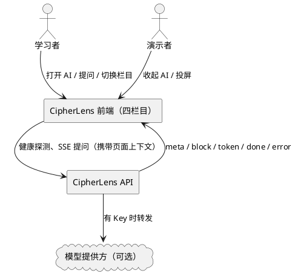

# CipherLens 全站 AI 助手（每页独立对话）· 第一阶段需求规格

> 文档编号：CL-GAI-REQ-v1.0
> 状态：**需求评审中，未进入实现**
> 日期：2026-11-22
> 输入：用户原始诉求「每个页面都嵌入 AI，每个页面的 AI 都独立运行，相当于同一个 AI、不同对话」
> 基线：F0–F24、B1–B3 已验收；`evidence/acceptance/` 原文不得删改
> 本文件只回答「做什么、做到什么程度、什么不做」，不回答「怎么写」

---

## 0. 阅读须知与判定用语

### 0.1 本文件的定位

把「AI 不再跳转工作台、改为每页内嵌且各页独立对话」拆成可评审、可验收、可回滚的需求。**本文件不构成施工令**：标注「待确认」的条目在用户拍板前不实施。

### 0.2 现状判定标签（全文强制使用）

| 标签 | 含义 |
|---|---|
| **[已有]** | 当前仓库代码已支持，可在现状基线上直接复用，不得重写 |
| **[新增]** | 当前代码不支持，需要新增行为或接口 |
| **[待确认]** | 方向或代价需要用户拍板；未拍板前不实施 |

### 0.3 本阶段明确不做的事

- 不修改任何业务源码、不提交、不建分支、不推送；
- 不新增依赖（含 UI 库、动画库、axios、图表库）；
- 不修改 `docs/` 既有设计文档与 `evidence/acceptance/` 原文；
- 不进入 design.md / tasks.md，不写实现方案与代码。

### 0.4 关键现状偏差（必须先说清，避免误以为漏项）

任务书列出了「练习 / 记录 / 速查卡」三个页面，但**当前仓库已不存在这三个页面**：

| 事实 | 证据 |
|---|---|
| 路由只有 4 条：`/`、`/workbench`、`/sbox`、`/avalanche` | `frontend/src/router/index.ts` |
| `views/` 只有 Home / Workbench / SBox / Avalanche / StatesDebug | `frontend/src/views/` |
| 导航只有 4 项 | `frontend/src/data/nav.ts` |
| 后端仍保留 quiz / records 路由与表 | `backend/routers/quiz.py`、`records.py` |

因此本轮「每个页面」的口径是**现存的四个栏目**；已移除页面只在 §6.7 作为「若恢复时的接入契约」记录，不纳入本轮验收。该偏差列为 D-G9 供用户确认。

---

## 1. 背景与目标

### 1.1 现状事实（只读核实）

| 编号 | 事实 | 用户感受 |
|---|---|---|
| S1 | 全站悬浮按钮 `AiFab` 只在 `AppShell` 渲染；点击执行 `router.push('/workbench?ai=1')` | 在任何页面点 AI 都被「踢」到工作台，当前页面上下文丢失 |
| S2 | 工作台是 `bare` 路由，不套 `AppShell`，因此工作台没有 `AiFab`；AI 由 E 区 `TutorPanel`（`minimal`）承担 | 四个栏目的 AI 入口位置与形态不一致 |
| S3 | 工作台 E 区收起时是固定在右上角的 44px 按钮；`AiFab` 固定在右下角 | 同一功能两个位置、两种视觉 |
| S4 | `TutorPanel` 已具备 11 态、3s 首字提示、本地 20s / 配置模型 55s 总降级、缓存直出、MORE、引用 chip、`goto-step` / `open-sbox` 动作 | 这套能力是资产，必须复用，不得为「全站化」推倒重来 |
| S5 | 后端 `/api/tutor/ask` 强制要求 `trace_id`、`step_index`，`TutorRequest` 为 `extra="forbid"`；`tutor_logs.trace_id` 为 `NOT NULL` | 非工作台页面**没有 trace**，当前接口无法被首页 / S 盒 / 雪崩直接复用 |
| S6 | `TutorRequest` 已有 `client: dict \| None` 字段，但 `routers/tutor.py` 从未读取 | 上下文注入的「预留位」存在但未生效 |
| S7 | 缓存键为 `(trace_id, step_index, question)` | 不含页面与上下文；跨页同问题可能串答案 |
| S8 | `build_local_blocks()` 只接受 `trace + step_index` | 非工作台页面没有可用的后端本地模板 |
| S9 | `useSSE` 已按调用方隔离控制器，并有 30s 无 token 超时；`useHealth` 为模块级单例 | SSE 作用域与健康探测可直接复用 |
| S10 | `AppDrawer` 已有 `role="dialog"`、焦点陷阱、Esc、焦点归还；`useHotkeys` 已有 `blocked` 机制 | 无障碍与快捷键拦截有成熟范式可复用 |
| S11 | `evidence/acceptance/F17.md` 记录 11 态与 3s/20s 降级；当前代码在配置模型时总等待为 55s，本地为 20s | 需求只能写「保持既有优先级」，不能擅自改数值 |
| S12 | 工作区存在一处与本任务无关的既有改动 `frontend/public/aes-quest/index.html` | 本次不得触碰 |

### 1.2 本轮目标

1. **消除跳转**：四个栏目内打开 AI 时，路由不发生任何变化，不新增 history 记录。
2. **四栏目常驻入口**：首页、工作台、S 盒、雪崩均有可见、可键盘到达的 AI 入口。
3. **每页独立对话**：每个栏目拥有自己的消息、阶段、错误与未提交问题，互不覆盖；底层仍是同一套 AI 服务、同一模型配置、同一条降级链。
4. **上下文可用**：工作台注入当前步；S 盒注入当前查表字节；雪崩注入当前实验参数；首页明确「无数据上下文」。
5. **零回归**：不破坏 F10 状态点、F17 11 态与缓存、F09 四块讲解与 chip、F24 SSE 不缓冲。

### 1.3 成功标准

| 编号 | 成功标准 | 证据形式 |
|---|---|---|
| G1 | 四栏目点击入口均不跳转 | 路由路径 + history 长度前后对比 |
| G2 | 四栏目各有独立会话，切页回来历史仍在 | 交叉提问后的 DOM 断言 |
| G3 | 非工作台页面能拿到本页上下文回答 | 回答文本包含本页实际数值 |
| G4 | 无 key / 断网 / 500 时四页都有本地讲解 | 降级截图与文字断言 |
| G5 | 既有 F09/F10/F17 行为可复现 | 回归清单 + 单测/构建 |

---

## 2. 范围与非范围

### 2.1 本轮范围

- 四栏目统一 AI 入口与浮层/抽屉的**行为口径**；
- 每页会话隔离模型与切换行为；
- 页面上下文注入契约（白名单字段）；
- 通用问答接口的**外部契约**与 SSE 事件、缓存、降级口径；
- 持久化介质与隐私口径；
- 无障碍、键盘、移动端布局口径；
- 对既有功能的回归清单。

### 2.2 非范围

- AES 引擎、判分、题库、记录后端的算法与数据结构；
- 模型选型、Key 管理、成本控制、多模型切换；
- 登录、注册、跨设备同步、云端会话；
- 练习 / 记录 / 速查卡页面的恢复；
- 五条视觉硬约束（边框宽度、边框取色、`--cell-gap`、格子不位移不缩放、判分在后端）；
- Docker / nginx / 桌面环境。

### 2.3 继承硬约束

| 编号 | 约束 | 本轮要求 |
|---|---|---|
| H1 | 不新增依赖 | 任何新增先决策 |
| H2 | 前端零复算判分 | 不因 AI 全站化引入前端判分 |
| H3 | 视觉硬约束不变 | 抽屉不得改字节格几何 |
| H4 | 证据只增不改 | 只允许追加口径说明 |
| H5 | 无登录 | 不新增鉴权与用户体系 |
| H6 | 无 Key 时可用 | 本地模板必须覆盖四栏目 |

---

## 3. 组件定位与术语

### 3.1 核心职责

本组件负责让学习者在**任意栏目内**就地提问，并让每个栏目拥有一段互不干扰的对话，底层共享同一套 AI 能力与降级链。

### 3.2 核心输入

1. 用户打开 / 关闭 AI 入口的指令（点击、键盘）。
2. 用户提交的问题文本（1–500 字）。
3. 当前页面的上下文快照（工作台步、S 盒字节、雪崩参数、首页空上下文）。
4. 环境输入：视口宽度、是否演示态、是否减少动效、后端健康状态。

### 3.3 核心输出

1. 就地展开的 AI 面板（不跳转），含本栏目历史消息。
2. SSE 流式四块回答：结论 / 为什么 / 下一步 / 依据。
3. 来源标识（AI / 本地）、阶段标识（11 态）、错误与重试入口。
4. 可访问播报（新回答完成、错误、降级）。

### 3.4 职责边界

- 不负责模型接入与提示词质量评估（沿用 F10 口径）；
- 不负责判分、记录、题库；
- 不负责跨栏目合并为一段长对话（除非 D-G4 选择多轮）；
- 不负责替代工作台 E 区的既有教学布局（除非 D-G2 选择统一抽屉）。

### 3.5 统一术语

**栏目（Page Scope）**
: 以路由为边界的对话作用域，取值为首页、工作台、S 盒、雪崩四者之一。

**会话（Conversation）**
: 某个栏目内由用户连续提问形成的一段消息序列；不同栏目的会话互相不可见。

**页面上下文（Page Context）**
: 当前栏目可提供给 AI 的白名单数据快照，用于让回答引用屏幕上真实存在的数值。

**通用问答**
: 不依赖 AES trace 的提问路径；工作台之外的三页走此路径。

**降级链（Fallback Chain）**
: 模型不可用 → 后端本地模板 → 前端页面级本地讲解的三级兜底。

---

## 4. 角色与边界

### 4.1 核心角色

- **学习者**：在任意栏目打开 AI、提问、查看依据、切换页面后返回继续看历史。
- **演示者**：投屏时打开 AI 不遮挡关键矩阵与播放控制，可一键收起。

### 4.2 外部系统

- **AI 服务（后端）**：提供 SSE 回答、健康状态、本地模板。
- **模型提供方（可选）**：OpenAI 兼容接口；无 Key 时完全不参与。
- **浏览器存储**：仅承载匿名标识与（可选的）本标签页会话。

### 4.3 交互上下文

---

## 5. DFX 约束

### 5.1 性能

| 编号 | 约束 | 可测量口径 |
|---|---|---|
| P1 | 打开面板不阻塞主线程 | 点击到面板可见 ≤100ms（本机、无网络请求） |
| P2 | 不产生额外健康探测 | 四栏目共用一个健康结果；页面切换后 `/api/health` 请求数不增加 |
| P3 | 缓存命中沿用 F17 | 同页同上下文同问题第二次到终态 ≤100ms |
| P4 | 包体不新增依赖 | `package.json` 依赖数量不变 |

### 5.2 可靠性

| 编号 | 约束 |
|---|---|
| R1 | 四栏目在无 Key、断网、模型 500 时均能得到本地讲解，不出现空白面板 |
| R2 | 单页 SSE 中断不影响其他栏目已保存的会话 |
| R3 | 面板关闭 / 切页不产生未捕获异常与控制台 error |

### 5.3 安全性

| 编号 | 约束 |
|---|---|
| S1 | 不新增登录与鉴权；匿名 `client_id` 仅用于归类，不作为权限凭证 |
| S2 | 页面上下文按白名单最小化；日志不得记录完整密钥与完整明文 |
| S3 | `/api/health` 不得回显 Key、base_url 或完整模型凭据 |

### 5.4 可维护性

| 编号 | 约束 |
|---|---|
| M1 | 四栏目共用同一套状态阶段命名（11 态），不得为单页另造阶段名 |
| M2 | SSE 事件名与语义保持 `meta/block/token/done/error` |
| M3 | 新增行为必须可被单测或探针覆盖，不引入新测试框架 |

### 5.5 兼容性

| 编号 | 约束 |
|---|---|
| C1 | 工作台既有 `/api/tutor/ask` 调用与响应不变 |
| C2 | 旧链接 `?ai=1` 仍能展开工作台 AI 区 |
| C3 | 未携带新字段的旧请求行为完全不变 |

---

## 6. 核心能力（EARS）

### 6.1 全站入口与面板形态

- **[新增]** WHEN 用户在首页、S 盒或雪崩页激活 AI 入口，THE SYSTEM SHALL 在当前页就地展开 AI 面板，并 SHALL NOT 改变 `location.pathname`、SHALL NOT 新增 history 记录。
- **[已有]** WHEN 用户在工作台激活 AI 入口，THE SYSTEM SHALL 展开 E 区 AI，并 SHALL 保持五区布局与既有键位。
- **[新增]** WHERE 视口宽度 ≤700px，THE SYSTEM SHALL 让 AI 面板占据可用宽度且不产生横向滚动；入口触控目标不小于 44×44px。
- **[新增]** WHEN AI 面板打开，THE SYSTEM SHALL 提供唯一的关闭入口，并在关闭后把焦点归还到触发入口。
- **[待确认]** 工作台是否新增右下悬浮入口（D-G2）；若新增，SHALL NOT 与 E 区形成同时可见的双面板。
- **[新增]** WHEN 用户处于演示态（`present`），THE SYSTEM SHALL 保持 AI 面板可开可关，并 SHALL NOT 遮挡 D 区播放控制的最小可操作区域。
- **[新增]** WHERE 四个栏目，THE SYSTEM SHALL 保证入口在全站导航切换后仍然存在，不因路由变化丢失。

**验收条件**

| 触发场景 | 预期行为 |
|---|---|
| 在 `/sbox` 点击入口 | URL 仍为 `/sbox`，history 长度不变，面板出现 |
| 在 `/` 按键盘激活入口 | 面板出现且焦点进入面板 |
| 在 390×844 打开面板 | 无横向滚动条，关闭按钮可点 |
| 面板打开时按 Esc | 只关面板，不触发页面其他 Esc 行为 |

### 6.2 会话隔离模型

- **[新增]** WHEN 用户在栏目 A 提交问题，THE SYSTEM SHALL 把该问题的消息、阶段、错误与结果只写入栏目 A 的会话。
- **[新增]** WHEN 用户切换到栏目 B 再返回栏目 A，THE SYSTEM SHALL 恢复栏目 A 的消息与最后一次结果，并 SHALL NOT 混入栏目 B 的任何消息。
- **[新增]** WHERE 每个栏目，THE SYSTEM SHALL 维护一个独立会话标识，并在请求中携带，用于区分「同一个 AI、不同对话」。
- **[已有]** WHEN 多个栏目同时存在，THE SYSTEM SHALL 复用同一份健康状态与同一条降级链，SHALL NOT 为每页单独探测或单独配置模型。
- **[待确认]** 切换栏目时，正在生成的流是「立即中止」还是「后台继续」（D-G1）；无论选哪种，SHALL NOT 把 A 的 token 写入 B。
- **[待确认]** 刷新页面后是否保留各栏目历史（D-G5）。
- **[待确认]** 是否支持同一栏目内的多轮上下文（D-G4）；本轮默认按单轮问答设计。

**验收条件**

| 场景 | 预期 |
|---|---|
| 首页问「AES 是什么」，S 盒问「0x53 查表得到什么」 | 两页各自只显示自己的问答 |
| 从 S 盒返回首页 | 首页仍显示原问答与来源标识 |
| A 页生成中切到 B | B 面板无 A 的 token；A 的状态不污染 B |
| 刷新页面（默认口径） | 四栏目历史清空，入口仍在 |

### 6.3 页面上下文注入契约

- **[新增]** WHEN 用户在工作台提问，THE SYSTEM SHALL 注入 `page=workbench`、`trace_id`、`step_index`（沿用现有 1-based → 0-based 映射）、`direction`，并 SHALL 保持既有回答引用当前步数值。
- **[新增]** WHEN 用户在 S 盒提问，THE SYSTEM SHALL 注入 `page=sbox`、当前查表方向、当前输入字节与输出字节；回答 SHALL 能引用这两个值。
- **[新增]** WHEN 用户在雪崩页提问，THE SYSTEM SHALL 注入 `page=avalanche`、目标（明文/密钥）、字节下标、位下标、密钥位数、当前 `changed_bits / total_bits / rate`；回答 SHALL 能引用这些数字。
- **[新增]** WHEN 用户在首页提问，THE SYSTEM SHALL 以「无数据上下文」模式回答，并在界面标明「通用讲解（未引用本页数值）」；SHALL NOT 编造数值。
- **[新增]** IF 某页当前没有可用上下文（如 S 盒尚未选中、雪崩尚未出结果），THEN THE SYSTEM SHALL 允许提问但改用无上下文模式，并给出可读提示。
- **[新增]** THE SYSTEM SHALL 只接受白名单上下文字段；未知字段 SHALL 被忽略而不是导致请求失败。
- **[待确认]** 雪崩页是否上传完整明文与密钥（D-G6）；建议只传实验结论数字与位置，避免敏感输入进入日志。
- **[已有]** 工作台上下文所需的 `state_before/state_after/changed/op/direction` 在前端已具备；**[新增]** 非工作台页面的上下文采集与传递。

**上下文白名单（外部契约）**

| 页面 | 必填 | 可选 |
|---|---|---|
| home | `page` | — |
| workbench | `page`、`trace_id`、`step_index` | `direction`、`focus_byte` |
| sbox | `page`、`mode`、`input`、`output` | `selected_hex` |
| avalanche | `page`、`target`、`byte_index`、`bit_index`、`key_bits` | `changed_bits`、`total_bits`、`rate`、`sweep_mean` |

**验收条件**

| 触发场景 | 预期行为 |
|---|---|
| S 盒选中 0x53→0xED 后提问 | 回答出现 0x53 与 0xED，且来源为当前查表方向 |
| 雪崩页改第 3 字节后提问 | 回答出现第 3 字节、变化位数与比例 |
| 首页提问 | 出现「通用讲解」标识，无虚构字节 |
| 上下文含未知字段 | 返回 200，未知字段被忽略 |

### 6.4 后端接口、SSE、缓存与降级

- **[已有]** WHEN 工作台提问，THE SYSTEM SHALL 继续使用 `/api/tutor/ask`，事件仍为 `meta → block/token × N → done`，异常为 `error`。
- **[新增]** WHEN 非工作台栏目提问，THE SYSTEM SHALL 使用不要求 `trace_id` 的通用问答入口；其 SSE 事件名、块结构与工作台一致。
- **[待确认]** 通用入口采用「新增 `/api/ai/ask`」还是「放宽 `/api/tutor/ask` 的 `trace_id` 必填」（D-G3）；建议新增独立端点，确保工作台零回归。
- **[新增]** WHEN 返回 `meta`，THE SYSTEM SHALL 至少包含：`page`、`source`（`llm`/`local`）、`quotes_values`（是否引用了页面数值）、`cache`、`conversation_id`。
- **[已有]** WHEN 未配置模型或模型不可用，THE SYSTEM SHALL 自动降级为本地模板并保持同一事件协议。
- **[新增]** WHERE 非工作台页面，THE SYSTEM SHALL 提供页面级本地模板；本地模板 SHALL 至少覆盖：首页概念、S 盒查表关系、雪崩结论数字。
- **[已有]** WHEN 连续 30s 未收到任何 token，THE SYSTEM SHALL 以 `timeout` 结束且只报一次。
- **[已有]** 前端 3s 首字提示、20s（本地）/55s（配置模型）总降级 SHALL 保持现有优先级；SHALL NOT 因全站化改动先后顺序。
- **[新增]** 缓存键 SHALL 至少包含 `page`、上下文指纹与规范化后的问题；SHALL NOT 包含 `client_id` 或会话标识。
- **[已有]** 工作台缓存键语义 SHALL 保持不变；同一问题在同一 `trace_id + step_index` 下仍可命中。
- **[新增]** THE SYSTEM SHALL 保证不同页面、不同上下文的问题不会互相命中缓存。

**验收条件**

| 场景 | 预期 |
|---|---|
| 工作台旧请求（仅三字段） | 行为与 F17 完全一致 |
| 非工作台请求 | 200 + SSE，无 `trace_id` 也能回答 |
| 同页同上下文重复提问 | 第二次 `meta.cache=true`，≤100ms |
| 工作台第 3 步与 S 盒问同一句话 | 两次回答不互为缓存 |
| 停掉后端 | 四页均显示本地讲解，无跳转、无空白 |
| 30s 无 token | `timeout` 一次，不重复报错 |

### 6.5 持久化与隐私

- **[待确认]** 会话默认存于内存，仅当前标签页有效；是否允许 `sessionStorage` 刷新保留（D-G5）；不建议 `localStorage` 长期留存。
- **[已有]** 匿名 `client_id` 已存在且持久化；本轮 SHALL 复用，SHALL NOT 新增登录体系。
- **[新增]** 通用问答 SHALL NOT 写入要求 `trace_id` 的 `tutor_logs`；如要审计，SHALL 采用不含问题原文的结构化日志，或另行决策新增字段（D-G7）。
- **[新增]** WHEN 用户执行「清空对话」，THE SYSTEM SHALL 只清空当前栏目会话，SHALL NOT 影响其他栏目。
- **[新增]** WHEN 用户关闭面板，THE SYSTEM SHALL 保留当前栏目已完成的问答，直到刷新或清空。

**验收条件**

| 场景 | 预期 |
|---|---|
| 刷新（默认） | 历史清空；`client_id` 不变 |
| 清空当前对话 | 仅当前栏目为空，其他栏目仍保留 |
| 查看网络请求 | 不出现携带完整密钥的 AI 请求 |

### 6.6 无障碍与键盘

- **[新增]** WHEN AI 面板打开，THE SYSTEM SHALL 使用 `role="dialog"`（或等价语义）、可读标题、`aria-modal`，并把初始焦点放入面板。
- **[已有]** WHEN 面板打开，THE SYSTEM SHALL 提供焦点陷阱（Tab/Shift+Tab 不逃逸）；关闭后焦点归还触发入口。
- **[新增]** WHEN 面板打开，THE SYSTEM SHALL 阻止页面快捷键被误触（沿用工作台 `blocked` 思路）；SHALL NOT 禁用 `Esc`。
- **[新增]** Esc 优先级：面板打开时先关面板；面板未开时保持页面既有 Esc 行为。
- **[新增]** WHEN 一段回答完成、发生错误或降级，THE SYSTEM SHALL 通过 `aria-live="polite"` 播报一次；SHALL NOT 每 token 播报。
- **[新增]** 四栏目入口 SHALL 有可读 `aria-label` 与可见焦点环；键盘可到达顺序 SHALL 不早于主导航。
- **[已有]** 减少动效偏好下，光标闪烁等动效 SHALL 停止。

**验收条件**

| 场景 | 预期 |
|---|---|
| 打开面板后连按 Tab | 焦点始终在面板内 |
| Esc | 只关面板，焦点回到入口 |
| 面板打开时按 `Space` / `→`（工作台） | 播放与步进不响应 |
| 回答完成 | live region 新增 1 条播报，token 阶段为 0 条 |

### 6.7 按页面行为

#### 6.7.1 首页 `/`

- 定位：概念问答，无数据上下文。
- **[新增]** 入口常驻；打开后就地浮层，不跳转。
- **[新增]** 默认问题建议面向「AES 是什么 / 为什么分组 16 字节 / 和密钥的关系」。
- **[新增]** 回答必须带「通用讲解」标识；不得出现具体字节值。
- **[待确认]** 首页是否提供「带我去工作台看一次」的跳转动作（D-G8）；若提供，必须由用户显式点击，不得自动跳转。

#### 6.7.2 工作台 `/workbench`

- 定位：当前步讲解，上下文最完整。
- **[已有]** 保留 E 区 `TutorPanel` 的 11 态、3s/20s/55s、缓存、MORE、chip、`goto-step`、`open-sbox`。
- **[新增]** E 区会话与全站会话模型统一：同一栏目只保留一段会话。
- **[待确认]** 入口是否改为右下常驻悬浮按钮（D-G2）；若改，E 区展开后 SHALL NOT 同时出现第二个面板。
- **[已有]** `?ai=1` 仍能展开 E 区；该参数不产生跳转。
- **[已有]** 第 0 步禁用提问、离线/不一致禁用提问的口径保持不变。

#### 6.7.3 S 盒 `/sbox`

- 定位：查表关系讲解。
- **[新增]** 上下文：正向/逆向、输入字节、输出字节、当前选中值。
- **[新增]** 默认问题建议：「0x53 为什么查表得到 0xED」「逆 S 盒为什么能还原」。
- **[新增]** 回答中的字节 chip 若可定位，SHALL 能高亮/选中对应格子（复用现有选中能力，不新增几何变化）。
- **[待确认]** 是否允许回答动作「切到逆向表」（D-G10）。

#### 6.7.4 雪崩 `/avalanche`

- 定位：实验结论讲解。
- **[新增]** 上下文：目标、字节下标、位下标、密钥位数、变化位数、比例；有连做结果时含平均值。
- **[新增]** 默认问题建议：「为什么改 1 位会变一半」「为什么不是正好 64 位」。
- **[新增]** 无结果时进入无上下文模式，并提示「先跑一次实验」。
- **[待确认]** 是否允许回答动作「改这个字节再跑一次」（D-G10）。

#### 6.7.5 练习 `/practice`（当前不存在）

- **[待确认]** 不属于本轮；若恢复，SHALL 按统一契约注入题目、作答、判分结果，并复用本文件会话模型（D-G9）。

#### 6.7.6 记录 `/records`（当前不存在）

- **[待确认]** 不属于本轮；若恢复，SHALL 注入筛选条件与聚合口径，SHALL NOT 上传他人记录（D-G9）。

#### 6.7.7 速查卡 `/cheatsheet`（当前不存在）

- **[待确认]** 不属于本轮；若恢复，SHALL 作为纯概念页使用无上下文模式（D-G9）。

---

## 7. 数据约束（逻辑层）

### 7.1 会话对象

1. **栏目标识**：必须是四个现存栏目之一；不得为空。
2. **会话标识**：每栏目唯一；切换栏目不得复用。
3. **消息序列**：至少包含用户问题、回答块、来源、阶段、时间；不得跨栏目混入。
4. **未提交问题**：切页后返回应保留；清空对话时一并清空。
5. **阶段**：必须落在既有 11 态集合内。

### 7.2 上下文对象

1. **page**：枚举，必填。
2. **workbench.trace_id**：非空字符串；不存在时不得伪造。
3. **workbench.step_index**：非负整数；映射规则沿用现有实现。
4. **sbox.input / output**：0–255 整数；必须成对出现。
5. **avalanche.byte_index**：0–31；`bit_index`：0–7。
6. **avalanche.changed_bits**：0–128；`rate`：0–1。
7. **未知字段**：忽略，不报错。
8. **敏感字段**：完整密钥与完整明文默认不进入上下文（D-G6）。

### 7.3 请求约束

1. **question**：1–500 字；空白串不得发送。
2. **conversation_id**：非空；仅用于区分对话，不作为权限。
3. **client_id**：可空；存在时仅用于归类。
4. **旧请求**：仅含 `trace_id/step_index/question` 时语义不变。

---

## 8. 验收标准（可测量）

| 编号 | 验收项 | 可测量口径 | 判定 |
|---|---|---|---|
| A1 | 不跳转 | 四栏目点击入口后 `pathname` 不变、history 长度不变 | 4/4 |
| A2 | 四栏目入口 | 1440×900 与 390×844 下四路由均存在可聚焦入口 | 4/4 |
| A3 | 会话隔离 | 交叉提问后返回，各页只显示自己的消息 | 0 条串页 |
| A4 | 切页不串流 | A 生成中切 B，B 无 A 的 token | 0 条 |
| A5 | 刷新口径 | 按 D-G5 选择执行；默认清空且入口仍在 | 与决策一致 |
| A6 | 工作台上下文 | 回答引用当前步 `state_before/after/changed` | 命中 |
| A7 | S 盒上下文 | 回答出现当前输入/输出字节 | 命中 |
| A8 | 雪崩上下文 | 回答出现变化位数与比例 | 命中 |
| A9 | 首页无上下文 | 出现「通用讲解」标识，无虚构字节 | 命中 |
| A10 | SSE 协议 | 事件仅 `meta/block/token/done/error` | 5/5 |
| A11 | 降级 | 停后端/无 Key 时四页均出本地讲解 | 4/4 |
| A12 | 超时 | 30s 无 token 仅报一次 `timeout` | 1 次 |
| A13 | 缓存 | 同页同上下文第二次 ≤100ms | 通过 |
| A14 | 缓存不串 | 工作台与 S 盒同问题不互相命中 | 通过 |
| A15 | 快捷键 | 面板打开时 Space/→ 不生效，Esc 只关面板 | 通过 |
| A16 | 焦点 | 打开入面板、关闭回入口、Tab 不逃逸、0 次丢到 body | 0 次 |
| A17 | 播报 | 完成/错误各 1 条，token 阶段 0 条 | 通过 |
| A18 | 移动端 | 390 宽无横向滚动，入口不遮 D 区控制条 | 通过 |
| A19 | 回归 | F09 chip/抽屉、F10 状态点、F17 11 态、F24 SSE 不缓冲 | 全通过 |
| A20 | 工程 | `vue-tsc` 0 error、`npm test` 全绿、`vite build` 通过、依赖数不变 | 通过 |

---

## 9. 对既有功能的回归影响

| 功能点 | 影响面 | 必须保持 |
|---|---|---|
| F09 结构化回答 | 四块协议、chip、抽屉联动 | 块类型与动作语义不变 |
| F10 真实 LLM / 状态点 | `/api/health`、`source` 标识 | 状态点仍区分 AI / 本地 |
| F17 11 态与降级 | 阶段机、3s/20s/55s、缓存 | 阶段名、优先级、缓存直出不变 |
| F16 SSE | 事件分派 | 事件名与顺序不变 |
| F22 无障碍 | 焦点、Esc、live region | 不引入焦点丢失与快捷键冲突 |
| F24 Docker/SSE | nginx 不缓冲 | 通用端点同样不缓冲 |
| B3/F19/F20 | 判分与记录 | 本轮不触碰算法与表结构 |

**回归红线**：任何一页出现「回答被另一页覆盖」「点击入口跳转」「面板关闭后快捷键失灵」，均判定为不合格并回滚该项改动。

---

## 10. 待用户决策项

### D-G1 · 切换栏目时正在生成的流

- 方案 A：立即中止，回来显示「上次生成已中断，可重试」。
- 方案 B：后台继续，回来显示完整结果。
- 建议：A。理由：避免多页并发流与状态污染，且不影响已完成问答的保留。

### D-G2 · 工作台入口形态

- 方案 A：保留 E 区，收起时的 44px 按钮即常驻入口；其他三页用右下悬浮按钮。
- 方案 B：四页统一右下悬浮按钮 + 抽屉；工作台 E 区退化为抽屉宿主或移除。
- 方案 C：四页统一悬浮按钮，但工作台点击仍展开 E 区（不弹抽屉）。
- 建议：C。既满足「四栏目都有入口」，又不破坏工作台五区与 F17 验收。

### D-G3 · 通用接口策略

- 方案 A：新增 `/api/ai/ask`，工作台继续 `/api/tutor/ask`。
- 方案 B：放宽 `/api/tutor/ask` 的 `trace_id` 必填。
- 建议：A。工作台零回归，通用页不依赖 trace；代价是多一个端点。

### D-G4 · 单轮还是多轮

- 方案 A：每页单轮问答，历史只展示不回灌提示词（与现状一致）。
- 方案 B：每页多轮上下文，把最近 N 轮带入提示词。
- 建议：A。本轮先保证隔离与就地可用；多轮需另立需求与成本评估。

### D-G5 · 刷新后的会话保留

- 方案 A：内存，刷新清空。
- 方案 B：`sessionStorage`，同标签页刷新保留。
- 建议：A 作为默认，B 作为可选开关；不使用 `localStorage`。

### D-G6 · 雪崩页是否上传完整输入

- 方案 A：只传位置与结论数字（推荐）。
- 方案 B：传完整明文与密钥，让回答可引用具体字节。
- 建议：A。降低敏感输入进入日志与缓存的风险。

### D-G7 · 通用页审计落库

- 方案 A：通用页不写 `tutor_logs`，只写不含原文的结构化日志。
- 方案 B：迁移 `tutor_logs` 允许 `trace_id` 为空并新增 `page` 字段。
- 建议：A。避免本轮引入表结构迁移与 F24 复验。

### D-G8 · 首页是否允许引导跳转

- 方案 A：只给文字链接，由用户点击。
- 方案 B：AI 回答内提供「去工作台看一次」动作按钮。
- 建议：B，但必须显式点击；不得自动跳转。

### D-G9 · 已移除页面是否预留契约

- 方案 A：本轮完全不涉及。
- 方案 B：在文档保留接入契约，代码不实现。
- 建议：B（仅文档），并明确「当前不存在」以免评审误判。

### D-G10 · 页面动作能力

- S 盒是否允许「切逆向表」、雪崩是否允许「改这个字节再跑一次」。
- 建议：本轮不做，先把问答链路做稳；动作能力下一轮评估。

### D-G11 · 是否加入主动核对

- 是否让 AI 在回答中主动核对当前页数值的合理性（如 S 盒输入输出是否互为逆、雪崩比例是否接近 50%）。
- 建议：本轮不做强制核对，仅在提示词中要求「不得编造数值」；主动核对另立需求。

---

## 11. 明确不做项

1. 不恢复练习、记录、速查卡页面。
2. 不做登录、注册、跨设备同步、云端会话。
3. 不做多模型切换、模型参数面板、成本控制。
4. 不做语音输入、图片识别、文件上传问答。
5. 不做跨栏目合并的长对话记忆（除非 D-G4 改判）。
6. 不做前端判分或前端 AES 复算。
7. 不改 `--cell-gap`、字节格几何、七态样式阈值。
8. 不改 Docker / nginx / 桌面环境。
9. 不删除工作台 E 区（除非 D-G2 选择方案 B）。
10. 不新增任何依赖与测试框架。
11. 不改 `evidence/acceptance/` 原文；只允许追加口径说明。

---

## 12. 风险

| 编号 | 风险 | 影响 | 缓解 |
|---|---|---|---|
| R1 | 双入口 / 双面板 | 工作台同时出现 E 区与抽屉 | D-G2 明确单一入口；验收 A2 加「同时可见面板数 ≤1」 |
| R2 | 会话状态串页 | 回答被覆盖、来源错乱 | 栏目级作用域 + A3/A4 |
| R3 | 非工作台无 trace 导致 400 | 三页不可用 | 通用端点；A11 覆盖无 trace 路径 |
| R4 | 缓存键冲突 | 跨页串答案 | 键含 page + 上下文指纹；A14 |
| R5 | 三层计时错乱 | 重复报错、降级不触发 | 保持既有优先级；A12 |
| R6 | 快捷键冲突 | 面板打开时播放/步进误触 | `blocked` 扩展；A15 |
| R7 | 焦点丢失 | 无障碍回归 | 复用 `AppDrawer` 范式；A16 |
| R8 | 移动端遮挡 | 入口盖住控制条 | 全宽面板 + 安全区；A18 |
| R9 | 首页回答泛化 | 用户觉得「AI 什么也没说」 | 明确「通用讲解」标识 + 建议问题 |
| R10 | 日志缺口 | 通用页无审计 | D-G7；写明取舍 |
| R11 | 改动范围外文件 | 误改 `aes-quest` 既有改动 | 开工前确认工作区；只改规格文档 |

---

## 13. 证据与引用

| 主题 | 位置 |
|---|---|
| 跳转根因 | `frontend/src/components/layout/AppShell.vue`（`openAi()`） |
| 四路由 | `frontend/src/router/index.ts`、`frontend/src/data/nav.ts` |
| 工作台 E 区 | `frontend/src/components/layout/WorkbenchLayout.vue`、`views/WorkbenchView.vue` |
| 11 态与降级 | `frontend/src/components/region-e/TutorPanel.vue`、`evidence/acceptance/F17.md` |
| SSE 协议 | `backend/routers/tutor.py`、`frontend/src/utils/sse.ts`、`composables/useSSE.ts` |
| 本地模板 | `backend/services/tutor_service.py`（`build_local_blocks`） |
| 上下文预留字段 | `backend/models/schemas.py`（`TutorRequest.client`，当前未读取） |
| 审计表约束 | `backend/services/tutor_log.py`、`backend/db.py`（`tutor_logs.trace_id NOT NULL`） |
| 无障碍范式 | `frontend/src/components/shared/AppDrawer.vue`、`composables/useHotkeys.ts` |
| 匿名标识 | `frontend/src/utils/clientId.ts`、`utils/events.ts` |
| 既有需求基线 | `docs/specs/code-review-optimization-v1/requirements.md`、`.codeartsdoer/specs/code_review_opt_v1/spec.md` |

---

## 14. 评审结论待办

1. 逐条确认 D-G1…D-G11；未确认项在实现阶段不得擅自选型。
2. 确认「四个栏目」口径是否等同用户所说的「每个页面」（练习/记录/速查卡已移除）。
3. 确认工作台是否保留 E 区为唯一 AI 宿主。
4. 确认后再进入 design.md 与 tasks.md；本阶段到此为止。